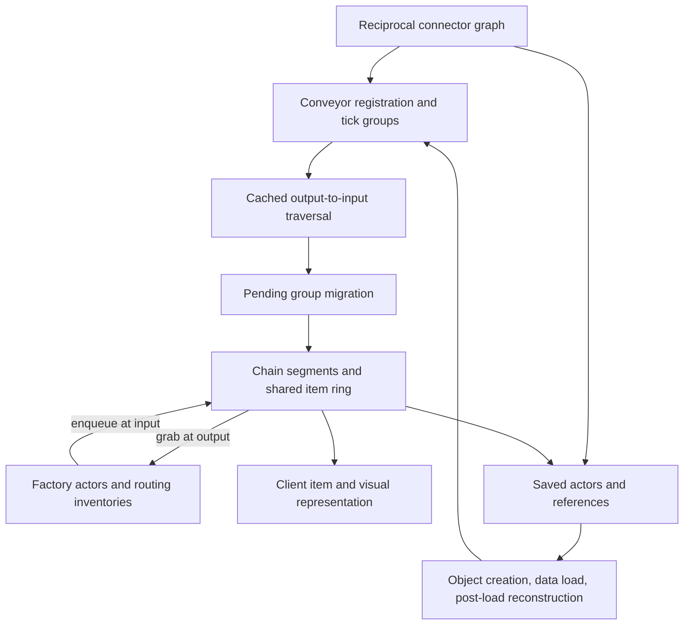
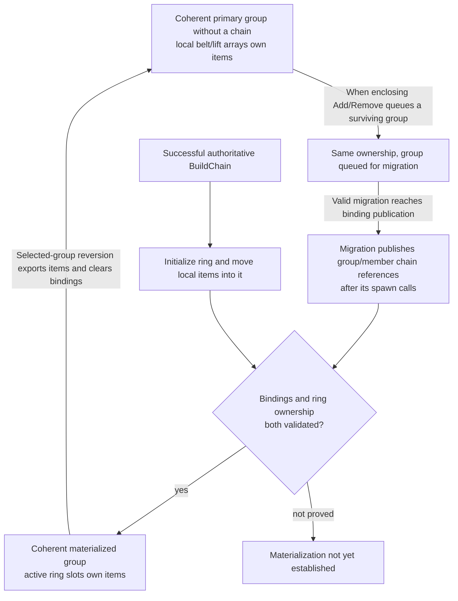
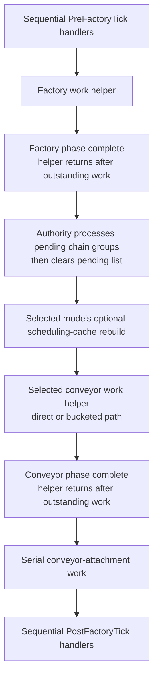
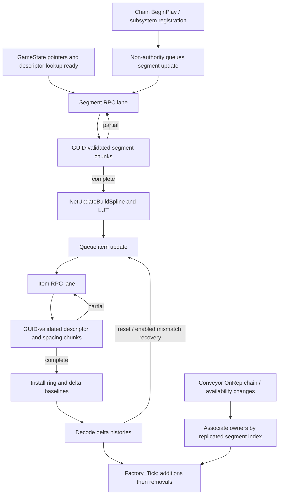
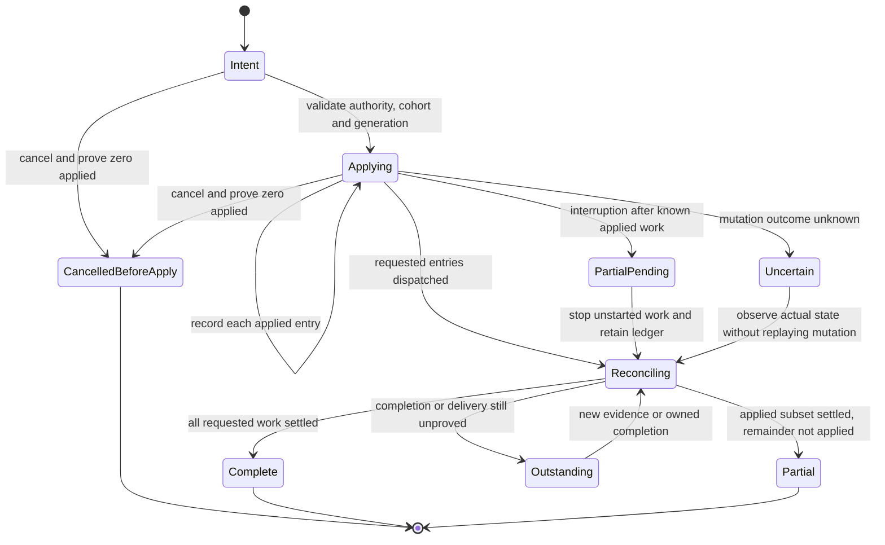

# Conveyor chains, transport variants, and Smart integration

This reference explains conveyor simulation, ownership, topology changes, routing, persistence and client reconstruction in Satisfactory CL **513885**, and audits Smart at commit `65197ac8b80cddf86e8ef2462049c4228009cc16`. Native-code observations below are from the shipped Windows server unless explicitly marked otherwise. They describe the inspected build, not a guarantee for future releases.

The strongest integration rule is to preserve the **whole native transaction**: connector topology, conveyor group membership, cached traversal, chain ownership, item migration, and replication bookkeeping must agree. A valid pointer or a successful `SetConnection` does not establish that agreement. Conversely, live topology changes are not universally forbidden: the SDK documents a sequential `PreFactoryTick` phase for read/write access to buildables, and the inspected native parallel phases join before execution proceeds.

The previous reference mixed historical experiments with broad current claims. Its full text and crash evidence are retained in [the historical record](THESIS_Belts_ChainActors_Placement_Historical.md). Those crash-class experiments remain **do not re-test**. The present document supersedes its statements about universal safety, implicit rebuild on reload, direct chain recovery, and the meaning of native helpers.

## System model

A conveyor chain is a simulation aggregate over a run of directly connected belts and lifts. The individual buildables remain the geometry, connection and save identities. A subsystem group supplies ordered membership and cached traversal; migration materializes a chain with ordered segments, a shared item ring and endpoint access. A splitter or merger is a separate factory actor with its own inventory and routing policy. It exchanges items at chain endpoints rather than becoming an arbitrary interior segment of a chain.



The arrows summarize the native paths detailed below; they are not permission to call each helper in isolation. In particular, the save/load path restores explicit state and has version-specific reconstruction, rather than universally discarding it and deriving a fresh graph.

| State | Owner and meaning | Required agreement |
|---|---|---|
| Connector peers | Individual buildable components; physical adjacency | Reciprocal links, compatible directions and the intended endpoints |
| Bucket/group and cached next links | Buildable subsystem; simulation order and migration input | Live members, valid indices, one appropriate registration and consistent cached traversal |
| Chain segments | Chain actor; geometry, distances, speed, owner and occupancy bounds | Conveyor-to-chain references and segment indices agree with chain-to-conveyor ownership |
| Transported items | Local conveyor storage before migration, or active chain ring afterward | Exactly one authoritative owner; active entries distinguished from allocated capacity |
| Distributor items and reservations | Splitter/merger inventory and per-pass routing records | Reservation is not another authoritative item; blocked ports obey the concrete routing algorithm |
| Client chain state | Client subsystem, chain actor and separately replicated conveyors | Geometry, item bootstrap, history indices and available actors converge through their own protocol |

Factory simulation has two scheduling layers: the Engine schedules the subsystem's tick functions; inside a factory step the subsystem runs ordered phases, using joined parallel work for eligible factories and conveyors and serial work for attachments. The sequential pre-handler boundary is therefore a useful integration seam. It does not make a malformed topology valid, nor does it license retaining an actor after native removal has retired it.

For Extend, Restore and Upgrade the unit of correctness is the complete structural transaction: snapshot the affected live graph and item ownership, execute the appropriate native lifecycle in a safe phase, reconcile groups and chain migration, then verify the resulting graph and resource totals. The operation-specific sections explain why split, merge, clone, replacement and dismantle cannot be treated as interchangeable ways of rebuilding a chain. The Smart audit records existing mismatches; it does not implement a correction.

## Evidence and scope

| Evidence class | What it establishes | What it does not establish |
|---|---|---|
| Native disassembly and decompiler output | Instructions, control flow, calls, offsets and observed state changes in the identified DLL | Original C++ source, every indirect target, or occurrence in a running game |
| SDK headers at upstream `8eebc9e659f0b2ff4392d2f8cf6e2cff60c8ea49` | Declared fields, interfaces, documented intended contracts | Bodies of generated implementation stubs |
| Shipped Blueprint CDO and component templates | Explicit serialized overrides and inheritance references | Every runtime mutation, world-space geometry, or successful transport |
| Shipped Blueprint function maps and decoded script | Declared functions, inherited class paths and the inspected script entry paths | Native superclass behavior, unexamined callbacks or runtime execution |
| Smart source at the commit above | Reachable hooks, local checks and implemented ordering | That a reported crash followed a particular path |
| Historical experiments | The recorded results on their recorded builds and fixtures | A current-build or cross-platform pass |

| Artifact | Identity |
|---|---|
| Windows server game DLL | `FactoryServer-FactoryGame-Win64-Shipping.dll`; SHA-256 `0b70e32067b6939688d22d1a8f138fbcb4ce0d0e10ad6799bbf4e92ba4a209fd` |
| Windows server engine DLL | `FactoryServer-Engine-Win64-Shipping.dll`; SHA-256 `914ec61f9ee29deecf85dc854cde2de647dfcb6647435c23c795a9e5ab3b9549` |
| Windows server Core DLL | `FactoryServer-Core-Win64-Shipping.dll`; SHA-256 `6c78b2866ac5e92c577d2f6f559b6f5a35523b032ca0172a72ef993ec7677f8e` |
| Windows client game DLL | `FactoryGameSteam-FactoryGame-Win64-Shipping.dll`; SHA-256 `3ddda3ded4b1b7dbf1aed35be461999d1ba4954f3670a8e4227bd17dcc4f8959` |
| Windows client Engine DLL (selected timer paths) | `FactoryGameSteam-Engine-Win64-Shipping.dll`; SHA-256 `5bbbad806c25cc91e42476b4f9eb0844f9a97009aa1607a2dbf43f0ced7b1a3b` |
| Windows client CoreUObject DLL (weak-reference lookup) | `FactoryGameSteam-CoreUObject-Win64-Shipping.dll`; SHA-256 `4f1b41324ef326a25071285241444a61f720b386f86870372d1752fb49160132` |
| Linux server game ELF (selected native comparisons) | `libFactoryServer-FactoryGame-Linux-Shipping.so`; SHA-256 `637c2c70e65f6386697a6a5f5746f64b187d2fcfeee56df1aeef3f172268c0c1`; ELF64 x86-64, build ID `7dd11ed7c1cc5e43` |
| Linux server Engine ELF (selected timer paths) | `libFactoryServer-Engine-Linux-Shipping.so`; SHA-256 `123c6c5876247d4d32ea53559d10d0c4c349b16780016cf67254a6ffc46227a0` |
| Linux server CoreUObject ELF (selected weak-reference lookup) | `libFactoryServer-CoreUObject-Linux-Shipping.so`; SHA-256 `564766a0a29f0213d623971f5ea98d0e786fda51eef3bb0a5d8a1ec2717601cd` |
| Product version on both DLLs | `++FactoryGame+rel-main-anniversary-2026-CL-513885` |
| Shipped client package set | Steam build `25782416`; depot `526871`, manifest `6505538658118198013` |
| Matching PDB identities | Server `95e7db98-78bf-f900-4086-01c7b8d5652f`, client `da023b35-e3bb-39df-4936-83d90401d7f3`; age 1 each |

The server SHA above is recorded in the native evidence catalog below. Matching PDB identity was checked, but the analysis provider did **not** load those PDBs. Names can be export-derived or inferred; field names are mapped through headers and small exported accessors, and uncertain offsets remain qualified. Windows native addresses are preferred-image virtual addresses with base `0x180000000`; subtract the base for an RVA. Decompiled code is not purported original source.

The Linux addresses explicitly labeled ELF refer to the file's ELF virtual-address coordinates. The retained Ghidra import adds `0x100000` to those coordinates. For example, its lift Upgrade address `0x17c21e0` maps to file offset `0x16c01e0`, and its first32 bytes match the raw ELF symbol at `0x16c21e0`. Do not mix these coordinates or interpret either as a live process address. Mapping and byte evidence: `ev_5e91408e517062c196cc86af2ae41b44809ab097cbd1b32e6c1f6e32d73b1009`, `ev_94480a1f6041005321aea1f0f1dae4b5b841e34cbc3fbdcdd8a76a92e4fe40cf`.

Engine observations below refer to that separately identified engine image. The installed `5.6.1-CSS` source provides names and structure for comparison, but some source bodies are partial. A source stub is not evidence that its shipped counterpart does nothing. Native bodies and instruction operands establish the behavior described here; matching source text alone does not establish binary equivalence.

Asset parsing used the installed mappings with a narrowly audited compatibility repair for 44 optional-property records. The repair inserted unknown inner-type placeholders and preserved version data. No target native transport structure contained such optional fields. Unknown optional values were not used as evidence. CDO output and raw native evidence are retained in the study archive; this reference includes the identities, locations and limitations needed to interpret its conclusions.

## Windows client reconciliation and platform limits

The initial server/client comparison covered seven procedures in the matching Windows client DLL: `RemoveConveyor` (`0x1806965a0`), `BuildChain` (`0x18077c3b0`), `TickFactoryActors` (`0x1806a2160`), `OnRep_ChainInformation` (`0x1804fac20`), `NetUpdateBuildItemsFromRanges` (`0x1807977e0`), and the parallel wrapper/worker (`0x180620050`, `0x180629600`). The later sections add client transport, clock, replication, loading and dismantling bodies with their own proof catalogs. The comparison remains scoped to the inspected paths rather than every client function.

Removal, the chain-information callback, and bulk item reconstruction retain the examined server transitions. Chain construction retains cached traversal and item migration, but its spline-component field access differs (`+0x590` on server versus `+0x5b0` on client); raw offsets are not portable between these binaries.

Client `TickFactoryActors` additionally checks `InternalGetNetMode` and disables the delta-time accumulation shortcut for `NM_Client` (`0x1806a2226`). Its migration decision tests the local player controller and that controller's authority role (`0x1806a2344`, `0x1806a2352`), whereas the server checks the subsystem role. The examined phase order remains pre-handlers, factory work, role-selected migration/client-chain handling, conveyor work, serial attachments, then post-handlers. The client parallel wrapper/worker retains the blocking completion structure. These differences matter when assigning a mutation to an authority or client path.

The matching Linux server independently corroborates selected Upgrade dispatch, registration-to-export, normal worker callback completion, passthrough direction and item-class assignment mechanisms, as detailed in the corresponding sections below. These comparisons support reuse of those local contracts. Static comparisons do not establish whole-program equivalence, loaded hook correctness, actual callback lifetimes, client convergence or Linux crash-core attribution. A compiler's `TickFactoryActors` lambda ordinal does not by itself identify a Windows callback or field access. Neither matching game CL nor similar function names establish platform equivalence. The separate Linux transport, replacement, save/load, client reconstruction and controlled segment-continuation observations below qualify only their recorded cases; unexamined Engine/Core paths and other network/lifetime scenarios remain unqualified.

## Native conveyor lifecycle and ownership

This section describes native behavior in Satisfactory CL 513885, using the Windows dedicated-server FactoryGame module.
The inspected module has SHA-256 `0b70e32067b6939688d22d1a8f138fbcb4ce0d0e10ad6799bbf4e92ba4a209fd`.
Addresses below identify instructions in that module; they are evidence anchors, not portable hook addresses or a stable ABI.
The findings are static observations supported by matching SDK declarations.
They do not establish that a particular Smart operation succeeds in a running game, or that another platform has identical scheduling.

### Three structures must agree

A conveyor's connector graph, its tick-group membership, and its chain-actor membership are related but distinct structures.
Connector pointers identify physical adjacency; bucket membership determines simulation ordering; a chain aggregates geometry and items.
Changing connectors does not by itself reconcile the other two structures.
Conversely, an apparently valid chain pointer does not prove that the connector graph or cached tick order is current.

The native accessor bodies identify `Connection0` at conveyor offset `0x6a0`, `Connection1` at `0x6a8`, bucket ID at `0x714`, and chain pointer at `0x6d8`.
Their entries are `GetConnection0` `0x1801be220`, `GetConnection1` `0x1801be230`, `GetConveyorBucketID` `0x1801be2a0`, and `GetConveyorChainActor` `0x1801be2b0`.
SDK declarations identify `Connection0` as input and `Connection1` as output.
These observations correct any interpretation that assigns input semantics to offset `0x6a8`.

The SDK describes the first conveyor as the output/front, from which a building grabs items, and the last conveyor as the input/back.
Tick groups are also documented in output-to-input order.
These names should not be interpreted as construction order or the order in which the player placed belts.

### Registration builds groups before chains

`AFGBuildableSubsystem::AddConveyor` (`0x180667900`) is an authority-side topology-registration operation.
It resolves directly connected conveyor owners through both connectors and accepts registered neighbors with valid bucket IDs.
It creates a group with no qualifying neighbors, joins a group with one, and can combine groups when both neighbors belong to different groups.
It updates membership and cached tick order, and it can invalidate an existing chain before queuing later migration.
The relevant native calls include `RemoveChainActorFromConveyorGroup` at `0x180667ce2` and `0x18066882c`, and `AssignConveyorTickOrder` at `0x180667e20` and `0x18066873b`.

Therefore, native behavior is not limited to making one immutable chain on first registration.
Separate existing groups can merge when a connecting conveyor is registered.
This does not make arbitrary repeated registration a supported repair operation.
There is no initial guard that makes adding an already registered conveyor a no-op; the body performs ordinary append operations.

Registration prerequisites include live connector objects, valid neighbor bucket IDs, coherent group membership, and ownership of the mutation phase.
A proximity match is not a substitute for native connector adjacency.
Code that changes several related connectors should treat the complete topology change as one transaction, not expose a succession of incomplete graphs to migration.

### Migration and chain construction

`MigrateConveyorGroupToChainActor` (`0x18068a1b0`) expects a nonempty group with valid members.
A null group returns, but an empty group reaches endpoint bounds checks.
It selects a chain class, spawns it deferred, assigns first/last conveyors, finishes spawning, then publishes the chain pointer to the group and its conveyors.
The endpoint assignment, spawn completion, and conveyor association occur at `0x18068a5fb`, `0x18068a6d1`, and `0x18068a711` respectively.
There is no guard that makes migrating an already migrated group idempotent.

A non-null `ForceIntoSharedByBuildable` is scheduling affinity, not proof that
the group has only member-local cargo. It may coexist with `ChainActor`.
In the matching Linux migration body (`0x1881280`), the group array is read at
`+0x8`, its count at `+0x10`, and the new chain is published at `+0x18`
(`0x1881661`); the owner at `+0x0` is neither tested nor cleared. Evidence:
`ev_7864beb3a33a637344d2c94639dd8dbabcbd0e3d3f59bd42735cdbc980c40d5e`,
FactoryGame ELF SHA-256
`637c2c70e65f6386697a6a5f5746f64b187d2fcfeee56df1aeef3f172268c0c1`.
An independently captured, settled native programmable-splitter lift group
contained both owner and chain before any Smart replacement. Rejecting that
combination prevents a legal adjacent-lift upgrade. Validate unique ownership,
chain endpoints, segment indices and cached reciprocal traversal when a chain
exists; only a shared group without a chain may use scheduler array order
instead of accelerated traversal order.

`BuildChain` (`0x180777d40`) distinguishes authority reconstruction from other roles.
The authority path requires both endpoints and its cached chain subsystem.
It starts at the first conveyor and follows cached next-conveyor links, observed at `0x180777ecc`.
It does not rediscover the complete authoritative chain by repeatedly reading live `Connection1` pointers.
The terminating conveyor must match the last endpoint; the comparison occurs at `0x180777f2e`–`0x180777f47`.

The traversal prepends members into a temporary list and populates final segment slots in descending order.
Thus, traversal order, temporary-list order, and segment-construction iteration order must not be conflated.
The routine writes segment indices, constructs aggregate spline data, initializes item storage, moves belt items, and finally builds the lookup table.
Key calls are segment initialization at `0x1807784f5`, item initialization at `0x18077861f`, migration at `0x180778627`, and `BuildLUT` at `0x1807786e7`.

Do not equate `BuildLUT` with the SDK's `mConveyorToSplineSegment` map. In the
matching Windows client binary, `BuildLUT` (`0x18077ce00`) samples spline positions
and rotations and publishes them through `AFGConveyorItemSubsystem::AddLookupTable`;
it skips that rendering work on a dedicated server. The shipped
`GetSegmentForConveyorBase` (`0x18078a950`) searches `mChainSplineSegments` for the
requested owner directly. Requiring the SDK map to contain every authoritative
member is therefore an unsupported admission condition. Validate actual segment
owners, member indices, endpoints and native group order instead. Evidence:
`ev_decf7c96c80548f4730b359f38a350379aa50e624fd1b7236df88f59a7909b53`
and `ev_17058fa4b91c86a096d4abfa3d1df3290c9064b3fc58bdfefe2a9ad270dd33bf`,
client SHA-256 `3ddda3ded4b1b7dbf1aed35be461999d1ba4954f3670a8e4227bd17dcc4f8959`.

The nonauthority entry path skips full reconstruction and proceeds to lookup-table construction.
An inner alternate-role connector branch exists, but it is not evidence that ordinary client entry reconstructs authority topology.
No visited-set or cycle bound is visible in the authoritative traversal itself.
Whether loops reach that path depends on earlier grouping and ordering rules; the absence of a local guard is not proof that a loop must hang.

`AFGConveyorChainSubsystem::AddConveyorChain` registers the actor before requesting `BuildChain` when its segment count is zero.
The call at `0x180775885` discards the boolean result, and no rollback is visible in that registration body.
A failed build can therefore leave a registered actor without completed segments.
A zero-segment actor is a state requiring investigation, not proof of a harmless object that may be deleted without checking ownership.

### Array order and item-travel distance are different

The first/last names use the chain's output-to-input convention, not the direction items travel. In a physical upstream-to-downstream run `B1 → B2`, a coherent representation can have `mFirstConveyor = B2`, `mLastConveyor = B1`, `mNextConveyor(B2) = B1`, and both group and segment arrays ordered `[B2, B1]`. This was observed in an empty native two-belt run with reciprocal ports and matching chain/group membership. It is not a reason to sort or repair the chain.

The matching Windows client `BuildChain` body (`0x18077c3b0`, evidence `ev_95c5d3c3a3cbce9790a82a009515d3c07afa4cc50f97e451c4c4b0f0f87ba2f2`) explains the ordering. It follows next-tick links from the first conveyor and prepends each member into a temporary list (`0x18077c514`–`0x18077c53c`). It then iterates that list while filling segment slots from `count - 1` downward (`0x18077c849`, `0x18077cb84`), accumulating distance in the opposite order. Consequently, segment array order may be `[B2, B1]` while the distance ranges are `B1: 0–800`, `B2: 800–1600`. Compare ranges against the physical port direction; monotonic `StartsAtLength` by array index is not a native invariant. The retained server tick-order and migration bodies corroborate the convention, but do not establish instruction-identical client assignment bodies: `ev_4ebd179a60cec549c07776c108a47cd8fe32efab2c138a94f2de283fea8fdd33`, `ev_e935fad58362910237f3b1308580626163ad191bc89a9d2ac3371f2b72266754`, and `ev_100b82e23187108aa61a7cdf29d5c0b054b6467a02ddcc0d0121bf204bc8f4cc`.

The same client body initializes a segment's `OffsetAtStart`, `StartsAtLength`, `EndsAtLength`, and `TotalLength` fields as a packed block whose fourth value is zero (`0x18077ca74`–`0x18077ca94`). It separately writes the accumulated length into the chain actor's `mTotalLength` at `0x18077cc67`. The observed segments had `TotalLength = 0` despite nonzero, contiguous start/end ranges; that alone does not show a zero-length chain. This observation does not establish that the segment field is never later written or used: `FConveyorChainSplineSegment::Initialize` at `0x18078cd70` is a visible material dependency whose body has not been retained. Do not fill the field from its SDK comment or repair it without establishing the relevant native readers, writers, and lifecycle state. The selected evidence covers an empty, generated two-belt chain, not all variants, loaded cargo, or recovery scenarios.

### Removal is a compound transaction

The normal `RemoveConveyor` path (`0x180693260`) starts from the conveyor's bucket ID.
An `INDEX_NONE` ID returns immediately; otherwise, the ID must index the actual group containing that conveyor.
When the group has a chain, removal performs the following sequence:

1. Revert the chain's item ownership and remove its subsystem registrations. This call already requests actor destruction transitively.
2. Clear every group member's chain association through `SetConveyorChainActor(nullptr)`.
3. Issue the wrapper's additional destruction request and clear the group's chain pointer.
4. Remove an endpoint member, or reconstruct the survivors when removing an interior member.
5. Reassign tick order and queue a surviving group when required.

The first three operations are visible at `0x180693306`, `0x180693325`, `0x18069333b`, and `0x180693347`.
Endpoint removal and interior splitting diverge at `0x1806934e9` and `0x1806934ff`.
Calling only a lower-level helper does not reproduce this transaction.

`RevertChainActor_Unsafe` (`0x18079b4e0`) first calls `MoveItemsFromChainToBelts`, then tail-calls `RemoveConveyorChain`.
The latter removes subsystem and pending-reference state and ultimately calls `AActor::Destroy` at `0x18079aa2d`.
Revert therefore destroys the actor transitively; its short direct body must not be interpreted as nondestructive deregistration.
The SDK explicitly warns that calling Revert directly while a tick group still refers to the actor leaves a dangling pointer.
Native callers coordinate the additional group and conveyor bookkeeping around it.

The segment index is conditional on an assigned chain; it is not an independent
local-storage ownership marker. `SetConveyorChainActor` (`0x180500020`) writes the
chain pointer and updates monitors without resetting the conveyor's cached segment
index. Consequently, after native removal/re-registration, a local or pending group
can retain its former index with a null chain pointer. Require the exact segment
index when a chain is assigned; for local ownership, validate the native group and
local cargo instead of requiring index `INDEX_NONE` or writing that value yourself.
Evidence: `ev_468318d452d7d78e4db41048f3fe250219af28f0ac670dee3ed6e7a7138b6419`.

`RemoveConveyorFromBucket` (`0x180693720`) sets the target ID to `INDEX_NONE` and removes its group membership.
Its return value means the group was deleted, not merely that the conveyor was removed.
When the group remains, it returns false; the outer caller must perform the remaining ordering and migration work.
When empty, it removes pending membership, frees the group, and rearranges the bucket array.

`RearrangeConveyorBuckets` (`0x1806900f0`) swaps the last group into the vacated slot and updates all moved members' bucket IDs.
The ID rewrite is visible at `0x1806901c7`.
Directly erasing an array element without this repair can leave apparently valid integer IDs referring to the wrong group.
Interior removal snapshots survivors, unregisters them, clears cached next links, and re-adds them through normal registration (`0x180692546`, `0x18069267b`, `0x1806926bb`).

### Item migration has explicit limits

The authoritative item owner changes when a chain is built or reverted.
Successful belt-to-chain migration copies item class, dynamic state, and position, then empties the corresponding belt storage.
Position conversion adds the segment's start length and start offset.
`MoveItemsFromBeltsToChain` performs the class/state copies at `0x18078bce7` and `0x18078bdb5`, and clears copied source storage at `0x18078befc`.

The copy is conditional: cumulative copied count plus the segment's item count must be strictly less than chain capacity.
The comparison and skip branch occur at `0x18078bbdf`–`0x18078bbe1`.
A segment that fails that condition is not partially copied by this body.
The routine assumes valid nonnull segment owners; it is not a general repair function for poisoned segment references.

Reverse migration resizes each destination belt array, copies class and state, converts positions back to segment-local offsets, and handles wrapped inclusive item ranges.
It then clears the entire chain array and resets lead/tail indices (`0x18078c3f3`–`0x18078c444`).
A null segment owner is skipped, but that does not prevent the final global clear.
Existing destination items are overwritten/resized rather than merged with a second independent inventory.
Consequently, conservation requires valid owners, coherent ranges and capacity, and unambiguous ownership before transfer.

A positive aggregate count after an operation does not establish item conservation.
Validation should compare item classes, dynamic state, counts, and offsets across the entire affected cohort.
Historical poisoned-chain crashes remain evidence to preserve; reproducing known destructive states is unnecessary to establish these native preconditions.

### Idempotence is operation-specific

| Operation | Repetition contract visible in native code |
| --- | --- |
| `RemoveConveyor` with ID already `INDEX_NONE` | Early return. |
| `RemoveConveyorFromBucket` with ID `INDEX_NONE` | No corresponding early return; bounds precondition applies. |
| `AddConveyor` or `AddConveyorChain` | No general duplicate-membership guard. |
| `MigrateConveyorGroupToChainActor` | No existing-chain guard. |
| `MoveItemsFromBeltsToChain` | Resets population bookkeeping; repeating after sources were emptied is not harmless. |
| `MoveItemsFromChainToBelts` with empty lead/tail | Early return, provided the actor is still live. |
| `SetConveyorChainActor` with unchanged pointer | Repeats monitor and notification side effects. |

No row grants permission to reuse an actor after Revert has destroyed it.
`SetConveyorChainActor` also updates attached monitor state and ends in a virtual notification (`0x18050004d`–`0x18050011a`).
A raw pointer assignment bypasses that behavior and is not an equivalent replacement.

### Monitor binding and registration are separate

Moving a retained throughput monitor to a replacement belt requires both its
snapped-buildable reference and its conveyor/chain registration to move.
`AFGBuildableConveyorMonitor::SetSnappedSplineBuildable` is not that whole
transaction. The matching Linux body (`0x16c48a0`) writes the snapped buildable
and cached conveyor, resets sampling state on authority and dirties replicated
data; it does not call either conveyor registration method. Evidence:
`ev_fabb3158863eea3192263316191d8d3fa20427db0517b1fca48bc72c56284937`.

`UnregisterThroughputMonitor` (`0x16b3310`) removes the conveyor's attached-array
entry and unregisters from its current chain. `RegisterThroughputMonitor`
(`0x16b3280`) adds the attached-array entry and registers with the current chain.
Both also handle dormancy. Evidence:
`ev_6578b6dd1b3268d3e51abced3e8ce6ae5df56196dfcebc1b6f469bf7bfef3ad2`
and `ev_d3a7218a24ce8c78c9da5df8812fad9241b99ef2b762fb9922f160b3d280af71`,
FactoryGame ELF SHA-256
`637c2c70e65f6386697a6a5f5746f64b187d2fcfeee56df1aeef3f172268c0c1`.
Under the owned native mutation phase, validate one old registration and no new
registration, unregister from the old host, set the new snapped buildable, then
register with the replacement. Verify both sides and the captured offset before
retiring the old host. An already completed native transfer must be verified,
not repeated.

The failure is observable: a Windows standalone belt upgrade using only the
setter changed one retained monitor's reference while leaving its old
registration. Smart withheld retirement and the old-material refund after
charging the replacement, and its later cohort check reported inconsistent
physical traversal. Thus setter success alone must never certify transfer.
The two retained native monitors' measured offsets were 1680 and 1800 cm; these
are stored conveyor offsets, not assumed hologram snap distances.

### Pending groups and materialized ownership

This diagram separates two facts required for a materialized chain: published group/member bindings, and completed authoritative chain construction/item transfer. It deliberately draws no call from publication to `BuildChain`; that Engine/lifecycle route is not established by these native call sites alone.



Native anchors: `AddConveyor` assigns cached order at `0x18066873b` and may enqueue the selected group at `0x18066888f`; migration is `0x18068a1b0`; `BuildChain` is `0x180777d40`, calling `InitializeConveyorItemArray` `0x180789610` and `MoveItemsFromBeltsToChain` `0x18078ba90`; selected-group removal is `0x1806931e0`, with reversion `0x18079b4e0` and chain-to-local export `0x18078bfc0`.

Predictions and limits:

- Queueing a group does not transfer its items. A coherent pending group with no chain pointers or global segment claims can still have complete local-item accounting.
- Binding a chain actor is not alone proof of completed cargo migration. Materialized classification also requires reciprocal member/segment identity and a valid active ring.
- A completed, correctly scoped migration should preserve the descriptor/state multiset across local and ring owners when no items enter or leave the captured cohort. This is a test prediction, not a reported live conservation result.
- Reversion exports the selected chain to its member local arrays before clearing the group/member chain references. The helper also calls actor destruction; the diagram does not claim synchronous Engine destruction completion.
- A surviving group can be queued again by its enclosing mutation workflow. A standalone group-removal helper does not itself prove requeueing, and removing the final member can eliminate the group instead.
- Direct or serial-only conveyor modes, partial client replication, unsupported dynamic item state and missing cohort closure require separate classification. No universal mutation permission or platform parity follows from these arrows.

## Factory simulation: phases, time and worker ownership

### Two scheduling layers

The engine schedules the subsystem's custom factory tick. Once that callback
enters, FactoryGame partitions its own factory and conveyor work into parallel
loops and joins the inspected loops before advancing to the next phase. The
outer engine tick task and these inner jobs are different objects with different
completion sets. A nonblocking engine group release therefore does not make
`TickFactoryActors` fire-and-forget. An inner join, in turn, does not stop every
timer, network callback or unrelated task in the process.

There are four distinct coordinates: the physical connector graph, the native
group/member order, the worker execution partition, and item-travel distance.
The first determines adjacency, the next determines cached conveyor dependencies,
the third distributes work, and the last locates items within an aggregate chain.
Bucket index is not a spatial position or an item index. Registration/removal must
keep the graph, group and chain ownership coherent before workers consume them.
The native callback bodies use raw cached members; task ownership of a capture
does not itself pin every referenced actor.

The server and client FactoryGame images share this observed architecture but
have separate addresses and role branches. Server phase anchors below refer to
FactoryGame SHA-256
`0b70e32067b6939688d22d1a8f138fbcb4ce0d0e10ad6799bbf4e92ba4a209fd`.
The explicit client callback/time proof refers to SHA-256
`3ddda3ded4b1b7dbf1aed35be461999d1ba4954f3670a8e4227bd17dcc4f8959`.
Engine and Core addresses retain their separately identified module scope.

### Accepted time and substeps

`TickFactory` (`0x18069ecc0`) rejects ELevelTick numeric1 and an unusable
subsystem/world. Let incoming scaled delta be d, `mMaxFactoryDeltaTime` be h,
and `mMaxSubsteps` be M. With finite positive h and positive M, it clamps the
accepted budget to D=min(d,M*h), computes a bounded substep count n of at least
one from D/h, and calls `TickFactoryActors` n times with the identical delta D/n.
It accumulates accepted D at subsystem+0x7c8 rather than the unbounded original d,
and updates `mCurrentSubStep`/`mCurrentSubStepMax` around those calls. The exact
recovered integer rounding expression is
`-((int)ROUND(-0.5 - 2*(D/h)) >> 1)`, limited by M and then raised to at least1;
this expression is the proof boundary, rather than an assumed engine frame rate.
Invalid/nonfinite settings are outside these arithmetic preconditions.

Native anchors are clamp/config reads `0x18069ed11`, `0x18069ed1b` and substep
dispatch `0x18069ed9c`; evidence
`ev_8a36f402cfd72fe4d5080d3af5414bb2ecc0e83b7a3321cf5ef31478007091f2`.
The numerical h/M are configuration parameters. Their values affect time and work
budgets; they do not prevent explaining the ordered phases below. Likewise,
ordinary subsystem Actor::Tick is a maintenance path (`0x18069db50`, direct-call
anchors `0x18069db7b`, `0x18069ebd8`), distinct from the custom factory callback.

### Authoritative phase sequence

The selected path is one eligible authoritative `TickFactoryActors` invocation. Work helpers can execute work locally or through tasks; returning from the reviewed blocking helper completes that phase.



Native anchors: pre-handler dispatch `0x18069ee2b`; first work-helper boundary `0x18069ef87`; pending migration call `0x18069f3c6` and queue clear `0x18069f3dd`; cache dirty check `0x18069f414`; serial attachment call `0x1806a0167`; post-handler dispatch `0x1806a01ad`. The blocking helper is `0x18061cfa0`, with a completion wait at `0x18061d38a`; its worker decrements the remaining count at `0x18062679a` and signals completion at `0x180626811`.

Predictions and limits:

- A pre-handler observation can legitimately see pending groups and a dirty scheduling cache. Their processing is later in the selected invocation.
- On this path, the final serial attachment phase follows completion of the selected conveyor helper. This does not prove that an arbitrary timer or external caller enters the same phase.
- `TickFactory` can invoke this sequence for multiple substeps. One engine frame is not necessarily one factory invocation.
- Client role/net-mode paths differ. This diagram omits their time-debt and client-chain branches and establishes no Linux scheduling equivalence.

### Observed Linux transport after demand

A CL 513885 Linux authority was observed at synchronized pre-factory boundaries
before and after creating one unit of demand in an existing smelter input.
The diagnostic removed exactly one Caterium Ore from an input holding 100; that
deliberate removal is outside the conservation claim and is not a measured game
loss. The input was back at 100 in the first following capture. The associated
observed chain subsequently advanced its lead/tail indices from 23/16 to 24/17
while retaining 43 items through replenishment. At factory frame 63407, all 43
records reported positive movement, with a maximum of 52.1103515625 cm; offsets
also changed across the temporal captures. This establishes actual native
transport, rather than merely populated but stationary arrays.

This was a deliberately bounded spatial sample, not a closed factory inventory
census: external connections and unselected chain members made its global
topology/conservation check incomplete. Do not use it to claim whole-factory
conservation, per-item identity continuity or universal scheduler safety. Earlier
unchanged samples from the same area remain valid evidence of stalled transport.
The movement receipt has SHA-256
`2b7d1aca5acb7424ffbcfb357e3974d87cb8f49cc8657c968ad6c427e59c14cb`.

### Client callback selection is explicit

The current client `TickFactoryActors` (`0x1806a2160`) captures four adapters.
Each adapter loads the pointed-to loop index with `MOV EDX,[RDX]`, then jumps
to the corresponding complete worker body. These are decoded instruction pairs,
not invented procedure boundaries:

| Captured adapter and tail jump | Actual body | Work performed |
| --- | --- | --- |
| `0x180674310` / `0x180674312` | `0x180668af0` | Factory chunk: start=chunkSize*index; end=min(start+chunkSize,factoryCount); virtual+0x7d8 on members in that contiguous range. |
| `0x180674320` / `0x180674322` | `0x180668bf0` | Client chain buckets at subsystem+0x490/+0x498; each chain receives base delta plus consumed client clock adjustment. |
| `0x180674330` / `0x180674332` | `0x180668cc0` | Conveyor buckets at +0x468/+0x470; each group dispatches its chain if present, otherwise its individual members. |
| `0x180674340` / `0x180674342` | `0x180668e00` | Direct primary groups at +0x3e8/+0x3f0; dispatch/defer each cached member. |

The first callback is submitted after pre-handlers with chunk size
ceil(factoryCount/partitionCount). In the client-chain branch, dirty chain buckets
are rebuilt by distributing chain entries across worker buckets. After the
role-selected work, the selected conveyor setting chooses bucketed or direct
primary-group work; a dirty bucket cache is rebuilt before execution. These are
execution layouts rather than four simultaneous passes over the same owner.
The four adapter/body links close callback selection for these client call sites;
the later factory virtual still dispatches to the actual member's class behavior.

The branch's defer Boolean is false for NM_Client (`0x1806a2226`,
`0x1806a223b`). For direct/group-member and final serial-attachment dispatch, the
inspected native flag/counter condition can accumulate the supplied delta into
the member instead of calling virtual+0x7d8 when that Boolean permits it. Otherwise
the virtual runs immediately. A bucket with a chain calls chain Factory_Tick
instead of ticking its constituent members in that bucket body. This explains
how native aggregate ownership changes the unit of simulation, while preserving
the configured alternative direct path. It does not assert that every possible
runtime cache is coherent merely because its integer index is in range.

### Server clock, client clock and bounded correction

The client body's migration decision tests local-controller presence and role
(`0x1806a2344`, `0x1806a2352`). An authority local controller takes server-time
accumulation and pending-group migration; an absent/non-authority controller takes
the alternate client-chain path. The server image instead tests subsystem role.
Thus the role of the loaded world matters even in a shared client executable.

Subsystem+0x308 is the server factory clock S, +0x30c the client clock C,
+0x310 stored debt B, and +0x318/+0x320 the server-update delta array/count,
consistent with the caller reads/writes and SDK accessors. The client caller only
enters its timing branch when a subsystem exists, C is nonzero, and the
large-delta test is false. The exact current-client predicate is S+0.5<C
(`IsUnusuallyLargeTickDelta`, `0x18078e8f0`). A large lead therefore suppresses
that selected client-chain tick rather than simulating an arbitrarily large jump.

`OnRep_ServerFactoryTickTime` (`0x180799cd0`) prepends the newly replicated
increment S-oldS to its history. It removes the last entry if count exceeds255,
so this body maintains at most255 entries, despite the SDK comment mentioning256.
It sets B=(S+L)-C, where L defaults to zero and, when available, is read from
field+0x47c of the object returned by the first player controller's virtual+0x588.
The controller getter is bound to `APlayerController::GetNetConnection`: the
current-client constructor at `0x1808edd40` installs primary table `0x1812a8678`,
whose `+0x588` cell at `0x1812a8c00` contains thunk `0x180ebbae6`; that thunk
dispatches through import `0x180eebdb0` to the named Engine method. The `+0x47c`
read therefore belongs to that returned connection. Its more specific field
meaning is not needed to establish the exact arithmetic and is not inferred
from the offset alone. Constructor proof is
`ev_332f03a876d0e1bb4a620e6d12b3f7bb101b324ef486b133bde00cf45279f3a1`;
the retained table bytes and import-thunk instruction corroborate the binding.

`GetAndConsumeClientTimeDebt` (`0x180786ba0`) then computes adjustment a for a
finite positive substep delta dt:

| Stored debt | Returned a | New debt |
| --- | --- | --- |
| abs(B)<0.1 | 0 | B unchanged |
| B>0 outside deadband | min(B,2*dt) | B-a |
| B<0 outside deadband | -dt | B+dt |

The average-server-delta helper (`0x180786e10`) sums history and divides by count;
it has no local empty-array fallback. A completed OnRep appends before this
average is used, but arbitrary pre-OnRep entry or external array mutation is a
different precondition. The caller accepts a when a>=-average, then advances C
by dt+a and sends dt+a to its client-chain workers. Negative correction can
produce zero advancement; positive correction permits catching up. This is
clock synchronization around local conveyor simulation, not a change to native
belt speed or an independent source of items.

The chain simulation callback also retains its own timing state. In the inspected
server Factory_Tick (`0x18077e100`) it checks begun-play/subsystem/positive storage
and segment prerequisites, reads current-substep state, and uses previous-delta
field+0x4b4 for its upstream item advancement calculation, with -1 falling back
to the current delta (`0x18077e26a`). It stores the current delta at the end
(`0x18077fd8a`). Speed*raw frame delta therefore omits both substep budgeting
and per-callback state. Item-specific offset/debt and spacing remain part of the
item movement contract, distinct from this subsystem clock correction.

### Native phases join their parallel work

`TickFactory` is a substep wrapper; `TickFactoryActors` owns the recovered phase sequence.
The latter invokes sequential pre-handlers, runs the first parallel phase, migrates pending authority groups, runs the conveyor/client-chain phase, processes serial attachments, and invokes post-handlers.
Pre-handler dispatch is anchored at `0x18069ee2b`, initial parallel work at `0x18069ef87`, pending migration at `0x18069f3a7`, and final conveyor dispatch at `0x1806a00fe`.

The inspected parallel helper is not a fire-and-forget launch.
It executes direct callbacks on the single-worker path and waits for unfinished work on the multi-worker path.
The completion counter, final event signal, and wait boundary are visible at `0x18062679a`, `0x180626811`, and `0x18061d3bc` respectively.
The absence of a local wait inside a mutator does not prove that it overlaps an active conveyor worker.
The caller's phase and ownership still need to be established.

The matching Linux server has an independently inspected callback-completion boundary. ELF `TickFactoryActors` at `0x187fc40` invokes the shared parallel wrapper at `0x184eea0`. That wrapper either runs the callback loop directly or waits when its worker reports unfinished work. In the worker at `0x184f4a0`, each block's callbacks precede the locked decrement of the remaining-block counter. Only the final decrement reaches the completion result and, on the background-worker path, the event signal. Thus subsequent phases wait for these callbacks to finish; this conclusion follows the counter/signal relationship, not merely the helper name. The conditional idle-work pump requires its rendering flag and the actual rendering thread; its Linux task-graph slot `+0x50` is not the Windows `+0x48` slot.

The event signal precedes the worker's remaining memory-stack/context cleanup and return. Callback completion therefore does not prove that every task object, captured pointer or worker epilogue has retired. It also does not complete unrelated timers, network work or alternate writers. Linux evidence: phase owner `ev_726dde067a51439ac0c88be6480f431555108c64378338a9ef21ffe4df9684f9`, wrapper `ev_55075582c10931eca0659f5f42b224a8520ba59156916a948bb153260cd55837`, worker `ev_fc860a7037f001c751f407142d2636dd8a2089e4cffd85d814360103f22ec01e`. Runtime thread/path and lifetime qualification remain open.

The SDK explicitly provides `IFGFactoryTickHandlerInterface::PreFactoryTick` as a sequential game-thread callback where buildable data may be read and written safely.
This is the documented seam for coordinated mutations that need to precede factory work.
It does not waive topology, item-ownership, or index invariants.
Nor does it establish that every existing Smart construction, timer, or EndPlay callback already executes at that seam.

### Scope matters even without a race

Authority pending-chain migration consumes a global pending-group list and clears it after processing.
The loop and clear are visible at `0x18069f3a7`–`0x18069f3dd`.
Clearing this list inside one operation can suppress unrelated groups even if all operations occur sequentially.
Correct scheduling and correct mutation scope are separate requirements.

Factory and conveyor callbacks eventually use raw members from their selected arrays/groups.
Examples are the factory call at `0x1806658ca` and conveyor calls at `0x180665ac7` and `0x180665bd7`.
Stale members or cached groups therefore provide a concrete crash mechanism.
They do not establish who introduced the stale value, or attribute a particular Linux crash to Smart without matching fault and object evidence.

## Factory tick registration and scheduler limits

The following observations apply to the inspected **Windows dedicated-server CL 513885** binary.
The retained Engine/Core bodies below close the selected normal scheduling, callback and supplied-task completion paths; alternate modes and receiver lifetime are identified separately.
Addresses refer to the identified server image and are not portable between platforms or binaries.

### Registration is configured in BeginPlay

The subsystem owns a separate `FFactoryTickFunction`, observed at subsystem offset `0x6d8`.
Its constructor calls the engine `FTickFunction` constructor and installs the derived vtable.
The inspected engine constructor (`0x181428670`) writes both requested tick groups to zero, `TG_PrePhysics` (`0x181428677`).
It writes flag byte `+0x0a` to `0x08` (`0x181428686`): with the matching declaration, dedicated-server ticking is allowed, while pause ticking, can-ever-tick, start-enabled, batching, high priority, any-thread execution and transactional ticking are initially false.
The following byte clears the manual-dispatch flags and sets the current tick state to Enabled (`0x181428684`–`0x18142868c`).
The interval is zero and prerequisite/internal-data storage is initially empty (`0x181428691`–`0x18142869c`).
These are base-constructor defaults, not a guarantee that no later owner, archetype or configuration changes them.

`AFGBuildableSubsystem::BeginPlay` sets the factory tick's can-ever-tick and start-enabled bits (`0x18066ddee`) and sets its tick group to numeric `2` (`0x18066ddfd`).
The matching `ETickingGroup` declaration identifies `2` as `TG_DuringPhysics` (`EngineBaseTypes.h:86–95`).
The registration then assigns the subsystem as Target, enables the tick and registers it against the owning level (`0x18066de43`, `0x18066de5c`).
The tick-member and flag interpretation is supported by the matching `FTickFunction` declaration (`EngineBaseTypes.h:187–221`) and `FFactoryTickFunction::Target` (`FactoryTick.h:20`).

Thus the observed BeginPlay path changes requested start group to `TG_DuringPhysics` without showing a corresponding requested end-group assignment.
This does not place completion before execution: the native queue computes **actual** groups separately and initially sets actual end equal to actual start, then incorporates applicable later end constraints.
The default `bRunOnAnyThread=false` is now established by native constructor evidence.
The tick's group alone still does not identify its execution thread, and these bodies do not exclude a later flag writer.

`RegisterFactoryTickFunction` (`0x1806911a0`) exposes the same member registration operation.
It gates registration on the can-ever-tick flag and computes enabled state from the existing start-enabled/state bits.
It does not add a prerequisite or explicitly assign `bRunOnAnyThread` in the recovered body.
A false registration request unregisters an already registered member tick.
Subsystem `EndPlay` likewise unregisters that tick before calling `AActor::EndPlay` (`0x18067af00`–`0x18067af52`).

The engine registration body (`0x181447020`) allocates internal data if needed, delegates level membership to the manager and marks the tick registered after insertion (`0x181447182`, `0x18144718b`).
The manager stores the owning tick level at internal-data offset `+0x28` (`0x18142fd45`).
The level insertion helper selects enabled or disabled membership from current TickState, and may also add an enabled tick to the newly-spawned collection (`0x18142fba0`).
The can-ever-tick and start-enabled policy in the owning FactoryGame wrapper must not be confused with the lower-level engine insertion operation.
An already-registered request checks membership in the supplied level rather than blindly appending another entry.

The engine registration path contains an allow-dedicated-server/null-world check.
Its shared accessor at `0x180cd1c10` is explicitly also exported as `ULevel::GetWorld` and reads the level's world pointer at `+0xc0`; another selected alias names a physics-handle getter, which does not change the receiver's role here.
The installed source additionally spells out `World::IsNetMode(NM_DedicatedServer)`, while the inspected dedicated-server body has no separate net-mode test.
This is consistent with dedicated-build specialization and must not be extrapolated to the client engine.

Engine unregistration (`0x181453f60`) obtains the stored level, removes membership through `0x181449c10`, and clears the registered bit (`0x181453ff1`, `0x181453fff`).
Removal covers enabled, disabled, cooling-down and applicable newly-spawned structures.
Neither inspected body directly waits for an already-entered callback or frees the tick's internal data.
That local observation does not prove arbitrary callers unsafe; it means that receiver lifetime and any surrounding task join must be established elsewhere.

### Configuration supplies parameters, not phase order

The settings accessor at `0x18065fce0` obtains the `UFGFactoryTickSettings` class default object, creating it if absent.
The wrapper's float and integer settings correspond to `mMaxFactoryDeltaTime` and `mMaxSubsteps` (`FGFactoryTickSettings.h:16–22`).
Their meaning is supported by declarations and the wrapper's clamp/substep arithmetic.
Use the active h/M when calculating numerical rates; no particular values are assumed in the phase model.

The settings constructor export at `0x1802ac840` shares its body with other developer-settings constructors.
The recovered body delegates to `UDeveloperSettings` and sets a vtable; it does not supply numeric tick defaults.
A selected decompiler class name at a shared address must not be treated as proof of a different settings type.

`FFactoryTickFunction::ExecuteTick` (`0x180631d30`) validates its Target and forwards to `TickFactory` at `0x180631f33`.
The recovered body does not consume its `CurrentThread` or completion-graph-event argument.
This narrows the forwarding contract without resolving how the engine scheduled that invocation.

### Actual tick groups and execution context

The normal queue (`0x1814456c0`) considers registered prerequisites and the current frame group when deriving actual start.
Demotion skips `TG_StartPhysics` and `TG_EndPhysics`; it does not invariably mean `TG_PostPhysics`.
The queue writes actual start at `0x181445b56` and initially writes the same value as actual end at `0x181445b5d`.
It then incorporates the requested end and retained prerequisite ends, updating allowed later groups at `0x181445bb5`.
For a tick requested to start in group `2` with inherited requested end `0`, actual end is therefore at least actual start on this path.
Use actual group metadata when interpreting completion lists.

The native task-creation body (`0x181443a00`) independently selects destination context.
Async selection requires all three conditions: `bRunOnAnyThread`, the frame's concurrent-tick permission, and actual start equal to requested start.
The relevant tests appear at `0x181443e26`–`0x181443e47`, with equivalent branches at `0x181444930`–`0x181444952` and `0x181445043`–`0x181445066`.
Otherwise it selects the GameThread context, with the high-priority bit handled separately.
Consequently, a requested `TG_DuringPhysics` tick can remain a GameThread callback while independent physics work overlaps it.
This is compatible with the outer factory callback launching its own parallel jobs.

The parallel queuing path is separately corroborated, rather than assumed equivalent from its name.
Its worker target (`0x18142c410`) calls `0x181445c20` for the selected tick.
That queue coordinates visited/queued frame state atomically, waits for another visitor to finish queuing, detects recursion-stack cycle edges and retains prerequisite completion handles.
It also initializes actual end from actual start (`0x1814461d6`, `0x1814461dd`) and applies later end constraints (`0x181446237`).
Its destination gate again tests any-thread, frame concurrency and unchanged start (`0x181446286`–`0x18144629c`).
Parallel **queuing** is therefore distinct from selecting asynchronous **execution**.

Single and batch task callbacks (`0x181434c10`, `0x181434820`) check current enabled/cooling state before invoking virtual `ExecuteTick`, then clear their internal task metadata.
They pass the copied context's thread value and a retained task completion reference.
That argument is not an independent measurement of the operating-system thread.
The tasks retain their own completion object while holding raw tick-function receivers; receiver lifetime through cancellation and destruction still needs a separate contract.

### Nonblocking group release and bounded completion

The inspected normal world path calls group `2` with `bBlockTillComplete=false` (`0x180d26e7c`, `0x180d26e89`) and group `3` with true (`0x180d26ea4`, `0x180d26eb2`).
World group dispatch reaches the manager through vtable slot `+0x28`; the verified manager entry is `0x18144d190`.
The manager forwards that flag to the sequencer (`0x18144d251`).
These call sites establish the selected normal path, not all paused or alternative world modes.

Sequencer release (`0x1814475e0`) distinguishes dispatch from execution completion.
It unlocks priority task arrays before ordinary task arrays through `0x181432d20`; unlock order is not a total execution order.
An asynchronous dispatch helper may itself be awaited without that wait being the completion of every dispatched tick.
For nonblocking, non-single-thread release, the body pumps GameThread work (`0x181447a5f`) rather than walking the completion lists.
The blocking path processes completion lists from its retained wait cursor through the requested group and advances that cursor afterward (`0x181447abb`, `0x181447c27`, `0x1814480d8`).
This covers the listed/chained work, not arbitrary detached jobs.

At frame start, the sequencer caches concurrency options and waits for its recorded cleanup handles before resetting frame arrays (Engine `0x181451360`, `0x181455a50`).
The separately identified Core image distinguishes the operations beneath those calls. Addresses in the following Core paragraphs belong to that image unless explicitly labeled Engine.
`FTaskGraphInterface::Startup` (`0x18007bd20`) constructs the object returned by `Get` (`0x18006d950`); its constructor (`0x18005fb10`) installs vtable `0x1805a2ad0`.
That table resolves slot `+0x48` to named-thread idle processing (`0x180075b70`), `+0x60` to the supplied-task completion wait (`0x18007fbb0`), and `+0x68` to callback-directed processing (`0x180075cd0`).
A pump of available named work and a wait for supplied task completions are therefore distinct operations in the shipped implementation.
This startup body selects the inspected implementation, but does not establish runtime worker counts or equivalence to another binary.

Named-thread idle processing checks the caller's named-thread identity, then invokes the selected queue's processor (`0x1800757d0`).
The processor executes available tasks and returns when that queue is empty or its return condition is set.
Emptying that queue does not join all asynchronous workers.
The callback-directed completion processor also has a stop-processing return path; its Boolean result and the caller's callback remain part of the completion contract.

No inspected completion boundary is a universal permission to destroy a raw callback receiver.
The relevant question remains which task handles the caller supplied, which detached work those handles exclude, and how the receiver stays alive until every use ends.

### What the completion wait actually waits for

The supplied-task wait (`0x18007fbb0`) first attempts to retract eligible work onto the waiting thread and checks each task's completion byte.
The retraction body (`0x18036e270`) excludes named-thread priorities through its extended-priority check, although the separate named-thread pump can execute those tasks on their required queue.
A worker-eligible task therefore need not always run on a worker thread.
The scheduler's launch body (`0x180071470`) also has an inline path when no workers are active and no temporary shutdown is in progress.
These are execution possibilities established by the bodies, not measurements of the running game's thread configuration.

For an eligible named thread that is not already processing tasks, the wait helper (`0x18007f520`) creates a return task whose prerequisites are the supplied completions and processes the named queue until that task requests return.
The constructor (`0x18005e6b0`) registers those prerequisites through `0x18005aef0`.
Registration increments the dependent task's locks, rechecks each prerequisite's completion while holding its completion mutex, and either links the dependent task into its subsequent list or subtracts the lock for an already-completed entry.
It also retains references to unfinished prerequisites.
This handles the local race between observing completion and registering a dependent task.
The return task (`0x18006c940`) reaches `RequestReturn` (`0x180078990`), whose selected named-queue writer (`0x180078930`) sets the queue's return byte.
While waiting, that queue can execute other eligible named work.

The fallback uses a scoped event.
The trigger helper (`0x18007ca80`) either signals immediately after finding all entries complete in its small-array check or registers an inline trigger task against the supplied prerequisites.
Its trigger task at `0x18006c6b0` loads the captured event and dispatches its trigger slot.
For the inspected multithreaded Windows event class, that slot reaches `SetEvent` through `0x18038f100`.
The scoped destructor (`0x180123f90`) calls the event's wait slot with an infinite timeout; the Windows implementation (`0x180390cb0`) reaches `WaitForSingleObject` on the event's stored handle.
It then resets and returns the event to its pool.
This is a concrete blocking wait for the registered prerequisite chain, not a join of every task in the process.
The non-multithreaded event class is a separate implementation.

### Explicit synchronization work and nested ticks

The engine also has an explicit synchronization-work route.
World/sync-point work-handle registration and `RequestWork` identify participation; ordinary tick group membership does not itself establish that a factory tick is enrolled.
Group-end synchronization can invoke `FTickFunction::ExecuteNestedTick` (`0x181434750`), rather than the ordinary queued-task wrapper.
Nested execution temporarily exposes the supplied completion-reference address, invokes virtual `ExecuteTick`, and clears the metadata afterward.
`GetCompletionHandle` (`0x1814367e0`) distinguishes that reference state from an ordinary task pointer and retains the returned completion object.

The request/abandon entry bodies operate on explicit handles (`0x181409020`, `0x1813e53c0`) and their owning synchronization point.
They do not establish that the FactoryGame subsystem's factory tick participates, that a handle owns its target UObject, or that abandoning a request joins a callback already executing.
Those are distinct enrollment and lifetime questions.
Do not infer enrollment from `TG_DuringPhysics`, and do not infer its absence from missing names in partial SDK source.

### Handler ownership is not an iterator-safety promise

`AddFactoryTickHandler` and `RemoveFactoryTickHandler` resolve the supplied object's interface address and update the same handler collection at subsystem offset `0x940`.
The relevant collection-helper calls occur at `0x1806691cd` and `0x18069435a`.
No deferred-update queue or iteration snapshot is visible in those entry-point bodies.
The insertion/removal helpers still require inspection before claiming deduplication or safe self-removal during dispatch.

The documented sequential `PreFactoryTick` seam remains useful for coordinated buildable changes.
That promise does not automatically permit changing the handler registry while it is being iterated.
It also does not prove that an arbitrary construction or timer callback executes at the same seam.

### Task cleanup can continue work

The shared-capture cleanup helper at `0x180620820` may resubmit work through `0x180647310` when its armed flag is set, before releasing its shared reference.
It atomically decrements the shared reference count and invokes virtual deletion only when releasing the final reference.
Thus, reaching this helper is not proof that the parallel operation has finished.
The blocking wrapper, outstanding-count decrement and final signal establish the normal loop completion boundary. Callable resubmission and reference release explain intermediate cleanup; entering cleanup is not the final join.
Shutdown, cancellation and task-graph pumping must not be inferred from the normal-return path.

Core task completion adds another distinction between completed work and completed bookkeeping.
The execution body (`0x18007de80`) claims the execution-lock state, retains the task, invokes its work through virtual slot `+0x8`, and only then releases the execution lock.
Nested completion locks can defer final completion until their last release (`0x18007eda0`).
The completion routine (`0x180067620`) publishes the completion byte with `XCHG` at `0x180067684` before draining subsequent tasks, clearing its pipe, releasing prerequisite references and waking remaining state waiters.
Observing this completion byte therefore does not mean that every subsequent task has run or all cleanup has finished.

The prerequisite-release helper (`0x1800779c0`) detaches and releases the task's retained prerequisite references.
It does not itself release the receiver's scheduler reference.
Likewise, the helper at `0x18035fd70` checks a timeout; it is not the task's execution body.
Function identity matters when attributing lifetime or execution behavior.

Engine's single-tick and batch wrappers retain their task object while holding raw tick-function receivers (Engine `0x181434c10`, `0x181434820`).
They dereference those receivers both for `ExecuteTick` and for clearing internal task metadata afterward.
Core task reference counting does not establish ownership of those raw receivers.
The registration, unregister, destruction and completion-set contracts must still establish their lifetime before a conveyor mutation boundary can be considered safe.

### Normal completion and its precise lifetime limit

The parallel wrapper performs the callback directly on its serial path. On its
multiworker path it installs shared work, schedules worker tasks, allows caller
participation, and waits outstanding work before destroying its local completion
event. In client worker `0x180629600`, an atomic fetch-and-increment of shared
field+0x20 claims the next batch; batchSize converts that claim to a bounded
index range, and the captured callback is called for each index in that range.
A useful batch decrements outstanding count+0x24 atomically after its callbacks.
The last batch returns completion to a participating caller or signals the
captured event when finishing as an external worker. A yielding worker can
retain/resubmit unfinished work instead of marking the phase complete.
The caller participates through that same work routine; if it did not finish the
last batch, it waits the event, or uses the inspected rendering-thread poll/pump
branch, before capture release and FEventRef destruction. This joins the loop's
work even when tasks execute on a waiting/calling thread. The client wrapper/worker have the
same normal blocking structure (`0x180620050`, `0x180629600`; wait anchors
`0x180620405`, `0x18062043a`; decrement/signal anchors `0x18062989a`,
`0x180629911`). There is therefore no unresolved normal-return join gap between
the selected factory/conveyor phases. The counter covers that scheduled loop,
not every detached task in the game.

Scheduling helper `0x180647310` transfers a shared-work reference into a worker
callable, requires a completed task slot before replacement, initializes task
priority/context and atomically launches it. Cleanup `0x180620820` may resubmit
an armed capture before its atomic reference release and final virtual deletion.
That is allocation/task ownership; factory/member pointers in its arrays remain
raw. The failure boundary is consequently specific: a caller that changes or
destroys a referenced receiver outside the joined owner phase must establish
its own synchronization/lifetime, including any later metadata dereference and
timer/delegate. Neither a global claim that native workers are always racing nor
a claim that any GameThread callback is safe follows from these bodies.

The documented IFGFactoryTickHandlerInterface pre-handler seam is sequential
and intended for coordinated buildable reads/writes. It does not authorize
self-modification of the handler registry during its raw-array iteration, nor
replace native connector/group/item invariants. World teardown, reentrant
callbacks and explicit sync-work enrollment have their own stated contracts.
These boundaries are narrower than the ordinary joined update described above.

### Proof catalog for client callbacks and time

All entries below identify the client FactoryGame image stated at the start of
this section. Exact decoded adapters retain their instruction addresses rather
than claiming that a label has a separately recovered procedure boundary.

| Proof | Native entry | REA evidence ID |
| --- | --- | --- |
| Client TickFactoryActors | `0x1806a2160` | `ev_5f6333e28c54eed11b9d6f471765bf9bed81b4c38fe113fcc543e7fb0ca86dab` |
| Client parallel wrapper | `0x180620050` | `ev_b103e3fd52bc830ba6d6342f4422f8edb9842398f4c2617fd62c811e8a64a68b` |
| Client parallel worker | `0x180629600` | `ev_212281bfd20d52dbe75764a6f2ad4b7047facec0964098993447bdb5fbce1e88` |
| Factory chunk | `0x180668af0` | `ev_46a1429c8162aa8d483815bf348e89d12f19adf7e90cefe070e4dfc12933f319` |
| Client chain bucket | `0x180668bf0` | `ev_8b7eeab1db0b34ba83d41e3767e112fd0065b53b2c156de4bb70986e911c2416` |
| Conveyor bucket | `0x180668cc0` | `ev_6b6ceb58460a0b58a76fc904cbe21bde5b6bbc35da2c99978822205e3b302381` |
| Direct primary group | `0x180668e00` | `ev_85a70607a00bc1a9625b184a3df3d68b78eff828224fe0a8485bcb2ea77741b8` |
| Debt correction | `0x180786ba0` | `ev_f64ebb5353cd960aab689e91b2670561c463b2fe76b2561de7b6f71318205824` |
| History average | `0x180786e10` | `ev_a56565ac0c6974e3e0143d883bdf53eea5a6170363ae048872cc6f996017a603` |
| Large-delta gate | `0x18078e8f0` | `ev_801f5883c24dc9f007e61bb82e570edd4170c1cdc4656dccdb5184e41d3a5f76` |
| Clock replication/debt writer | `0x180799cd0` | `ev_2a16f2c311bd7319e7b69c0cc94bbde50f54956e9a144f837a3f97e1c1600d46` |
| Adapter `MOV EDX,dword ptr [RDX]` | `0x180674310` | `ev_92a0ffa5c674c3eb7afe8f2c91cd08c3e9f4226bf55a537832ddb3a7575006e2` |
| Adapter `MOV EDX,dword ptr [RDX]` | `0x180674320` | `ev_7754e3f6dc96aadf7fa8a2beadcdc9f8694b53f489d9fab480a036931eac6881` |
| Adapter `MOV EDX,dword ptr [RDX]` | `0x180674330` | `ev_7bf5aec118025f1bb63aa4845e729fe750a8a030dd1f6ee2ce948ed7e21a2364` |
| Adapter `MOV EDX,dword ptr [RDX]` | `0x180674340` | `ev_7d28bdba9f291ae82ba451ad975a400e1b83445a3d21274caec75c84c0a65496` |
| Adapter `JMP 0x180668af0` | `0x180674312` | `ev_de42e5a51ba823b91b081a8d18b401c1ff9050fdf8ab466727887f653ec16d41` |
| Adapter `JMP 0x180668bf0` | `0x180674322` | `ev_49fc5ea3743bcfb0ce8b5643a1e7cf8758579a8ba02405cdf71362f1ef912ca2` |
| Adapter `JMP 0x180668cc0` | `0x180674332` | `ev_bdadee7e7ef449bc079ca053f07eec41188b08666e456a5a3e99605334fde33a` |
| Adapter `JMP 0x180668e00` | `0x180674342` | `ev_151485e5eea81e86006f6ee30739a39c0ca697d4e7973a5b63da4648a0d06069` |

## Persistence and client reconstruction

Persistence and replication preserve different representations. Save serialization records authoritative ownership and versioned geometry. Network reconstruction builds a client representation from segment payloads, descriptor/spacing ranges and delta histories; live conveyor actors can become available later. Neither a saved chain pointer nor a replicated one proves that all of its owners, ranges and derived caches are ready.

### Reload restores saved ownership

`AFGConveyorChainActor::Serialize` (`0x18079baf0`) explicitly handles saved endpoints, segments, total length, ring capacity, lead/tail indices, and active items.
The per-item serializer (`0x1808494b0`) preserves descriptor references and, for modern save versions, dynamic state; chain serialization adds position separately.
This is saved ownership and geometry, not a guarantee that reload recomputes every chain from the current connector graph.

The segment-array wrapper (`0x18076dc20`) serializes the count and constructs segment elements on load.
Its per-element helper at `0x180770670` preserves the segment fields described under [Segment and spline serialization](#segment-and-spline-serialization).
That field-level evidence does not establish save scheduling or cross-actor load ordering.
Archive flag meanings are matched to SDK layout and control flow: save-game, saving/loading, and byte swapping; they are not portable offsets.

PostLoad sanitizes invalid item descriptors, reconstructs spline points from saved segments, updates live segment indices/speeds, and restores endpoint-derived state.
If a segment owner is missing, it calls chain-to-belt export and requests destruction of the chain (`0x18079742d`, `0x18079743e`).
That is conditional recovery with the reverse-transfer limitations above, not proof that all orphaned items survive.
Removing invalid item classes is deliberate sanitization, not count-preserving repair.

### Observed Linux save/load and client rejoin

A populated CL 513885 Linux authority saved and reloaded the world after the
belt-fed lift replacement described below. The same server process loaded a
new world from the verified saved file (SHA-256
`c871ac8e851aa7b255dfc46f7ab3831201d28849ba24104d96ea1f41083ee82c`).
The reload API request timed out; the subsequent native load log and loaded-world
capture establish the outcome, rather than treating that timeout as a failed
load or repeating the request.

The before/after comparison retained all eighteen selected actor identities and
classes, twenty-eight reciprocal directed connector edges, nine chains, and
twelve stateless Wire items. Per-inventory descriptor/state totals agreed for
all twelve observed inventories. The replaced Mk3 lift retained its 2,300 cm
span and belt input; its formatted yaw differed by 0.000001 degrees. Runtime
component and passthrough tokens changed, while the corresponding saved
passthrough path and port association agreed. These observations distinguish
saved identity and geometry from process-local observation tokens; they do not
establish bitwise equality of every transform or internal cache.

The original Windows client disconnected for the level change. Its subsequent
native join attempt failed with a Server API timeout and remained in the menu.
After restarting only that client, a fresh Windows process joined the reloaded
Linux authority and reconstructed the selected two-segment chain with twelve
Wire and a valid lookup table. This is a successful fresh-process rejoin after
reload; it does not convert the earlier same-process recovery failure into a
pass. Client peer pointers remained unavailable, as discussed below.

Authority post-replacement capture SHA-256:
`282963ae31480509cf675eddc167e1e67c1aa5340c3595c45238b1ee2d089e92`;
reloaded capture:
`e1f5e7807fcf64d89b9827849c5fc90cc39416f6e5192471bcf4bae8b0c01657`;
client reconstruction:
`efb4aeab34bb9c7b4473c7b9f8983bc8a2eae4fd1bd3890cdffb4fe7ffc9bef3`.
This bounded case does not qualify typed dynamic payloads, a cold server restart,
all scheduler interleavings, multipart delivery or resource payment.

### Client representation and authority remain separate

The native factory connector does not replicate a complete peer edge. In the
identified Linux image, `UFGFactoryConnectionComponent::GetLifetimeReplicatedProps`
(ELF `0x19e3a90`) calls its superclass and registers `mHasConnectedComponent`.
The SDK separately declares `mConnectedComponent` as a saved object pointer;
`GetConnection()` returns that pointer, whereas `IsConnected()` reads the
lightweight flag. The selected native lifetime-registration body does not add
the peer pointer. Evidence: `ev_f7f5f288f80f9361cef75f9bfadbc87e7ecaa23ee0bacf7b9a00f7410908bbd7`.
This is the exact native-class contract, not a claim about arbitrary derived
replication implementations.

A matching Windows-client/Linux-server observation illustrates the consequence:
the authoritative storage-to-belt-to-lift edges were reciprocal, while four
connected client ports reported unresolved peers. The client nevertheless
associated the belt and lift with one two-segment chain containing twelve Wire.
A missing client peer therefore cannot independently diagnose a broken server
edge. Validate authoritative reciprocity on the server, and client connected
flags, chain association and reconstruction on the client. Actor names in that
observation also differed between server and client; cross-role correlation
used a unique class/position match corroborated by the chain, rather than
assuming identical `GetName()` values. The authoritative pre-replacement capture
has SHA-256 `99b3f954685399592b787343fcc78d4fca6ee41394f8dee502107cb7a955f0c7`;
the client peer-read receipt has SHA-256
`c82bf3528f4fdfbf987798e887695292071727a85f1ad7dba21d0254cecf6959`.

The following protocol addresses identify the CL 513885 **Windows client** image `3ddda3ded4b1b7dbf1aed35be461999d1ba4954f3670a8e4227bd17dcc4f8959`. Explicitly identified server anchors retain the server image scope above. Inspecting the client image's server-role branches is static evidence of those bodies, not observed dedicated-server execution or network delivery.

`OnRep_ChainInformation` has a nonnull-chain guard and queues the conveyor through `AddClientAvailableConveyor`; its null branch does not directly export items. The matched callback is `0x1804fac20` on client and `0x1804f7d20` on server. Availability notification, spline construction and occupancy reconstruction are separate operations. A nonnull pointer does not imply a fully materialized late join.

`ClientMoveItemsFromChainToBelts` (`0x180779c80` in the server artifact) supplies temporary visuals. Its nonauthority branch writes only to segment owners that still reference that chain; authority bypasses that association check. It copies descriptor/state/relative offset but retains the chain array and its lead/tail bookkeeping. These visual copies are not an additional authoritative inventory and cannot be used as an authority repair transaction. Anchors are `0x180779d5b`, `0x180779e75`, `0x180779f27`; evidence `ev_9d38bf3fc31135d1d81ccfac22c00988f2e8ecbd42bda1572b500e3826e7dd09`.

### Readiness, two request lanes, and continuation

Client `AFGConveyorChainSubsystem::Tick` at `0x1807a2510` returns on authority. On the nonauthority path it requires the expected GameState, `AreClientSubsystemsValid` (call at `0x1807a2584`), a nonempty descriptor lookup, a local player controller and its chain RCO. Those are native readiness gates, not a reason to diagnose every startup wait as corruption. `ReceiveItemDescriptorRepArray` at `0x18079c4c0` copies into the descriptor array at subsystem+0x328; the `FHotbar::operator=` label is a shared compiled assignment helper, not evidence of hotbar semantics.

There are two independent serialized request lanes. Item lane flag RCO+0x148 gates moving chains from needs-item (+0x2d8) into pending-item (+0x2e8); segment lane flag+0x149 similarly gates needs-segment (+0x2c8) into pending-segment (+0x2f8). Each dispatch selects at most 5000 chain entries, removes those entries from needs, and sends a copy. A still-busy item lane does not itself block the segment lane. Item dispatch is at `0x1807a2a98` followed by setting flag+0x148; segment dispatch is at `0x1807a2ec6` followed by flag+0x149. The controller virtual+0x588 obtains its NetConnection, as bound in the clock section. The caller then reads connection member+0x68 and invokes **that object's** virtual+0x340 with the chain. A nonzero returned identity key is paired with the chain's weak object in the RCO expected-response maps (+0xa8/+0xf8). This establishes the exact key-to-expected-actor contract used below. SDK declarations identify these as FNetworkGUID maps and the package-map route; the Engine implementation of the indirect key lookup is outside this FactoryGame-body proof. No conclusion about the lookup's internal allocation or key-generation policy is required for the observed equality check.

The four notification methods bind the collection meanings: NeedsItem appends through +0x2d8, NeedsSegment through +0x2c8, ReceiveSegment removes from pending-segment+0x2f8 then queues needs-item+0x2d8, and ReceivedItem removes from pending-item+0x2e8. Container helper behavior (particularly duplicate/null handling) remains a separate small dependency.

Server RequestChainItemUpdate copies the requested chain list and associated references, sets IsServerData=true and calls Client_RespondChainItemUpdate. It asserts its existing pending item-chain count is zero. RequestChainSegmentData likewise copies the chain list/RCO, sets IsServerData=true and dispatches its response. These implementations are **not** the bodies that fill network payload arrays themselves; serialization of those response parameters is where material work must occur.

Likewise, the client Respond implementations do not directly apply item/segment arrays. If the RCO remaining-chain list at+0x88 (items) or+0x98 (segments) is still nonempty, they prune through the collection helper, copy the remaining list, request another response and set the respective pending flag. Item continuation call is `0x18077e8c6`, segment continuation `0x18077e9ff`. The now-inspected RPCData serializers perform flag clearing and actual application before these continuation callbacks. The application timing cannot be inferred from an RPC's friendly name alone.

### The custom bulk serializers own decoding and completion

The bulk serializer bodies are connected to the RPC structures by native registration rather than guessed from nearby symbols. Each struct's construction parameters identify its CppStructOps factory; the factory installs an ops table whose NetSerialize slot+0x50 points to an ABI adapter. The adapters load the struct-data receiver from the fifth stack argument and tail-jump to `0x180793680` for item RPC data and `0x1807962c0` for segment RPC data. Struct parameter records, native factory bodies, ops-table bytes and decoded adapter instructions bind those bodies to the declarations. This explains why inspecting only the four RPC `_Implementation` methods misses the payload work.

Both serializers have request and authority-response branches. Requests serialize chain references and continuation/reset context. Authority responses carry bounded portions of data, not necessarily the entire requested batch in one call. The serializer uses an FNetBitWriter scratch stream and tests a 0x7d000 bit-position budget (512000 bits, approximately 64000 data bytes), with per-element checks; this is an internal response budget, not a guarantee about network packet sizes or exact maximum bytes after a final element. Segment responses also obey a configurable segment count at `DAT_1819f40fc`; nonpositive means INT_MAX in that branch. The flag's actual setting name/default remains separate evidence.

#### Segment transfer: geometry first, live conveyor references separately

The segment reader resolves the RCO and clears its in-flight lane flag at `0x180796a75`. It resolves each response actor through the package-map GUID, then requires the expected-response map's weak object still exists and equals that decoded actor. A stale GUID/replaced actor response is not allowed to populate a different current chain. If the actor cannot be accepted, it still consumes the serialized segment payload through temporary records rather than applying it to an unrelated owner.

A valid response has total segment count and current chunk count. The receiver grows the destination segment array when needed and resumes at the RCO's pending segment index. A changed pending chain resets that state; a transmitted reset indicator also clears it. Out-of-range destination indices consume into a temporary segment and log instead of blindly indexing. Partial receipt retains PendingSegmentChainActor and the next segment index at RCO+0x78/+0x80. Only when the supplied segment sequence reaches the advertised total does it clear pending state, remove that actor from the remaining-request list/expected GUID map, and call `NetUpdateBuildSpline` (`0x180797f10`). The normal Respond callback can then request the remaining chains/chunks.

The per-segment network serializer (`0x180797620`) carries spline-point array, OffsetAtStart, StartsAtLength, EndsAtLength, cached Speed and IndexInChainArray. It does **not** transmit the live conveyor-owner reference, chain-owner reference or first/last occupied item bounds through this body. This is a different schema from save serialization. It explains why spline receipt and conveyor availability notifications are separate prerequisites. First/last occupancy is rebuilt later from item ranges; conveyor-owner association comes from the availability consumer.

After geometry completion, the native NetUpdateBuildSpline transition removes pending-segment tracking and queues an item update. The newly inspected NotifyChainReceiveSegmentUpdate explicitly corroborates that queue transition. A later client subsystem tick sends the item lane request when its flag permits it; it need not happen in the same network callback or frame.

#### Item transfer: snapshot ranges, exact actor identity, and rolling baselines

The item reader resolves controller, RCO and subsystem references, clears item lane flag+0x148 (`0x180795127`), consumes server-data/reset context and, for server data, a factory-time value. For each chain response it checks the expected GUID→weak-object association against the decoded chain. An expired or replaced identity is logged/dropped for application while the payload is consumed. If a different pending chain interrupts a transfer, its old range accumulation is cleared through `ClearPendingItemTransferData`.

Each chunk supplies removal/addition baselines, ring capacity, descriptor-range total/chunk count and spacing-range total/chunk count. Partial data is appended into RCO-held arrays with its pending chain and baseline indices. Completion requires both range sequences to be complete; retained earlier portions are combined with the final data, then the remaining chain request and expected GUID entry are removed. Only a currently acceptable chain invokes `NetUpdateBuildItemsFromRanges` at `0x18079607f`. That method installs capacity, both the current and consumed removal/addition baseline indices, fills descriptors/positions, reconstructs segment occupancy and removes subsystem pending-item tracking. Thus the decoder, not the later response method, supplies the actual ring initialization.

`ClearPendingItemTransferData` (`0x18025c380`) clears the pending chain, both range arrays, both send indices and sets the two saved baseline indices to INDEX_NONE. It does not itself clear the independent lane request flag. The serializer clears that flag at the start of receipt, and the Respond callback sets it again only if it issues another continuation request.

On the authority writing path, a fresh item snapshot builds descriptor and spacing ranges from the active ring. A partial transfer caches those arrays and original baseline indices in the RCO so subsequent chunks can continue the same data. An empty chain encodes zero ranges but still installs the connection's item-state entry. On completed transmission, `AddConnectionEntryForItemStateIndices` (`0x180779970`) uniquely records the connection in its key array, ensures both baseline-map entries exist and writes the chain's **current** removal/addition indices into them. This permits subsequent delta serialization for that connection. Physical ring indices, range boundaries, history indices and per-connection baselines remain distinct values.

A frozen multipart snapshot's recorded baselines must not automatically be assumed equal to the live indices at final baseline installation. The retained body stores original partial baselines, while the installation helper reads current indices. If authority history progresses between chunks, the mismatch/full-refresh path is material to convergence. The code explains how native resynchronization is requested, but does not constitute a packet-loss/reordering/late-join runtime proof or justify declaring this a game bug. A complete implementation must respect the native handshake rather than trying to reset one map/index independently.

The item protocol also bootstraps the client's factory time only when its current accumulated time is not already positive. Later bulk replies are not arbitrary clock resets. Descriptor lookup readiness is established by the earlier subsystem gate; valid descriptor compression is not an excuse to treat arbitrary dynamic item state as transmitted.

### Delta streams queue changes, rather than replacing the full ring

Both native NetDeltaSerialize bodies use per-net-connection baseline maps on the chain (addition map+0x418, removal map+0x3c8). A missing map entry or the pending sentinel0x7fffffff causes no ordinary delta payload; an invalidated baseline-1 sends a reset control bit. The non-reset packet carries its start baseline and count and serializes the pending rolling-buffer interval. After sending, the corresponding connection baseline advances. These are per-connection state, not the chain's physical item indices.

The readers first consume the reset bit. With a valid chain and segment array, a reset invokes `MarkChainForItemUpdate` (addition call `0x18079239b`, removal `0x1807930dc`). Otherwise they consume item/removal entries into their respective rolling buffers. Descriptor resolution uses the subsystem lookup. Addition records reconstruct time from replicated server factory time, millisecond-encoded elapsed time and average server update delta; this is not a direct restore of the authority item's current local rendering transform.

The removal stream supports a compact mode for ordinary front removals and an expanded per-record mode containing distance-from-front and item class index. The SDK's IndexDistanceFromFront is deliberate: physical item array indices are not assumed synchronized across peers. A client may also flag a pickup removal WasHandled; the actual consumer must determine how that affects local progress.

When the received starting baseline equals the client's expected current index, the reader advances that index by the received count modulo the maximum history size. A mismatch with an available chain/segments calls MarkChainForItemUpdate only when the current global flag `DAT_1819ba420` is enabled (addition gate at `0x180792648`, removal gate `0x180793593`; calls `0x180792675` and `0x1807935c4`). Its identity/default must not be invented. Reset-bit recovery and mismatch-flag recovery are distinct branches.

Decoding updates **history buffers**; `Factory_Tick` subsequently calls HandleClientAdditions and then HandleClientRemovals before item movement. Their now-inspected bodies explain the queued consumption described below; the enqueue/time-debt primitives supply further visual evolution details. A successful NetDeltaSerialize return does not mean all conveyor visuals have already been updated. Invalid reader bits can set overflow; ordinary missing-array/chain paths may consume without applying data, rather than guaranteeing a complete local inventory.

### Applying decoded histories and requesting resynchronization

`HandleClientAdditions` (`0x18078b2f0`) requires segments and a usable current-addition index. It drains the interval LastAdditionIndex→CurrentAdditionIndex, stopping when the destination chain ring lacks a free slot. For each processed history entry it constructs an FInventoryItem from the descriptor, calls `Factory_EnqueueItem` with offset 0 and the difference between reconstructed AddedAtTime and client factory time, and shifts the last segment's item-back index. Only the number actually processed advances LastAdditionIndex modulo history size. A received addition can therefore remain queued across ticks under capacity pressure; decoding is not immediate population. This path constructs descriptor-based items rather than transporting an arbitrary saved dynamic-state blob. The enqueue and time-debt helpers remain material for the exact visual offset evolution.

`HandleClientRemovals` (`0x18078b680`) distinguishes ordinary leading-item departures from explicit pickups. An ordinary front-removal record is held while the local lead item's position is below the chain's total length. Once eligible, it updates the owning segment's occupied bounds, clears the item, advances head/tail and advances the removal-consumer index. Explicit pickup records resolve item class and distance from the current front, adjusted by deferred front-removal accounting; they call `Factory_RemoveItemAt` once and set WasHandled. Already-handled records are accounted for without removing the item twice. A malformed/unavailable lead index logs and returns; this body does not universally repair that state or discard all queued history. Client additions run before removals in Factory_Tick, so capacity-freed-by-removal may be used on a later pass.

`MarkChainForItemUpdate` (`0x180790130`) does not directly reconstruct anything. It resolves GameState's chain subsystem and appends the chain to the needs-item queue (+0x2d8). The later subsystem Tick issues the baseline request when its lane is available. The tiny body does not provide a general null-safe recovery API: it assumes its required world/GameState/subsystem route is usable before its collection call.

`RemoveClientAvailableConveyor` (`0x18079e220`) sets the availability-changed flag then removes the conveyor through the same collection-removal helper used elsewhere. Together with AddClientAvailableConveyor and the Factory_Tick consumer, this closes the native notification→reassociation→local-visual-cleanup route. Exact container uniqueness/null-removal behavior remains a separate helper contract.

`AreClientSubsystemsValid` (`0x180809ee0`) is itself now inspected. It requires a set of GameState subsystem pointer fields to be nonnull. It does not validate each subsystem's complete initialization, absence of destruction or chain data consistency. Its name must not be expanded into a universal world-readiness guarantee.

### Availability association: current-client confirmation

The current-client `Factory_Tick` body (`0x180782790`) retains the examined availability-changed path from the server artifact. It clears segment owner pointers, assigns currently available conveyors by replicated segment index, clears their temporary local item storage and retains the changed flag only for invalid available indices. It then calls HandleClientAdditions followed by HandleClientRemovals. A cleared changed flag is **not** a proof that every segment owner exists: the loop checks available conveyors, not a full missing-owner census.

Association also schedules real visual cleanup when frozen item instances exist. The task wrapper at `0x1804d7430` captures a raw chain pointer and segment index; its callback adapter at `0x18077db80` jumps to `0x180777210`. That body checks the captured index against the chain's current segment array, resolves the current segment owner, checks its nonnull/liveness state, and calls `DestroyStaticItemInstancesNextFrame` on that conveyor. The latter method (`0x1804d9530`) constructs a weak-UObject delegate and queues it with `InternalSetTimerForNextTick`; returning from the association task therefore proves scheduling, not completed instance destruction. This is deferred visual work, not an inert notification or an authoritative item transfer. The checked index and owner do not establish a general lifetime shield for the captured chain, which the callback dereferences to obtain them. Nor does a factory-worker join imply that this separate next-tick timer has run. Evidence: wrapper `ev_eb61b85110174fa75cab4b7b7502521d49ca2f07957f42276fd4a28dcb062cea`, decoded adapter `ev_0bd39678b82dbbd16f4247e2bc5b6eb8743125d8cc60b0fb82ca09ce39346a58`, cleanup body `ev_8d495c6bd4535ac7fc1f57dd00c7e3409324acecee854682b7a09e5816f0b826`, next-tick scheduling `ev_fc004062cceb54427f25b559a0f3bcc075fc33695dffd7ad61e7b7c53be733ce`.

The next-tick callback has a further concrete dispatch: `0x1804cd740` loads the conveyor's native table, then `0x1804cd743` jumps through slot `+0x958`. The inspected conveyor-base table binds that slot to `DestroyStaticItemInstances` (`0x1804d9480`). That body iterates the frozen-instance array at `+0x6c8`/`+0x6d0`, invokes each component's virtual `+0x498` with a false argument, then clears the array count and shrinks its allocation. This closes the base-conveyor scheduling→callback→instance-list-cleanup path; it does not identify every component subclass's virtual implementation or turn the timer into a worker barrier. Evidence: decoded callback `ev_15facd33f6dd2458f5aede3e27f85158f6889ce17fa48306759dc04ee7e51105`, `ev_dfd6026c741daff8b61b552e836c7c02d488dfc8b978e7886137e93dd39b7c95`; table slot `ev_fb82a5515192e77c2075ab045bbb96d95e202a84bad158832d1776fabc1042fd`; cleanup body `ev_84a5dacacf53896d6f8aedb55520abfcae120520aada499bd82c7a032d66c17e`.

### Native sequence and the meaning of incomplete states

The retained server nonauthority branch of AddConveyorChain (`0x180775750`) appends the new actor to needs-segment tracking after normal subsystem/buildable registration. It does not authoritatively BuildChain on the client. That branch, followed by the inspected client protocol, gives this sequence:



This is a dependency graph, not a promise of a fixed number of frames or simultaneous actor relevance. Item and segment lanes can service different chains concurrently. Cross-actor availability is lateral: geometry and item data may exist before every live conveyor owner arrives. Requested-chain arrays, subsystem pending arrays, RCO partial-chain buffers and connection baselines have different owners and clear at different stages.

| Observed condition | Native branch | What the observation does not establish |
|---|---|---|
| GameState pointers unavailable or descriptor lookup empty | Subsystem Tick returns before request dispatch | Corruption, discarded authority cargo, or need for forced reconstruction |
| Segment/item lane busy | Its new requests wait; the other lane may still run | Deadlock merely from a nonempty pending array |
| GUID maps to expired/replaced weak actor | Payload is consumed without applying to another actor | Automatic successful resync of every destroyed-chain lifecycle |
| New chain interrupts prior partial chain/reset indicator set | Partial cursor/range state is cleared | A transaction rollback or authority inventory refund |
| Segment destination index invalid | Consume into temporary record and log | Valid complete spline despite bad indices |
| Addition destination ring full | Stop consuming; preserve unprocessed addition history | Lost item merely because it is absent from the current rendered ring |
| Ordinary removal arrives before local item reaches exit | Defer visual front removal | A server-side blocked transfer or missing authority record |
| History baseline invalidated/reset bit received | Queue full item update | Immediate full replacement in the decoder callback |
| Baseline mismatch | Full update is conditional on global mismatch-recovery flag | Unconditional self-healing under every configuration |
| Lead item index unusable in removal consumer | Log/return | Complete repair, safe deletion, or verified preservation of every history record |

Those are actual native failure/wait paths. They argue for classification and preserving lifecycle context, rather than rebuilding any chain that appears incomplete on one frame. They also bound the paper's claims: sender/receiver trust and archive error propagation are not a general validation proof for malformed external payloads.


### Network spline fields are not the saved segment schema

The segment network serializer's point-array helper (`0x1807723c0`) serializes the point count and each 72-byte point through `0x1807750e0`. It checks archive error, nonnegative count and a conditional network-count bound before constructing/loading elements. The point helper retains a legacy loading branch for versions below 1000 that reads three float vectors and converts them to doubles; its later branch delegates each of position, arrive tangent and leave tangent to `0x18055cdf0`. That helper has its own version boundary: loading versions below 1004 read three 32-bit floats and promote them; version 1004 onward archives three 64-bit doubles. Thus a modern point carries three double vectors (72 scalar-data bytes), while both legacy conversion layers remain significant. These version branches must survive an explanation of network geometry; neither a raw struct dump nor an unversioned float-only schema matches the recovered path. Evidence: `ev_0970cf667b8bb01f49337636ad50906d8ccb12eba47d5fb99d759e2e6bb7d533` and the point/double-vector archive EvidenceIDs below.

The shared helper at `0x1801605f0` archives four 32-bit fields with byte-order handling. In the item RPC caller those fields belong to `FConveyorItemSpacingRange`: start, exclusive end, first position and spacing. A shared quaternion-related symbol or evidence filename does not make this payload a quaternion. Evidence: `ev_f16bcb6abe3642ca284276ffa49390cba299ac52981de39c19ad8599bcc9833b`.

### Observed native segment continuation and completion

The shipped implementation exposes
`FG.ConveyorChain.DebugMaxSegmentsPerSend` specifically for debugging partial
sends. Its registration passes the backing integer to the console manager and
documents nonpositive values as unthrottled. The Windows registration and
matching Linux registration are retained as
`ev_6bdd094497ab0469ca158b48892367854d29c2df5b612043f0a20cfcf9fa811e`
and `ev_618d3e379f2369cf5dd71bc3680533c5a766b9b9798dbda3b6cb6523ead05c23`.
This supplies a supported diagnostic condition for the partial-send branch;
it is not evidence that a particular chain splits under the default setting.

With the isolated Linux authority temporarily set to four segments per send,
native response-entry observations on the Windows client retained one pending
chain identity across indices 4, 8, 12 through 68. A second identity then
progressed similarly while the remaining request count fell from two to one;
the request list subsequently drained. The same trace observed an item response
while a segment partial remained outstanding, corroborating independent lane
progress. No item-range multipart claim follows from this segment observation.

A completion-focused observation closed the distinction between a drained list
and successful reconstruction. For one unchanged runtime chain address, the
client first reported pending segment index 4, then entered and returned from
`NetUpdateBuildSpline` with five segments and cached segment count five, and
subsequently entered and returned from `NetUpdateBuildItemsFromRanges`. At the
last sample, both request counts and lane flags were zero. The native spline
body constructs the spline, builds its lookup table, removes pending-segment
tracking and queues the item update; evidence
`ev_9c16f1678f95056a07000f5123b355d5ee2a6afce39783b78010aa089bf24804`.
This binds partial receipt and both reconstruction calls to the same observed
identity, without relying on a similar-looking final chain name.

The setting was read back as zero after each diagnostic window. Observation
hooks were removed and the client remained connected. Hooks affect timing even
when they do not replace arguments or results. The observations qualify this
segment-continuation path, not exact cargo/geometry equality, address reuse,
reset or loss/reordering recovery, moving item-history baselines, or default
budget exhaustion. The continuation trace has SHA-256
`3744799b468aad37f499d3e1e5d60cdde6cd708340e0305746f6c22408d25280`;
the identity-bound completion trace has SHA-256
`1fbfcb089f00e8a28cecc2bc9136f5c2c69ccd16a578b1fbd6802776d7bfb1b4`.

### What remains separate from the recovered protocol

The native bodies explain readiness gating, two independent request lanes, bounded batching, multipart accumulation, expected GUID/weak-object identity checks, baseline installation, rolling delta histories, queued consumption and resynchronization requests. They do not establish a fixed convergence time, packet-loss behavior, late join during destruction or correctness under every reflected subclass/configuration.

Two distinctions remain material. First, a frozen multipart item snapshot retains original baseline indices while the final server connection-registration helper reads current indices; cross-tick overlap must be evaluated with the delta/full-refresh path rather than assumed atomic. Second, a cleared available-conveyor flag verifies the available indices processed, not a complete census of all segment owners. Neither observation alone establishes a game bug or justifies a forced rebuild.

World teardown and initial loading also have reason- and class-specific routes. Chain EndPlay's remaining cleanup is Destroyed-reason guarded, and nonauthority visual fallback differs from authoritative export. Belts add significance cleanup; base/lift route through shared buildable cleanup. Observations and pending work must therefore remain bound to a world/process generation. The exact whole-world object/reference-resolution/PostLoad/BeginPlay ordering is a load-pipeline proof obligation, distinct from the chain serializer and its individual callback. No universal safe automatic-repair window follows merely from waiting a fixed number of frames.

### Replication proof catalog

The EvidenceIDs below identify retained native bodies in the client image. Full raw records include instruction ranges, callees, archive branches and limitations; function names alone are not the proof. Earlier server persistence and migration evidence remains applicable in its identified artifact scope.

| Native body | Entry | EvidenceID |
|---|---|---|
| `AFGConveyorChainActor::Factory_Tick` | `0x180782790` | `ev_4c8f533c141fa23e316e9c5354daf790fd91c60ab842476808fafd09eda5a2b2` |
| `UFGConveyorChainRemoteCallObject::Client_RespondChainItemUpdate_Implementation` | `0x18077e720` | `ev_32d5f8574e1e7b7e0a5c57aaf7ec086f396284319f3a101a49c7099bacc73838` |
| `UFGConveyorChainRemoteCallObject::Client_RespondChainSegmentData_Implementation` | `0x18077e900` | `ev_6cf1987b45a089abacb2292f3623e2a19bd5f8b6856a7323d701d778a944fecd` |
| `FConveyorItemAdditionItems::NetDeltaSerialize` | `0x180791cb0` | `ev_fde982496e38c1305f0668049dd229b31e068b8dbb3c06bccf88d4b35e580875` |
| `FConveyorItemRemovalItems::NetDeltaSerialize` | `0x1807926c0` | `ev_39667f041a6286355018bf03edb7e86b221065713a6ef45c1e7db8ffd288b581` |
| `AFGConveyorChainSubsystem::NotifyChainNeedsItemUpdate` | `0x180798180` | `ev_95d583cc1db388f46c88bacc4570e8d6410a92091b1a4c53c43e4db4a13fb4c3` |
| `AFGConveyorChainSubsystem::NotifyChainNeedsSegmentUpdate` | `0x1807981c0` | `ev_b7e521559fc84da6403596af3ef85fa0dbce7fd1884df539393eab6548fa6c46` |
| `AFGConveyorChainSubsystem::NotifyChainReceiveSegmentUpdate` | `0x180798200` | `ev_6d6427405bce258d232331e8b7225bddb1a93d085722fd92d8a56e74a1dae8fc` |
| `AFGConveyorChainSubsystem::NotifyChainReceivedItemUpdate` | `0x180798280` | `ev_13dd0f2629181b92e07308577361cba5a129f98256851a6de06f2b2936e7746d` |
| `AFGConveyorChainSubsystem::ReceiveItemDescriptorRepArray` | `0x18079c4c0` | `ev_79ed9fedbea2f533200a7641213ec5e4d4b5f7c931f22944cf715a5182a7c1db` |
| `UFGConveyorChainRemoteCallObject::Server_RequestChainItemUpdate_Implementation` | `0x1807a08e0` | `ev_aaf6ecb60e026a50eb77f0115b7c679b6e20b703ac5a1c0c40afca256f432020` |
| `UFGConveyorChainRemoteCallObject::Server_RequestChainSegmentData_Implementation` | `0x1807a0a40` | `ev_89ee0922b51412e74a27bb975a6cab19ee41032a718a4afb153a4b606b408ac1` |
| `AFGConveyorChainSubsystem::Tick` | `0x1807a2510` | `ev_ffed3f356aed62476850de3dfa9a7efb051baceff715510e9bef0fa6c69c39dd` |
| `AFGConveyorChainActor::HandleClientAdditions` | `0x18078b2f0` | `ev_3b5364e7ea07b8717c4a73b043a9039f66ddd70401c70569dd18c9907b690473` |
| `AFGConveyorChainActor::HandleClientRemovals` | `0x18078b680` | `ev_00303cb716b83887ccc91f758e3a51e3e4a6bb36b837fc1be7659341551d0a47` |
| `AFGConveyorChainActor::MarkChainForItemUpdate` | `0x180790130` | `ev_c7686b1c5ae10480e497924311bff5c54f9753b319415f7d33ecb2ce87fdfdfb` |
| `AFGConveyorChainActor::RemoveClientAvailableConveyor` | `0x18079e220` | `ev_2b0e48ff190950ff440d51785f19d626a4cb232eb3c08a2a17d62484f27ec54f` |
| `AFGGameState::AreClientSubsystemsValid` | `0x180809ee0` | `ev_7a7b26223e1b2fded51bafbb3d3e9b1b20e20c91c4efa81f9a2ba7fe0c1e6e55` |
| `FConveyorChainItemRPCData::NetSerialize (ops-bound body)` | `0x180793680` | `ev_79d4de81c2f43159cd3f46fda61a74a400413683785fe52f4871e2bbb885cd85` |
| `FConveyorChainSegmentRPCData::NetSerialize (ops-bound body)` | `0x1807962c0` | `ev_f08bfef5cf7bb9a3075c56e7beedfc809f8f5602ec16f353c84266b00cb70243` |
| `AFGConveyorChainActor::AddConnectionEntryForItemStateIndices` | `0x180779970` | `ev_c7790ace2c8efd5db4826c3180e9d35d829869e605493ca99c39877e6166afec` |
| `FConveyorChainSplineSegment::NetSerialize` | `0x180797620` | `ev_a39d08b50e075d8927f4916a8ce75d551a8b6e3723c59f6bf6e53a913fcf1d11` |
| `UFGConveyorChainRemoteCallObject::ClearPendingItemTransferData` | `0x18025c380` | `ev_02e38fb2583eb2e84cbaad8742c7b945d0dbba834a9a1593d18374ac542c6934` |
| `FUN_1807723c0` | `0x1807723c0` | `ev_0970cf667b8bb01f49337636ad50906d8ccb12eba47d5fb99d759e2e6bb7d533` |
| `FUN_1801605f0` | `0x1801605f0` | `ev_f16bcb6abe3642ca284276ffa49390cba299ac52981de39c19ad8599bcc9833b` |
| `FUN_1807750e0` | `0x1807750e0` | `ev_8ebc5806c39e0816720f97cedd2156e314955994f3dd26f1e878010d3eed024e` |

Additional modern/legacy vector archive proof: `ev_8aed71c12bd1618907e39ac7bcd53a96a0e11665fccf1f53c163add543cd6a75` (`0x18055cdf0`).

Serializer identity is additionally bound by struct-parameter/factory/ops-table evidence: `ev_873096cafcb330ede6ba3a3fdc7102d509bd5c510648b026f75f8f10743bf7a5`, `ev_83e8db4d43914032db8cc664cd518e0d8b3056e59409256da0fdf1138a901254`, `ev_89e78bec5604bc83e31b2b55ca7e1ad5af26b29e6d6d90cb864bcebfa9b3aec9`, `ev_f7a851616d5bc44a47e8b3d6573035564890147f4a5a69fa87360fc0c19fe4b3`, `ev_b2cd9d7fe01a903811f2f7eeea414504edec4894bcc237d8c7896b1bd183a502`, `ev_f5267456c1df87675a527b9e592e8faa5ea8cb336b4ac51d989f1cb76b7d6a95`. Decoded ABI adapters establish the receiver load and tail jumps to the two bulk bodies; their instruction EvidenceIDs are `ev_58873ffd0a72a27cadf3e4e93f23d26791ff1a9ce85929085ec238e251231899`, `ev_99800e7cbb1750b82122c62331d3a637ab17ec654d48214c33e04de8e8ae1fc3`, `ev_0c30ed6d137e633f1ec3d6f2bfd3cf85794413e4799efdeb2001841919b839c2`, `ev_bf828c445c54aca6f6265f144229224102adcb6d4c4326d388cb02fe852d463a`.

### Segment and spline serialization

The save-schema addresses in this subsection and the following save-scheduling
subsection refer to the identified Windows server image. They are distinct from
the client network-schema and loader addresses explicitly labeled above/below.

The per-segment serializer at `0x180770670` preserves chain/conveyor references, spline points, start offset, start/end lengths, inclusive first/last item indices and the segment's array index.
The field mapping follows `FGConveyorChainTypes.h:303–342` and explicit accesses at segment offsets `0`, `8`, `0x10`, `0x20`, `0x24`, `0x28`, `0x34`, `0x38` and `0x3c`.
No serialization of the segment's `TotalLength` at `0x2c` or cached `Speed` at `0x30` is visible in that helper.
That observation concerns this helper, not every possible property-serialization path.

The spline array helper (`0x18076de40`) delegates each 72-byte point to `0x180770b60`.
The element helper handles three vectors: position, arrive tangent and leave tangent.
It supports a legacy float-to-double path and otherwise delegates to the double-vector serializer.
The segment helper separately normalizes the first arrive tangent and last leave tangent for loaded save custom versions below 45, when the squared magnitude exceeds approximately `0.01`.
These version-specific operations explain why saved geometry cannot be treated as an unversioned memory dump.

This closes the previously opaque top-level segment and spline-point schema.
The scheduling evidence below is separate from that schema. Quiescence against all factory work, cross-actor load ordering and successful live save/reload still require further evidence.

### Save requests, memory serialization and background work

`UFGSaveSession::SaveGame` (`0x1809ba560`) validates the name and rejects a request while its in-flight flag is already set. An accepted request sets byte `+0x420`, retains its completion delegate/user data and filename, and selects one of two paths. If its world is paused, it calls `SaveWorldImplementation` immediately (`0x1809ba6ec`). Otherwise it registers `SaveWorldEndOfFrame` with `OnWorldPostActorTick` (`0x1809ba6c2`).

The callback (`0x1809bcaf0`) compares the event's world with the session's world. An event for another world does nothing. For its own world, it checks the retained request state, calls `SaveWorldImplementation` (`0x1809bcb46`), then removes and clears the delegate handle. The SDK instruction to enter through `SaveGame` therefore has a concrete native basis; calling the world implementation directly bypasses that scheduling decision.

In the inspected Engine `UWorld::Tick`, the post-actor event occurs at `0x180d2722c`, after the normal branch's blocking groups 5 and 6 and tick-manager EndFrame call (`0x180d271ca`). It occurs before `FinishAsyncTrace` and the later flush work. This is evidence of specific ordering, not a claim that every world task or callback is quiescent. The paused immediate-save branch must be considered separately.

`SaveWorldImplementation` (`0x1809bcb80`) constructs its save header and memory archive, processes eligible level state, calls `SaveLevelState` for persistent state, checks actor coverage, concatenates level data and only then calls `StartBackgroundSave` (`0x1809bd9a6`). `SaveLevelState` (`0x1809baab0`) collects objects, invokes each selected object's `Execute_PreSaveGame` (`0x1809bb26d`), runs its chunk work through the previously inspected blocking ParallelFor helper (`0x1809bb830`), concatenates the chunk buffers, and invokes `Execute_PostSaveGame` (`0x1809bc1b4`). The helper joins its submitted work before returning; it does not join arbitrary work started by those callbacks.

The background capture constructor (`0x180980c30`) stores a weak save-session reference and copies the filename, archive state and save header. It transfers the archive byte-array data/count/capacity from source offsets `+0xa8`/`+0xb0`/`+0xb8` into capture offsets `+0xc0`/`+0xc8`/`+0xd0`, then zeros those source fields (`0x180980d15`, `0x180980d3f`, `0x180980d46`). Its game-thread check is explicit (`0x180980d5e`–`0x180980d6e`). This establishes detached buffer ownership before the background task starts.

The task table at `0x1811da8e0` binds its execution slot to `0x180993df0`. That worker calls `SaveToDiskWithCompressionInBackground` (`0x1809bc450`) with the captured filename, archive, header and weak session. The inspected body compresses the archive bytes, updates the header checksum, writes the result through `FFGSavePlatform::WriteSaveGame` (`0x1807a35c0`, called at `0x1809bc935`), and reports success or failure through `CompleteBackgroundSave` (`0x18098d460`). It does not visibly serialize live conveyor objects in this phase. The normal execution wrapper then destroys its header/archive/filename payload. These are distinct from `StartBackgroundSave` merely accepting the background work.

The callback at `0x18098ad20` is now resolved by instruction evidence: it loads the index from `[RDX]` and tail-jumps at `0x18098ad22` to the bounded chunk body `0x1809835e0`. This is a two-instruction adapter, not an invented standalone function boundary. For each collected object, the chunk body calls the TOC and Data archive proxies through their `+0x160` slots. Their constructor-bound targets are `0x18048cb70` and `0x18048c5d0`. These slots belong to the archive objects, not to the saved UObject.

On the saving branch, the Data proxy calls `0x180b31450`, which creates a saving archive and invokes the selected UObject at virtual `+0xc8` (`0x180b31529`). The constructor-bound native chain table `0x180f0c0c0` and the inspected folded replication-size table `0x180f0c870` both bind that slot to `AFGConveyorChainActor::Serialize` (`0x18079baf0`). This links the previously inspected chain serializer to the joined memory-serialization stage before the detached bytes enter background compression. It is conditional on the object being selected, using one of these tables and returning normally; it does not bind every UObject override or prove the actual save cohort is quiescent. Completion handoff is explicit: `CompleteBackgroundSave` (`0x18098d460`) captures weak-session identity, the success flag and retained error text, then requests `AsyncTask(1)` on the game thread. The callback wrapper (`0x18098acf0`) resolves the weak session and, only when it still exists, calls `CompleteBackgroundSaveOnGameThread` (`0x18098d530`). The final method asserts game-thread execution, invokes the stored completion helper with success/error/user data (`0x18098d56e`), then clears byte `+0x421`, empties the pending filename and clears the in-flight byte `+0x420` (`0x18098d57a`–`0x18098d587`). Completion dispatch therefore precedes those resets. On success, if exit is not being requested and the session still has a world, it broadcasts the save-collection change (`0x18098d5b7`). Effects of external completion subscribers are not established by this call order. Disk-write return, completion delivery and successful reload remain separate facts.

Consequently, the explicit conveyor save fields and native save scheduling now have separate evidence. Neither proves that pending conveyor migration is completed by saving, that all callback work has joined, or that a subsequent reload conserves the fixture's items. Those require the relevant callback/worker ownership proofs and actual save/reload observations.

### Object creation, data restoration and post-load order

The native client loader establishes an ordering boundary that is distinct from chain-specific reconstruction. `UFGSaveSession::DeserializePersistentAndRuntimeState` (`0x180997310`) first blocks for level streaming, constructs loading archive proxies, runs the object table-of-contents pass, runs the object-data pass, processes recorded destroyed actors, and then dispatches `Execute_PostLoadGame` for loaded objects. Both retained version branches preserve table-of-contents before object data before post-load callbacks. This creates or resolves object identities before restoring their data; it does not prove a special dependency order among individual actors' post-load callbacks.

The table-of-contents pass (`0x180665340`) loads its count, sizes the object-pointer array and dispatches archive slot `+0x160` per entry. The constructed `FArchiveObjectTOCProxy` installs vtable `0x1812b6070`; its `+0x160` cell is `0x18048d920`. This binds the actual loader consumer rather than inferring behavior from a header declaration. The subsequent object-data pass (`0x180997130`) dispatches the data archive for the resolved objects. Chain `Serialize` and chain post-load behavior described above therefore occupy different parts of this lifecycle.

The TOC consumer resolves an existing object when possible or creates the saved object with its recorded class and identity. On its actor path, an existing actor receives the saved transform only when the header requests it and the placed-in-level/root-mobility condition permits it; it calls `AActor::SetActorTransform` without sweep, using teleport mode `1`. The missing-actor path validates the saved transform, applies fallback values for invalid data or near-zero scale as shown in the body, then passes the transform to `UWorld::SpawnActor`. These are state-restoration paths, not native chain repairs. A later post-load callback may legitimately find dependencies that still require registration or reconstruction.

### Load readiness depends on the invariant being inspected

Reference resolution, derived geometry and subsystem registration are different
load-time obligations. The selected client loader completes its table-of-contents
and object-data passes, processes recorded destroyed actors, and then dispatches
the loaded objects' `PostLoadGame` callbacks. Once the relevant object's data pass
has completed, a raw null segment pointer is not explained merely by another
conveyor having a later post-load callback. A later null-to-valid transition needs
an identified writer, resolver, replacement or streaming operation. This does not
establish the cause of the missing reference, nor classify every early snapshot
as corruption.

The matching client `AFGConveyorChainActor::PostLoadGame_Implementation`
(`0x18079b960`) sanitizes loaded items and iterates saved segments. A nonnull member
supplies its speed and receives its segment index while the callback rebuilds the
aggregate spline. A null member sets a missing-member flag. If that flag is set,
the callback calls `MoveItemsFromChainToBelts`, requests `AActor::Destroy`, and
returns. This branch contains no deferred retry to resolve the missing segment.
Export success and destruction success are not established merely by those calls.

The conveyor-base callback (`0x1804fc6a0`) and lift callback (`0x1804fc6f0`) perform
their own cleanup and restoration. A live conveyor whose geometry or index has
not yet been restored is therefore different from a raw null segment reference.
The native `PostLoadGame` entry points receive an interface-adjusted receiver;
their field offsets must not be interpreted as complete-actor offsets. This
analysis applies when dispatch reaches the inspected native implementations,
not to arbitrary modded overrides.

Subsystem registration has a genuine later-availability path.
`AFGConveyorChainActor::RegisterWithSubsystem` (`0x18079d570`) checks its world,
GameState and chain subsystem. When those dependencies are available it records
the subsystem and calls `AddConveyorChain`; otherwise it queues a next-tick weak-object
method delegate to retry.
That retry concerns registry availability. It is not a resolver for a missing
saved conveyor reference, and queueing the delegate is not successful registration.

The registration target has additional, concrete side effects. In this client
image, `AFGConveyorChainSubsystem::AddConveyorChain` (`0x180779dc0`) appends the
chain to its registry and calls `AFGBuildableSubsystem::AddConveyorChainActor`
(`0x18066bc50`). The latter appends the chain to the buildable subsystem's
client-chain list and marks its grouping dirty. Neither inspected body searches
for a duplicate entry before appending. Repeating registration is therefore not
an idempotent way to wait for readiness.

After these writes, the chain subsystem branches on its own authority role.
Authority invokes `BuildChain` only when the chain's segment count is zero or
negative; a nonempty loaded segment array does not cause a rebuild in this
branch. Nonauthority instead appends the chain to the segment-update queue.
The authority call is an ordinary tail jump, not proof that `BuildChain` cannot
return. These are the normal-path effects in
`ev_bd967f543749a7edc2178928e10aac3f1a4aaa269230bec7b5c2441aba8a07d7`
and `ev_56bef4064d2626626c990603bf3621926c9310626d446719ff55c124d699e42b`;
they require valid receivers and successful execution of the preceding calls.
They do not certify segment health, completed client bootstrap, completed worker
regrouping or successful repair. An auditor must distinguish registry membership,
pending regrouping, segment reconstruction and item synchronization.

| Invariant being inspected | Relevant readiness evidence | Insufficient substitute |
|---|---|---|
| Saved segment identity | The same load's relevant identity/data attempts and outcomes are known, including skipped or failed payloads; the raw field and referenced actor generation are bound, including destroyed-actor processing. | Assuming every null will become valid after another frame or callback. |
| Segment index and aggregate spline | This chain's reconstruction result is known for the same member cohort; successful index reconstruction requires the non-missing path. | A nonnull chain pointer or a world-wide begun-play flag. |
| Lift endpoint geometry | The applicable saved-version restoration and connection setup have completed for that lift. | An unrelated actor's callback, or preview geometry. |
| Chain registry membership | The relevant registration attempt and its result are known, or its specific availability retry remains identified as pending. | A next-tick request or nonnull GameState alone. |
| Safe simulation use | The affected cohort's required initialization, ownership and relevant work completion are established with no intervening invalidation. | A fixed delay, global quiet, or repeated identical snapshots. |

A complete diagnostic observation need not describe healthy state: it can establish
a raw null reference or a failed registration attempt. Unavailable fields and
omitted owners are different from those observed outcomes. Requiring successful
registration before checking registry health would hide the failure being diagnosed.

A load-time auditor should name the violated invariant before selecting a wait or
recovery action. It must also distinguish null references, references to retiring
objects, valid objects awaiting reconstruction, and incomplete observations.
Native missing-member fallback can already change item ownership and, if the
destruction request succeeds, remove the chain before a later census. A later
absence does not prove that no problematic chain existed. None of these findings
authorizes automatic repair or proves a universal safe repair window.

This is a same-image static dependency contract for the CL 513885 Windows client,
SHA256 `3ddda3ded4b1b7dbf1aed35be461999d1ba4954f3670a8e4227bd17dcc4f8959`.
It reuses loader evidence `ev_72e5c213713ed05e090d8172b1baf4202f4aede0212b80bfc46cd23efc0b0f07`
and callback evidence
`ev_ef67cc6475bc58747e1865318a5dd9cf18a1bd896f0b91f81b8c8e5b275e5d97`
(chain), `ev_970fe5ad4067e36cdc28120121bf598a5e51fba8a8361a874f38b973ccf61137`
(base), `ev_f875b94f267d5ea2c09bf55c5aed386e4a858d78ea2f9db2aca72e0945e75b49`
(lift), and `ev_0e55ce4f0b6931263232aa45f354cf7e825ad9ae8d329bba3ab18cd97b16f02d`
(registration). It does not measure all callback ordering in a running load or
establish multiplayer timing. The following Linux comparison establishes selected local mechanisms, not an observed load sequence.

### Linux load callbacks and registration postconditions

The matching Linux bodies distinguish the same local responsibilities. Conveyor-base `PostLoadGame_Implementation` (ELF `0x16af7d0`) first calls its base, removes invalid local item descriptors and sets its item-transform update flag. Legacy-item actor destruction and dynamic-payload removal on that path are cleanup, not a promise to conserve invalid saved items. Lift `PostLoadGame_Implementation` (`0x16bd5e0`) calls that conveyor-base path before testing its legacy reversal flag. When that flag is set, it restores canonical connection directions, adjusts the base/top transforms and swaps the saved passthrough references, then clears the legacy reversal flag. These observations do not equate every floating-point transform operation or overridden callback across platforms.

Chain `PostLoadGame_Implementation` (`0x198b940`) calls item sanitization before rebuilding its spline from saved segment records. For each nonnull member it reads speed and writes the member's segment index. A null member sets a missing-member flag; after the scan, that flag selects export-to-conveyors followed by a destruction request and return. The normal path updates spline/endpoints and available-space state. A post-callback census can therefore miss a chain that already took native fallback. The sanitization call and destruction request alone do not prove cargo preservation or successful actor retirement.

The Linux sanitizer itself is now explicit. `SanitizeItemsFromLoad` (ELF `0x198bb70`) derives the active count from the lead/tail indices and cached ring bound, then visits the original active entries backwards from the tail. A null descriptor or a class that fails the `UFGItemDescriptor` ancestry check is passed to `RemoveItemAt_Internal` (`0x198af40`). It does not substitute a guessed item type or move the invalid entry into a refund inventory. Ring-array accesses still require valid bounds; this routine does not make malformed pointers or inconsistent ring metadata safe.

The removal helper searches the segment ranges for the requested index. A reached segment is updated through `FConveyorChainSplineSegment::RemoveItemFromIndex` (`0x198b2d0`); subsequent segment bounds are shifted only within the cached limit at chain `+0x490`. The caller writes that limit from the segment-array count after sanitization returns, so this cleanup must not be assumed to repair arbitrary stale cached metadata. Later ring records are copied toward the removed position and the global tail is adjusted; the allocated ring-array count is unchanged. Removing the only active item resets the empty sentinel pair. If no segment covers the requested index, the helper can return without removing it. This is conditional native cleanup over expected chain bookkeeping, not a general repair that guarantees removal of every invalid entry. It is also not count-preserving for the invalid items it does remove. Evidence: `ev_f8f945755426d2227fc0ce141d23ec28dc8259b00dc4b94cce3258d8be8a57b6`, `ev_cd2d2db499ff8f010b6c0bc6bd774edb8d39b08e5d18dd953a9fa585a847666d`, and `ev_1996c74d2b3b82de9f25487bae25aaab5458c982fd1be6be1ec366248b8b673b`. These are static paths, not evidence of an invalid saved item encountered during the study.

These named Linux callbacks take complete actors in `RDI`; the save-interface adjustment wrappers are separate entries. Conveyor base/lift wrappers at ELF `0x16afae0`/`0x16be0d0` subtract `0x2b8`; the chain wrapper at `0x198c1b0` subtracts `0x2b0`. They forward the save/game-version arguments unchanged. The native fallback in `IFGSaveInterface::Execute_PostLoadGame` (`0x154ca30`) obtains the interface address and invokes slot `+0x18`, whereas a found reflected function uses `ProcessEvent`. A measurement must identify the selected entry and receiver convention before reading actor fields.

The Linux loader exposes a bounded ordering fact. In the two inspected branches of `UFGSaveSession::DeserializePersistentAndRuntimeState` (`0x1be6a60`), destroyed-actor handling precedes the serial loops invoking `Execute_PostLoadGame` at `0x1be7ad4` and `0x1be8654`; the applicable level-state bit is set afterward at `0x1be7ca0` and `0x1be8820`. Returning from an individual dispatch establishes its synchronous call completion. It does not establish a dependency order between arbitrary actors, completion of callbacks' separately queued work, or the meaning of every earlier anonymous TOC/data helper. Those additional premises remain necessary for a complete load-readiness claim.

The selected TOC and data-array helpers can now be identified more precisely. The loader calls the TOC array helper at ELF `0x18a3360`, then the data-array helper at `0x1be17f0`, before its later post-load dispatch. Both walk their applicable entries synchronously through archive slot `+0x148`. Constructor-installed proxy tables bind that slot to `FArchiveObjectTOCProxy::operator<<` (`0x1641ba0`) and `FArchiveObjectDataProxy::operator<<` (`0x1641420`) respectively. The TOC body resolves saved classes and references, calls native SpawnActor for missing actors and follows selected subobject-handling paths, and writes the resulting object pointer into the destination slot. Other branches explicitly write null, including the unresolved-class path. This is object-identity preparation, not successful payload restoration for every slot.

The data-array helper reads a serialized count and invokes per-object data deserialization only when that count passes its validity/error checks and equals the current object-array count. An otherwise admissible positive count mismatch branches directly to the helper's return without invoking the per-object loop or setting an error on that branch. The helper returns the archive address, not a success Boolean. Therefore a returned data pass is insufficient evidence that an affected object's payload was read. This is a static failure-path observation, not a measured malformed-save incident.

For a nonnull destination, the data proxy reads the saved record, invokes `Execute_PreLoadGame`, records the serialized version, and constructs `FObjectReaderFName`. That reader synchronously calls the destination object's virtual serialization slot `+0xc8`; a read-error check can log afterward without changing the constructor's return into a success result. A null destination skips payload application. The later loader callback loop requires a version-map entry and contains a missing-entry assertion, so the count-mismatch branch must not be described as guaranteed successful post-load dispatch. Stage return, payload application, error outcome and callback completion are four distinct observations.

For diagnosis, qualify the relevant load's identity and data outcomes before interpreting a field as restored save state. An explicit null from identity resolution is distinguishable from a skipped or failed payload pass, and a callback-complete actor need not establish that all other actors or queued work are ready. The raw-field and per-cohort readiness rules above remain; these mechanisms do not justify a fixed delay, a world-wide success assumption, or an automatic repair.

Load-pass evidence: array helpers `ev_a0cf2e4f8701bf05fe4bd8f2f37277f6b62308372be51f82109fcdc1e3dee8b8` and `ev_4f4cbadf6cc08915e6f8cd86b02cfe853243ca131a606edb0a6657bfc9fe4b21`; proxy constructors `ev_17c672d8e6e54e013fe05f88d44f5bbbf9be623c81bd45f4e2d9e277acc30319` and `ev_11da6ab65af8e8adca6fe2c125c55ad1d619c0129af4cb23d3ac02d4caf677aa`; constructor-table reads `ev_49ff457e68c30ccce5cbd4b638ecdc784e8e7073a881235b51b0612f7721c03d`, `ev_c030e16b99ab175064d40170f5a3bccd865b5ad4f541e75bf1e9650f0c1613ac`, `ev_cbb3df5c7d69d21b2db073044de5cbddcca474ed2cdc90cc79870c3cd8cc3fd2`; object operators `ev_f03f31f193c83ec8970afb9b8f6bd403f70f9590a7241644cc169b714610dfdb` and `ev_c587025d59f97955852c14f621741b37aba47e768871e2e6f6fb770cd972b6ad`; reader `ev_86aa2df21c013bcf1b8ea184e859a95a198c51d7c1876defb8c984e9ae3aa34e`. The proxy tables come from the Ghidra image with loader fixups; these are static dispatch bindings, not observed live addresses.

Successful Linux `RegisterWithSubsystem` (`0x1983200`) stores the available subsystem pointer and calls `AddConveyorChain` (`0x198c1c0`). The latter appends to its registry without an identity duplicate search, calls buildable-subsystem registration, and only then selects the role-dependent branch. Authority builds a chain only when its segment count is nonpositive; a positive count does not request a rebuild. Nonauthority appends to the segment-update queue. `AddConveyorChainActor` (`0x1881010`) likewise appends without identity deduplication and sets its grouping-dirty flag. These are distinct writes with possible partial completion, not one atomic repair transaction. The availability-retry branch remains a request to try registration later, not proof that membership is correct.

This independently supports the same operational restriction as Windows: do not call registration repeatedly as a readiness poll or generic repair, and do not interpret successful registration as evidence that existing segments were reconstructed or validated. Inspect the relevant attempt, membership, segment state and subsequent work separately. Linux timer execution/lifetime, live callback selection, actual load ordering and downstream repair safety still require their own evidence.

Evidence in the identified Linux ELF: callbacks `ev_902ad9b31d2c6be4ffe8df3ad84611dbcc4e0218d34999ab2733f0bd54a4cd1a`, `ev_52c9d35f037c2713c6740d94e9d43b2329c88d50606b58f68bda3ebfd265ef68`, `ev_4499592f7b1cf50050f2eb489d4e317b6301d1819083774dd575e172221f1995`; adjustment wrappers `ev_3ccd475e51edd93b411bb25f77165c647410200189ec4409fbde1c027844a576`, `ev_a2e666f25ff6cae079818f512b453a6f1b63c1f1c4eb3268e1f072fddad0c20d`, `ev_2f1ee7e98f6d0c70896f09b0725769a3be61b1e29eab137dbf6a2824929eef23`; loader and dispatch `ev_f545e19160fa1b6d9f6ff9b1b92b86d43f49310c2656eab0d65f8de11ffcdab1`, `ev_76f791584d9221aac2b84e3c8ea61d1c9ad2d494517875066b50b9d38d320313`; registration and append bodies `ev_56beb1ee64c641e9bdf0e808eb0918db1835dab5d88e90a6616b28ed0a4510a5`, `ev_c9865c29bf55d709fe6b439c843000aed3f672491a0c13b02f82b52dddd1ec8d`, `ev_a0c1733e9c629feacd148b288085f4cda8dac0fad194d48e03fd13a61af978d6`. Addresses in this subsection are ELF virtual addresses, not the Ghidra import's addresses or live ASLR addresses.

### Registration retries own a delegate, not the chain actor

#### Linux native retry dispatch

The selected Linux Engine `FTimerManager::Tick` at ELF `0x272a010` writes the executing status before calling the unified-delegate helper at `0x27279d0` (`0x272a2b2`, `0x272a31a`). Afterward it finds the timer again using its handle (`0x272a325`) and checks its current status (`0x272a349`), rather than assuming callback execution preserved the timer record. The native-delegate branch is tag `1`: it checks the allocation count and pointer, calls virtual slot `+0x38`, skips execution if that returns false, calls `+0x10`, rechecks storage, and tail-calls `+0x60`. These slots differ from the Windows `+0x30` safety check and `+0x58` execution slot below.

The Linux chain-registration delegate table binds `+0x38` to Game ELF `0x167a500`, which returns whether `FWeakObjectPtr::Get` on the delegate's `+0x18` reference is nonnull. Slot `+0x10` at `0x167a4b0` returns that weak lookup again. Slot `+0x60` at `0x167a6a0` performs a further lookup, adds the stored receiver adjustment at `+0x28`, resolves the stored member-function representation at `+0x20`, and jumps to it. Registration supplies its own method and a zero adjustment. The selected execution body contains no separate null check, strong-pin acquisition or expected-world-generation comparison. The visible caller also does not retain the object returned by `+0x10`. This establishes the local check/invocation sequence, not an observed race or an unconditional lifetime guarantee. The lookup policy is established below; actual runtime scheduling and lifetime remain separate evidence requirements.

The matching Linux CoreUObject no-argument weak getter (`0x68df70`) supplies the internal lookup policy: zero serial, negative/out-of-range index, mismatched object serial, or object-item flags matching mask `0x10200000` return null. The matching header names those mask bits `Garbage` (bit 21) and `Unreachable` (bit 28). A valid lookup returns the object pointer; it does not establish a strong lifetime pin. The selected normal path of Linux Engine `UWorld::DestroyActor` (`0x1ea46c0`) resolves the object item from the same actor's internal index and atomically sets bit 21 at `0x1ea4ef0`–`0x1ea4f09`. Consequently a later weak lookup rejects that actor once the bit is visible. This does not prove that every destruction request reaches the flag write, cancel a callback already running, or establish automatic removal of its timer. Evidence: weak getter `ev_d5170df562b3f80f127cac02ae2bd6c62951cb2b823289fe5488877f77e85085`; destruction body `ev_5ac3fa605f08c68d4e744563002dff8766f165d6ff5014c432704ccd6144b025`. Both use the separately identified Linux images; these are ELF addresses.

Linux `InternalSetTimerForNextTick` at Engine ELF `0x2728fe0` checks game-thread context before setting up the timer. The tag-1 move selected by its table at `0x2f4cb68` resolves through an ELF relative relocation to `0x2749c80`. That leaf transfers the allocation pointer and count and clears both in the source. It first transfers the native delegate into the local timer construction path. `AddTimer` (`0x2728d60`) then calls the record-insertion helper at `0x273cf40`. After obtaining a record slot, that helper copies the timer header and variant tag, then moves the delegate from source `+0x10` to destination `+0x10` through the same variant table (`0x273cff5`–`0x273d016`). For native tag 1, the same leaf therefore transfers the pointer/count a second time and clears the local source. On this normal path the stored record holds the original delegate allocation. This does not establish successful allocation on every path, final destruction/reclamation, or actor ownership. A next-tick request is also not a promise that a particular retry has run.

Linux evidence: named Engine `Tick`, insertion and `AddTimer` bodies `ev_f863f23c4835d84a5c1cc169f8666b0a48ce1ab92ed87b5e5052db50afc3c12f`, `ev_74f69b7d83a198af1042594ac51bb5ea2055de12347be27e71763dcc8345da7d` and `ev_99043b756bb6e7bbcdba7188a5f75df597c0f9addc252b516dbf11340618cadb`; Game delegate table `ev_37b4a5d19b03a2634c1052c07bd4ec8ad96fcdf914f792aafaaf97a4936a2452`; safety, bound-object and execution bodies `ev_b891b104f2dfe530340ab8b261bcd9eae3a20900e9016c2b09c484623a49e60f`, `ev_9660257ea2271d97c128376cf05d318368143e7a0ec66f23cb1503f596fe18e3`, `ev_73f26707e208e27bbc710c0765d0d678f343be9434e981c911719c091a2f9f65`. The unexported Engine dispatch/record helpers and move leaf additionally use hash-bound, bounded instruction reads and exact ELF relocation support. Those supporting reads are not decompiler dossiers, and their closure excludes callees or exception paths not inspected. All Linux addresses in this paragraph use ELF coordinates.

#### Windows native retry storage and dispatch

The selected client registration retry binds a native method delegate: it stores
a weak chain-actor reference, the `RegisterWithSubsystem` method pointer, and a
zero receiver adjustment. The delegate's table is `0x1812b9e68` in the client
FactoryGame image. Its safe-check slot (`+0x30`) resolves the weak reference and
tests for nonnull; its plain execution slot (`+0x58`) resolves the reference again
and invokes the stored method. The receiver helper only returns that pointer;
it adds no validity or world-generation check. The separate `+0x60` method is
`ExecuteIfSafe`: it checks before invoking and additionally pins the receiver
off the game thread. These are distinct entry points, not interchangeable
descriptions of every delegate invocation.

The matching client Engine timer code establishes which entry is used. Native
`FTimerManager::Tick` passes the timer's delegate to the helper at `0x1814d7ab0`
from `0x1814f606e`. For the native-delegate variant (tag 1), that helper calls
slot `+0x30` and returns if it is false; otherwise it reaches the plain
execution slot `+0x58`. It does not select `ExecuteIfSafe` at `+0x60`.
Consequently this path has a weak-receiver check, but no strong pin supplied by
the unused `ExecuteIfSafe` implementation. That is a description of the native
path, not evidence of a race or a use-after-free. After the callback, Tick finds
the timer again by its current handle and checks its status before continuing;
it does not assume callbacks leave timer storage unchanged.

Scheduling also transfers real storage. `InternalSetTimerForNextTick`
(`0x1814e2c80`) invokes the unified-delegate move assignment at `0x1814ce430`;
the native-variant move table selects `0x1814d5980`. This leaf transfers the
delegate-allocation pointer and count, then clears both in the source. The
timer-record move helper (`0x1814c9cc0`), used by `AddTimer`, preserves the variant
tag and uses the same native move operation. On this normal path, destruction of
the caller's moved-from local does not retain ownership of the allocation now
stored by the timer. Ownership of this allocation must not be confused with
strong ownership of the chain actor referenced inside it.

This evidence uses client Engine SHA256
`5bbbad806c25cc91e42476b4f9eb0844f9a97009aa1607a2dbf43f0ced7b1a3b`,
with export identity `ev_13c19a536f80261f68c13664ddde57e1a79a4d67a0ef64409fb8d323fc4e910f`
and instruction captures including explicit chained PE unwind ranges. The move
leaf is a separate bounded straight-line capture through its return. FactoryGame
delegate evidence is
`ev_d3ddffb3f13e8815d0eb5f649ce78ee974f94172fbe33f7c9dab4d3f0c877811`
(table), `ev_ece4d8b56f91eccaf74ecceb9161927c0a0eacd6fe959e8077391f6b3370bfb9`
(safe check), `ev_4b0ca4c2de568ca37f8c678483a0e4d2c02eb9be01b58fcd75c9d2c1487de0d4`
(plain execution), `ev_89a3a65ec50d0df34ee73f7eb7cb5581c6ba04b2e3f6497933b653a7a48e36dd`
(`ExecuteIfSafe`) and
`ev_43083d6ceb935973ebab743cce121c328f6e753daf7e62ec7e86ed1720a5660e`
(receiver helper).

The weak check establishes neither that the actor belongs to the expected world
generation nor that registration has not already happened. The callback returns
no registration-result value to this timer path. Timer insertion, callback
execution, successful registration, and completed conveyor reconstruction
therefore remain separate observations. The inspected timer clear/destructor
bodies do not, by themselves, identify when world teardown invokes them or prove
that every retry has been canceled at a proposed repair boundary.

Completed actor destruction supplies a different suppression mechanism. In the
matching client Engine, the normal `UWorld::DestroyActor` path sets bit 21 of the
actor's object-item flags at `0x180d02d06`–`0x180d02d1c`, after earlier teardown
callbacks. The matching CoreUObject no-argument `FWeakObjectPtr::Get`
(`0x180392b00`) checks the weak serial and rejects object-item flags matching
`0x10200000` at `0x180392c79`. That mask includes bit 21, named `Garbage` by the
matching header. Thus, after that destruction branch has marked the same actor,
a subsequent retry weak lookup returns null even if the object's allocation has
not yet been freed. This prevents that later lookup from admitting the callback;
it does not establish that the timer record was explicitly removed.

The default no-argument import is bound by
`ev_aa46963d28a9054a8353f15c90ea5861c6f9057a560d8d8eaf4d733fdcb1d7f6`;
the matching CoreUObject export identity is
`ev_a890b26b1485b78fa9f83a49c81715fcab708198ee6afa716bf0df20195c758e`.
The captured client `AActor::EndPlay`, `RouteEndPlay`, `Destroyed` and
`UWorld::DestroyActor` bodies contain no direct call to `InternalClearAllTimers`.
That bounded negative result does not exclude cleanup in virtual callbacks,
other classes or external callers. In particular, entry into EndPlay alone does
not prove that the later Garbage write has occurred, and a lookup after that
write says nothing about a callback already executing. Neither a weak reference
nor an EndPlay notification replaces an operation/world-generation check.

### Actor transforms have a float32 save boundary

Runtime world transforms use double components, but `FActorSaveHeader::Set` (`0x18042c040`) converts the actor root transform to float components for the saved header. Native `CVTPD2PS` instructions at `0x18042c09d`, `0x18042c0a5`, `0x18042c0a9`, `0x18042c0ae`, `0x18042c0b6` and `0x18042c0be` establish the conversion. The header serializer (`0x18042be90`) writes the transform-request flag, rotation, translation, scale and placed-in-level flag. Its vector helper (`0x1804291e0`) transfers three four-byte components, including the archive's fast-buffer and byte-swapped paths.

The loader does not recover discarded low bits. In the TOC consumer, `CVTPS2PD` instructions at `0x18048e354` through `0x18048e371` promote the saved float components for an existing actor; the spawn path does the same at `0x18048e7b9` through `0x18048e7e1`. The runtime result is therefore the double representation of the saved float, subject to the actor's transform application. The SDK's `FTransform3f` header field agrees with this observed writer/consumer pair; the SDK alone was not used as proof of the loader.

For an ordinary finite translation component the first-order prediction is `loaded = double(float32(original))`. Float spacing increases with magnitude: near `177300 cm` adjacent float32 values are `0.015625 cm` apart, giving a maximum nearest-rounding error of approximately `0.0078125 cm`. A universal exact-string or `1e-6 cm` comparison across save/reload can therefore reject normal native restoration. Rotation and scale also cross this header boundary; transformed world-space ports must be evaluated from the restored owner transform and unchanged local geometry rather than assumed bitwise identical.

This boundary is separate from segment spline serialization. Modern spline-point position and tangent vectors use their versioned double-vector archive path; a float32 actor header does not imply that every stored spline scalar has the same representation. Conversely, unchanged local splines do not require exactly unchanged world-space endpoints when the owning actor's transform has rounded. Item totals, connector reciprocity, segment membership and the numerical representation of geometry are separate validation assertions.

The precision rule follows from native instructions. It is not an excuse to absorb arbitrary displacement into a loose tolerance: compare each component with its predicted serialization result, retain local spline/control-point and port transforms, and investigate residuals that the representation change does not explain. No malformed topology is made coherent by rounding or by loading it again.

| Client persistence proof | Entry | Evidence identifier |
|---|---|---|
| Actor header writer | `0x18042c040` | `ev_760ecd11a918614bae02da13c58d0634cddfe0e3c948eda4d6421dec48a76073` |
| Actor header serialization | `0x18042be90` | `ev_daca5c2aa9e6a794f8ffb138c2f62a7045319003118dcd61f5877fca3c880d03` |
| Float-vector archive | `0x1804291e0` | `ev_04545a01d2e2403d6975acffc190b59d0d9a9be178dc1c0bea6bbd0fbfd1f027` |
| TOC proxy constructor and slot binding | `0x18048ac80` | `ev_f135426469625b4432cddbb7ec77ac717dbdad05eb1138293e659fc0a20054c7`; cell `0x1812b61d0` contains `0x18048d920` |
| Actual TOC transform consumer | `0x18048d920` | `ev_c9829a178e4be4cb84903a9a2245474e6d40961b3bf1f1830c19e2bfa7ddfd1e` |
| TOC object pass | `0x180665340` | `ev_677dabbd6a00a390992d8a745e862ce572b09e787697524be3684671b92a7744` |
| Object-data pass | `0x180997130` | `ev_5d3b25e711a0a4cea0bf823acd033e1c01c04c90c69a9ddb8c2fdadc812481c8` |
| Loader phase ordering | `0x180997310` | `ev_72e5c213713ed05e090d8172b1baf4202f4aede0212b80bfc46cd23efc0b0f07` |

## Variant families and their shared contracts

This section describes Satisfactory CL 513885.
Its evidence comprises shipped asset defaults and Windows server native function bodies.
Asset presence establishes a packaged class, not a recipe unlock or a live-world observation.
A native constructor default combined with a serialized Blueprint override establishes a configured default.
It does not establish every value after save restoration, construction, or other runtime changes.

The asset identities below are relative to `/Game/FactoryGame/Buildable/Factory/`.
Each table cell supplies the remaining package path exactly; its generated class has the `_C` suffix.
The speed column records the serialized `mSpeed` float, without converting it to measured items/minute.

| Family | Exact package identity | Native ancestry | `mSpeed` |
|---|---|---|---:|
| Belt Mk.1 | `ConveyorBeltMk1/Build_ConveyorBeltMk1` | `AFGBuildableConveyorBelt` | 120 |
| Belt Mk.2 | `ConveyorBeltMk2/Build_ConveyorBeltMk2` | `AFGBuildableConveyorBelt` | 240 |
| Belt Mk.3 | `ConveyorBeltMk3/Build_ConveyorBeltMk3` | `AFGBuildableConveyorBelt` | 540 |
| Belt Mk.4 | `ConveyorBeltMk4/Build_ConveyorBeltMk4` | `AFGBuildableConveyorBelt` | 960 |
| Belt Mk.5 | `ConveyorBeltMk5/Build_ConveyorBeltMk5` | `AFGBuildableConveyorBelt` | 1560 |
| Belt Mk.6 | `ConveyorBeltMk6/Build_ConveyorBeltMk6` | `AFGBuildableConveyorBelt` | 2400 |
| Lift Mk.1 | `ConveyorLiftMk1/Build_ConveyorLiftMk1` | `AFGBuildableConveyorLift` | 120 |
| Lift Mk.2 | `ConveyorLiftMk2/Build_ConveyorLiftMk2` | `AFGBuildableConveyorLift` | 240 |
| Lift Mk.3 | `ConveyorLiftMk3/Build_ConveyorLiftMk3` | `AFGBuildableConveyorLift` | 540 |
| Lift Mk.4 | `ConveyorLiftMk4/Build_ConveyorLiftMk4` | `AFGBuildableConveyorLift` | 960 |
| Lift Mk.5 | `ConveyorLiftMk5/Build_ConveyorLiftMk5` | `AFGBuildableConveyorLift` | 1560 |
| Lift Mk.6 | `ConveyorLiftMk6/Build_ConveyorLiftMk6` | `AFGBuildableConveyorLift` | 2400 |

| Distributor family | Floor package identity | Lift-mounted package identity | Native ancestry |
|---|---|---|---|
| Splitter | `CA_Splitter/Build_ConveyorAttachmentSplitter` | `CA_SplitterLift/Build_ConveyorAttachmentSplitterLift` | `AFGBuildableAttachmentSplitter` |
| Smart splitter | `CA_SplitterSmart/Build_ConveyorAttachmentSplitterSmart` | `CA_SplitterLiftSmart/Build_ConveyorAttachmentSplitterSmartLift` | `AFGBuildableSplitterSmart` |
| Programmable splitter | `CA_SplitterProgrammable/Build_ConveyorAttachmentSplitterProgrammable` | `CA_SplitterLiftProgrammable/Build_ConveyorAttachmentSplitterProgrammableLift` | `AFGBuildableSplitterSmart` |
| Merger | `CA_Merger/Build_ConveyorAttachmentMerger` | `CA_MergerLift/Build_ConveyorAttachmentMergerLift` | `AFGBuildableAttachmentMerger` |
| Priority merger | `CA_MergerPriority/Build_ConveyorAttachmentMergerPriority` | `CA_MergerLiftPriority/Build_ConveyorAttachmentMergerPriorityLift` | `AFGBuildableMergerPriority` |

Belts and lifts inherit `AFGBuildableConveyorBase`; the higher-tier Blueprints inherit their family's Mk.1 Blueprint.
That ancestry and the repeated speed overrides support sharing the base transport contract across tiers.
They do not prove identical geometry, visual behavior, or every virtual override.
Smart and programmable splitters share native `AFGBuildableSplitterSmart`, with distinct asset rule defaults.
Floor and lift-mounted distributors share their respective native routing family, but have different connector templates.
Distributors remain inventory-backed routing boundaries; their tick routines are distinct from conveyor item movement.

## Distributor storage and initialization

Conveyor rings, local conveyor arrays and distributor inventories are distinct transport owners. A materialized chain owns one active ring; its segments claim ranges in that ring rather than additional copies. A distributor remains an inventory-backed routing boundary between conveyors. Its admission/consumption state cannot be inferred solely from neighboring chain membership. Smart splitter reservation records copy item data but refer back to inventory slots; counting both as independent cargo double-counts the same buffered item.


`AFGBuildableConveyorAttachment::AFGBuildableConveyorAttachment` (`0x1804c6540`) sets `mInventorySize` to 9.
The store occurs at `0x1804c6565`; the constructor also creates the `StorageInventory` component.
The ten distributor Blueprints do not serialize a replacement `mInventorySize` value.
Their derived native constructors retain that configured default.
`AFGBuildableConveyorAttachment::BeginPlay` (`0x1804ce490`) calls `SetDefaultSize` with that setting.
It then reads the inventory's actual array count into `mCachedInventorySize` at `0x1804ce4d9`.
Thus nine is the configured common default; the cached actual size is the value used by later routing decisions.
Allocation size and the slots used by a particular algorithm must be distinguished.

`AFGBuildableAttachmentMerger::Factory_Tick` (`0x1804dd8f0`) admits a new item only when slot 0 is empty.
It rotates the input cursor modulo input count before each grab and returns after the first success.
The modulo operation and cursor write occur at `0x1804ddaaa` and `0x1804ddab0`.
`AFGBuildableAttachmentSplitter::Factory_Tick` (`0x1804ddc40`) associates buffer slots with output indices.
It checks slot emptiness before pulling and rotates the output cursor; the cursor write is at `0x1804ddff8`.
Its `BeginPlay` (`0x1804cb8e0`) binds output connections to corresponding inventory access indices.
The merger's `BeginPlay` (`0x1804cb460`) binds the first output to slot 0.
These are bounded admission policies, not a claim that all nine allocated slots participate equally.
Cursor rotation establishes selection order; it does not prove equal sustained throughput or starvation freedom.

An ordinary merger IT-D3 only admits when slot0 is empty. It selects an input at the saved cursor, advances the cursor modulo input count before attempting the grab, tries further inputs if necessary and ends after the first success. That success populates slot0. Downstream consumption must empty that slot before another admission. Under the explicit conditions of all inputs continuously eligible and slot0 emptied between admissions, successful inputs cycle round-robin and each receives one turn per input-count admissions. If those conditions do not hold, the algorithm promises selection order, not a throughput ratio. Anchor: modulo/cursor at server 0x1804ddaaa/0x1804ddab0.

An ordinary splitter IT-D4 binds output i to inventory access slot i in BeginPlay. For each connected input it scans output positions from its saved cursor. A connected output with an empty associated slot can receive one pulled item; a successful pull stores one item in that slot. The cursor advances for scanned/filled outputs. A failed input pull breaks that input's output scan before the cursor advances, so the next attempt resumes at the unfilled position. With all relevant slots empty and sufficient input, a pass can reserve up to one item for each connected output, rather than exactly one total item per tick. Actual drain speeds then determine when each slot becomes eligible again. Anchor: cursor 0x1804ddff8. Disconnected/occupied outputs are skipped; a blocked output does not create an unbounded queue.

## Smart and programmable splitter policy

`AFGBuildableSplitterSmart::AFGBuildableSplitterSmart` (`0x180557450`) initializes `mMaxNumSortRules` to 64.
`GetMaxNumSortRules` (`0x180206890`) confirms that the constructor's `+0x690` field is this setting.
Both Smart splitter Blueprints override `mMaxNumSortRules` to 3; both programmable variants inherit 64.
The Smart defaults contain wildcard output 0, None output 2, and None output 1 in `mSortRules`.
Programmable defaults contain one wildcard rule at output 0.
These output indices are logical routing indices, not a proven mapping to a physical compass direction.

`Factory_Tick` (`0x180569f90`) peeks connected inputs and calls `FindEmptyIndex` before buffering items.
`Factory_GrabOutput_Implementation` (`0x1805695a0`) serves a matching unconsumed distribution record.
It copies the record's item and offset, then marks the record consumed at `0x1805697c6`.
A subsequent factory tick removes consumed inventory slots, clears the old table, and calls `FillDistributionTable`.
The removal and refill calls occur at `0x18056a2bc` and `0x18056a431` respectively.
This deferred cleanup makes the inventory and distribution table one combined transport state.
Editing only the inventory or only the table would not reproduce the native transition.

`GetAllOutputConnectionsForItem` (`0x18056e170`) builds eligible destinations in stages:

1. Add connected outputs whose rule descriptor exactly matches the item descriptor.
2. If that list is empty, add connected `UFGAnyUndefinedDescriptor` outputs.
3. Add connected `UFGWildCardDescriptor` outputs, avoiding duplicates already present.
4. Once item count reaches integer `mCachedInventorySize / 2`, consider overflow fallback.

During overflow handling, a nonzero service estimate for any existing candidate returns the existing list.
If none has a nonzero estimate, connected `UFGOverflowDescriptor` outputs are added.
The count, estimate, and overflow-class calls occur at `0x18056e74e`, `0x18056e7c5`, and `0x18056e884`.
For an unchanged actual inventory size of nine, the integer half-size threshold is four.
That conditional threshold does not substitute for examining saved or modified inventory state.
`EstimatedMaxNumGrabFromConveyor` (`0x180567950`) uses connected conveyor state and twice the supplied delta time.
Its result is an unsigned-byte estimate, not a measurement or promise of actual throughput.

`FillDistributionTable` (`0x18056b040`) assigns buffered candidates using eligible outputs and service estimates.
Its default path creates at most one candidate per cached inventory slot and consumes one candidate per table append.
With the previous table cleared and actual size nine, this bounds the resulting table to at most nine records.
That explains why the byte-sized record index in `Factory_GrabOutput_Implementation` is adequate on this default path.
It does not establish a global bound for modified inventories, alternate callers, corruption, or concurrent mutation.
No equal-share or starvation-freedom theorem is inferred from the builder's rotating loops.

The complete reservation transition is inventory-resident/unreserved → output-assigned distribution record → record consumed on a successful grab → original inventory slot removed at the next tick. Unconsumed inventory remains available when the old table is cleared and rebuilt. A table record is a reservation and copied payload, not a second independently owned item.

The builder retains each candidate's original inventory slot, obtains per-output byte service budgets, then chooses rule-eligible outputs using global cursors and per-descriptor `mItemToLastOutputMap` memory. Each appended reservation consumes one candidate and decrements that output's budget. The selected output, copied item and source slot are stored with zeroed offset/consumed fields. This closes the bounded allocation mechanism without interpreting the service estimate as actual delivery.

There is a concrete per-pass head-of-line boundary: the builder examines temporary candidate0, removes it only after a reservation append, and exits when a full output scan makes no progress. An unassignable front candidate can therefore prevent later candidates receiving reservations in that same pass. The body reads `mCurrentInventoryIndex` at server `0x18056b058`, but no separate writer to that field is visible in the retained constructor/grab/tick/builder bodies. A field name does not establish next-pass rotation. This is a bounded selection rule, not a theorem of permanent starvation. Evidence: IT-D5–IT-D9.

## Priority merger ordering

`AFGBuildableMergerPriority::RebuildPriorityGroupInputIndices` (`0x180540e90`) groups inputs by equal numeric priority.
It sorts the group keys with `0x180514820`, whose adjacent-pair pass swaps when the left signed integer is smaller.
Its merge helper (`0x180514010`) preserves descending order.
The group sort call is at `0x1805410cc`; groups are copied in that resulting order.
`AFGBuildableMergerPriority::Factory_Tick` (`0x180529fc0`) scans groups from index zero upward.
Consequently larger numeric priorities are attempted before smaller ones.
Within each group, candidate selection rotates from the saved input position.
A remembered successful-group field can stop a later scan and reset itself; this gate is visible at `0x18052a0c0`.
Therefore descending priority is not equivalent to unconditional lower-priority fallback on every tick.
Neither group order nor cursor rotation proves starvation freedom or exact output proportions.

The remembered group gives a precise fallback transition. After success in group g, the next empty-buffer scan may try groups0 through g, but reaching g+1 without success clears the remembered field and returns. A subsequent scan with it cleared can descend farther. The server clears/returns at `0x18052a339` and records a successful group at `0x18052a34a`. Thus lower-priority fallback can wait one additional scan. Continuously supplied highest priority can starve lower groups; within an equal-priority group, continuously ready inputs rotate after each success. These are conditional consequences of the state machine and ordinary slot0 drainage, not measured output ratios. Evidence: IT-D10/IT-D11.

## Connector templates and lift-mounted variants

`UFGFactoryConnectionComponent::GetDirection` (`0x180193a70`) reads the direction byte at `+0x258`.
Its native constructor (`0x1807b1770`) initializes that byte to zero, `FCD_INPUT`.
Thus named Input templates that omit `mDirection` inherit input direction; Output templates explicitly specify `FCD_OUTPUT`.
All five lift-mounted variants have `TopConnection` and `BottomConnection` templates explicitly marked `FCD_ANY`.
Their two lateral templates lie at local Y=-100 and Y=100.
The priority merger lift's vertical template positions have Z=-45 and Z=155.
The other four lift-mounted variants have both vertical template positions at approximately Z=50.
These are serialized relative template positions, not observed final world geometry or evidence of a defect.
Base `BeginPlay` restores saved directions in sorted component order before routing families cache inputs and outputs.
Construction and save state must therefore be considered before assigning permanent roles to the vertical ports.

The raw direction is not a replicated peer-state contract. The inspected SDK marks
`mDirection` as `EditDefaultsOnly` and `mConnectedComponent` as `SaveGame`, while
only `mHasConnectedComponent` is replicated. The Linux
`UFGFactoryConnectionComponent::GetLifetimeReplicatedProps` body at `0x19e3a90`
registers exactly that connected flag after its scene-component base; its FName
literal at `0xf06f34` is `mHasConnectedComponent` (REA
`ev_30d15c931477d490a334e1f304cb5dc2ba668133f65fee5268db94b5476afd9a`).
The attachment's `mSavedDirections` array is also save-only; its `BeginPlay`
restores directions only when that array is populated (REA
`ev_d970019a96f45ac1c50b03dc4c3e993c161cd350814ac8d0e6be5d1550a2ceed`).
A fresh Windows client joining the saved Linux specimen retained `FCD_ANY` on
all five variants' vertical docks while their authority had concrete input/output
roles; the connected flags, positions and ordinary lateral directions matched.
Do not interpret that client raw-direction difference as damaged server topology
or force the client to reproduce non-replicated state. Validate exact live peers
and resolved roles on authority; client comparison must respect the native
replication boundary. This does not authorize an ambiguous authoritative connection.

Each floor variant's `mHologramOverrides` contains a FloorToLift override; each lift variant has LiftToFloor.
The override's `mRecipeToOverrideWith` names the matching opposite-mount recipe under `/Game/FactoryGame/Recipes/Buildings/`.
Recipe `mProduct` values point to the corresponding descriptor classes.
This establishes reciprocal recipe references, not unlock availability or the conditions that select an override.

The retained shipped export data binds the configured queries as well as their recipe references: each of the ten floor/lift attachment CDOs has one override entry, whose exported class is exactly the native `FGHologramOverride_ConveyorAttachment_FloorToLift` or `FGHologramOverride_ConveyorAttachment_LiftToFloor`. These entries do not name a Blueprint subclass of the selector. This is configured-default evidence, not proof that every caller invokes the query or that runtime modifications cannot replace it. The retained export data has SHA-256 `b9f5a11dd4fab0d2fb695e13d74653799dbfc94d65b09c685bcdbc11d0206db2`.

#### Native floor/lift recipe selection

The matching Linux native selectors supply those conditions. `FloorToLift::GetHologramOverride_Implementation` at ELF `0x16a82b0` and `LiftToFloor::GetHologramOverride_Implementation` at `0x16a8400` both first require a nonnull conveyor-attachment hologram. A failed class check returns a null recipe. These are recipe queries: they do not construct a lift, move cargo, charge resources or register a chain.

For finite values and ordered intermediate results, define `n` as the absolute double read from hit-result offset `+0x50`, `d` as the absolute float returned by the hit lift's `FindOffsetClosestToLocation(hit + 0x10)`, `m` as the lift float at `+0x760` plus `50`, and `L` as its float at `+0x620`. The matching headers correlate these hit fields with `Normal.Z` and `Location`, and the lift fields with `mMeshHeight` and `mLength`; these semantic names are header/layout corroboration, not independently recovered Linux reflection offsets. The predicates below retain their literal field basis.

| Selected native query | Returns its configured opposite-mount recipe when | Returns null when |
|---|---|---|
| Floor to lift | Attachment hologram, null pointer at hologram `+0x788` (header-correlated snapped connection), `n < 0.25`, hit actor is a lift, and `m < d <= L - m` | Any preceding condition fails |
| Lift to floor | Attachment hologram, and either `n >= 0.25`, hit actor is absent/not a lift, or the finite offset fails `m < d <= L - m` | Wrong/null hologram, or a qualifying lift-side hit within that interval |

The margin addition and upper-bound subtraction use single-precision float arithmetic (`ADDSS` and `SUBSS`); preserve those rounding steps when reproducing the predicate. The lower endpoint is excluded and the upper endpoint included. Thus a hit exactly at `d = m` differs from one exactly at `d = L - m`. Do not simplify this into a symmetric strict distance test. Nor should code generalize the finite table to NaNs: the selectors use different unordered comparison branches. Null means that this native query supplies no replacement recipe; it is not proof of the outer caller's final recipe or placement decision.

The lift constructor installs the primary vtable at symbol `0x21e8220 + 0x10`. Its queried slots `+0xae8` and `+0xaf0` resolve to `FindOffsetClosestToLocation` (`0x16c03e0`) and `GetLocationAndDirectionAtOffset` (`0x16c0420`). The first returns the hit location's Z minus the actor/root Z as a float; the selector takes its absolute value. The second writes two caller-owned output vectors, after which the selector uses neither output in its remaining comparisons. The `50` padding and `0.25` normal threshold are read directly from the identified image, not inferred from an observed placement.

The selected outer query is also explicit. `AFGConveyorAttachmentHologram::ProcessHologramOverride` (ELF `0x1cd43e0`) obtains the buildable class's default object and, when it is a conveyor attachment, calls its `GetHologramOverride` (`0x16ae500`). That method walks the configured override array in order, skips null or flagged entries, invokes the reflected override query, and returns the first nonnull result that passes the recipe-class check. Otherwise its optional result is unset. A Blueprint implementation can therefore differ from the native selector. These two outer methods return an optional through caller-owned storage: in the inspected SysV calls `RDI` is result storage, `RSI` the receiver, and the later argument registers carry hologram/hit data. The decompiler's uncorrected parameter labels must not be used as hook signatures.

The query has a specific consumer; it is not an automatic consequence of constructing a conveyor attachment. In the Linux `UFGBuildGunStateBuild::TickState_Implementation` (ELF `0x17a8580`), the reached branch tests hologram byte `+0x453` for zero and invokes primary virtual slot `+0x830` with caller-owned optional storage, the current hologram, and the current hit. The attachment constructor installs primary address point `0x22c1640`; its `+0x830` entry is `ProcessHologramOverride` at `0x1cd43e0`. When the returned optional is set, the tick passes its recipe value to `AFGBuildGun::GotoBuildState` and returns before its ordinary placement/cost validation and final clearance update. This establishes a request to change build state, not successful downstream construction, recipe availability, or the behavior of every derived hologram. Earlier tick gates still apply, and the byte predicate is retained without assigning an unverified field name. Evidence: tick `ev_a34bf88d24dd619f6579f8814fd6a35fe356f1068b574fd3421e879d8fa62947`, constructor and exact slot receipts in the native evidence index.

Smart's inspected distributor-clone route has a different selection contract. Ordinary Extend, scaled Extend, authority reconstruction, and Restore replay reach `FSFCloneTopology::SpawnChildHolograms`. Capture records the source distributor's build class and built-with recipe; the spawner resolves those identities, directly creates `ASFConveyorAttachmentChildHologram`, and calls `SetBuildClass` and `SetRecipe`. That branch supplies no hit result or explicit override query. The child suppresses its normal location/nudge updates and delegates construction to its native superclass. See `SFExtendCloneTopology.cpp` (capture and record copying), `SFExtendCloneSpawner.cpp` (recipe resolution and distributor creation), and `SFConveyorAttachmentChildHologram.cpp` (custom callbacks). Consequently, the native hit-based selector is not an established automatic recipe-conversion step for those cloned children. This source finding does not exclude effects of uninspected indirect callbacks.

The consumer obligation is therefore to preserve or deliberately reselect the appropriate recipe/build-class identity for the intended clone context, and then satisfy native construction and endpoint contracts. A copied floor-mounted identity cannot be declared converted to a lift-mounted identity merely because native selector predicates are known. Validation should compare intended identity with the resulting native actor and endpoints on the selected operation path; repeating threshold geometry across operating systems does not answer that question. Recipe choice, construction payment, and subsequent conveyor ownership remain separate proof obligations.

The independently inspected Windows client selectors at `0x1804eeea0` and `0x1804eeff0` use the same finite, ordered scalar predicates, including the floor-only null-pointer gate, single-precision margin arithmetic and asymmetric endpoint inclusion. Their exact constant bytes also agree. The constructor-installed client lift vtable `0x180f7c0b0` binds slots `+0x918`/`+0x920` to `FindOffsetClosestToLocation` (`0x1804e5cb0`) and `GetLocationAndDirectionAtOffset` (`0x1804f08e0`); these slot numbers differ from Linux. The first again subtracts actor/root Z from hit-location Z and converts to float. Windows selector calls pass the receiver in `RCX`, caller-owned result storage in `RDX`, hologram in `R8`, and hit data in `R9`. This differs from the SysV argument order above even though the selected finite predicate agrees.

That agreement is deliberately limited to finite values and ordered intermediate comparisons. Windows uses `COMISD`/`COMISS` and Linux uses the inspected `UCOMISD`/`UCOMISS` sequences with different conditional branches. If execution continues after an unordered comparison, the Windows normal gate can proceed where Linux rejects it; the Windows floor-to-lift upper comparison can accept an unordered upper bound after an ordered passing lower comparison; and the Windows lift-to-floor lower comparison selects its configured recipe on unordered distance/margin where the Linux sequence can return null. Floating-point exception behaviour also depends on the runtime control state. These are instruction-level differences, not observed gameplay defects. An integration should validate finite geometry and preserve the native ordered comparisons rather than assume universal bit-for-bit equivalence or reproduce nonfinite cases in a live world.

Linux evidence: retained selector bodies `ev_0041121fec5e02e2ad9db098c83fcc4f16b5b1e843e022e338aa630485feff50` and `ev_de67cbc8953e905f0bc7c8d088e69cfb1179e0f37ddb9a2d7415ff0ddeb45c09`; sign-clearing masks `ev_f697771430f6a0e7ddb568fad9b678ef57848f0bf862886488a432cdb77e3d90` and `ev_b4bc56e477fefadfef6c94525bb56b77532e5cb81221067cf08b437176bb82bc`; constants `ev_86474d29eb9f097a4cc2fea0398de4d28a7c8f82b6f0692896672df8a47257cc` and `ev_ab34ed8007a74e2420b0d8bbe31fc6fe3e64f54cc1ea4c5452862b65b567b0be`; vtable slots `ev_fe824041b43771ccaf07b6bc358a332b429b20fe5fbceff3823d58a58f086144`; helpers `ev_61f345ced1c2fd7e9fbff1caaedb48ce99643e66d98bef81260d2adda77a8ef3` and `ev_b1afda84b3b39949513d2c644ed02aafe4f40ab75cf6700afcdb743ebb8e595e`; caller `ev_3a8ae8ec111856c23ddcf0584318938d0d6383c1690234616d5c5bde31ba1a4b`; array selection `ev_03d3277ab92c96ba71c57be0d940a824de9bf18e20eb09fabf90bb72565e4352`. These refer to the Linux ELF identified above; Linux addresses use ELF coordinates.

Windows client evidence: selectors `ev_7c8fb7c17405072c6349756aecbc523d10d6991f7b7860b12fdb0c3b9d72cc1f` and `ev_60c7417373df71e808f5d22d2a074c171ba128b8ba26719e184435bfbcfc8d2f`; constants/masks `ev_c094f4e820b9634ddd2e689fb10f8f6c06e851ac62ae9090f42b182166baef12`, `ev_4a6dee97d1ac157402ff1bddc2f12e753d9c72ea3cfe4dfb8f6bcd70690d826c`, `ev_53a8ccd0fb500b2c8c1962e104e59f5fca88a6f5db7b87f017b42bc33389a73f`, `ev_f2895362f26ba2a27bc1d553e482727b8fc9429074fad07efddb8427ab218e0b`; constructor/table `ev_019d2d73d882f82eb7cec8275ed082b707d08455f72232807567bb7fbc6bdfc1`, `ev_9081eb5c667bf572753d6895e271e69cb0d2c74d441a2407bf3b34eaa351c279`; helpers `ev_285de11fb3e973565d23fb11d5476c88f742256dbd9d7714165d9d0df6f46dc0`, `ev_17fc7373b922bdb0f330d58548c8fa6d7ebbf4f473e8acb3133fe80c850ac777`. Actual recipe availability, downstream acceptance, custom reflected overrides and uninspected server selector paths remain separate qualifications. Extend/Restore must not infer eligibility merely from reciprocal asset references.

The selected Linux lift-split branch in `AFGConveyorAttachmentHologram::ConfigureComponents` (`0x1cd5070`) resolves effective vertical directions beyond those templates. For upward flow it sets the actual component named `BottomConnection` to input and `TopConnection` to output; downward flow swaps them. This follows the initializer strings, not the C++ static member names: `mLiftConnection_Top` is initialized from `"BottomConnection"` at `0x1d08f90–0x1d08fa3`, and `mLiftConnection_Bottom` from `"TopConnection"` at `0x1d08fa8–0x1d08fbb`. Treating the member names as literal component identities would reverse the conclusion.

In that reached branch, native lift Split supplies two ordered results: the first retains the original input side and the second the original output side. The pointer-array move preserves that order. The attachment caller reconnects the first result's Connection1 and the second result's Connection0 to its flow-selected vertical components, writes their input/output directions at `0x1cd5b9f`/`0x1cd5c88`, and saves current directions at `0x1cd5d13`. This is a scoped construction rule, not a runtime result or proof of the conditions selecting every attachment override. Full branch admission, effective geometry after construction/reload, downstream recipe acceptance and Windows attachment-split caller equivalence remain separate obligations.

Evidence: Linux attachment body `ev_9afeb70fb4404380d96e36550c0bffa9a144fca751aae9025ec75bc58cf47b7c`, lift flow `ev_d13d55d15762f0a321e9febf94edfddcba435226c2ea6945467b501b65654fef`, and lift Split `ev_1759417cc313a57bcfc3796f203cdea2a9c8057403282e99301ec8e699079da8`, all from the identified CL513885 Linux ELF. Supporting exact ELF relocation, initializer/string and bounded helper reads bind the names and ordered pointer move; unnamed helper labels are not taken as semantic identities.

### Lift flow, connection gaps and passthrough relationships

All six lift tiers share the examined lift family with configured speeds120/240/540/960/1560/2400; the corresponding belt tiers use those same values. The examined movement algorithms retain120-unit spacing. Under an ideal saturated uniform-speed line with no stalls or transition overhead, speed/120 items per second is the kinematic packing limit:60/120/270/480/780/1200 items per minute. This derived conditional bound is not observed delivered throughput.

Lift `SetupConnections` explicitly marks canonical Connection0 input and Connection1 output. `GetConveyorLiftFlowDirection` derives upwards/downwards from the signed top-transform Z; physical top/bottom does not permanently name output/input. The deprecated reverse flag has a separate legacy load transition. Roles must be read after native construction/load rather than guessed from vertical position. Evidence: IT-L1/IT-L2 and the SDK enum/deprecation declaration in `FGBuildableConveyorLift.h:64–69,268–276`.

Lift geometry includes opposing-connector gaps. The first/last distance methods return Euclidean separation from each lift connector to its connected opposing component, or0 without one; these distances feed chain offset/spline construction. Setup ensures two snapped-passthrough references and selects passthrough/non-passthrough connection-transform branches, with authority opposing-clearance caching. Hologram actor configuration installs relative top/actor transforms and orientation-dependent passthrough references. Evidence: IT-L1/IT-L3–IT-L5.

The client passthrough setters register those relationships: bottom writes its connection reference at `+0x698`, top at `+0x6a0`, with an optional reachability barrier and a tail call to `FlushNetDormancy`. Neither body connects opposing transport components. Actual endpoint connection belongs to lift hologram `ConfigureComponents`, whose retained server body conditionally clears old upgrade connections, validates two collected components, checks target connection compatibility and invokes native `SetConnection` at `0x180a64c9f`/`0x180a64dbc`. Thus passthrough relationship storage and physical conveyor connection are separate native steps. A passthrough is not thereby an additional cargo-owning ring segment. Evidence: IT-P1/IT-P2/IT-L6.

The folded `FFGObjectScannerItemState::operator=` label on a pointer-looking passthrough-reference element in actor configuration is not evidence of scanner gameplay or cargo item-state transfer. Mesh-ending/thickness helpers explain geometry roles, but their source template is not substituted for independently inspected shipped behavior.

#### Observed downward lift and native tier replacement

A controlled Windows standalone CL513885 case started a lift at a lower storage input and extended its free end upward. The selected receiver made the placement preview reversed even in the default build mode. Construction moved the built actor's canonical origin to the upper end and produced the following effective arrangement:

| Built endpoint | Relative Z from actor origin | Direction | Connection |
| --- | ---: | --- | --- |
| `ConveyorAny0` | 0 | Input | Open, physically upper |
| `ConveyorAny1` | −2300 cm | Output | Reciprocal lower storage input |

The built top-transform Z was−2300 cm, absolute height2300 cm and flow enum0 (downward). The lower endpoint-to-peer distance was300 cm; the cached opposing clearances were `[0,100]`, which are different quantities. The upper input was open.

A single native Mk1-to-Mk2 upgrade preserved the actor transform, signed top transform, endpoint directions, world positions, open input and reciprocal receiver connection. The chain remained empty; speed changed120→240 cm/s and capacity stayed22. Construction used24 Iron Plates, and upgrade consumed24 Reinforced Iron Plates while refunding24 Iron Plates. The upgrade preview's reversal flag was false, unlike the construction preview's flag; flag equality across phases is therefore not the geometry contract.

This construction/upgrade observation verifies one empty downward/open-input case; it does not establish cargo transport, passthroughs or platform parity. The retained before/after snapshot SHA256 values are `13895c6c6fdfdbf87d66469038ec52e95779454cff85fc3958ef5a107d01b277` and `b67757961c7e0d197e871fb6c53f643e10d71164d407fd1e8585e4d01ef3d50b`, for client binary SHA256 `3ddda3ded4b1b7dbf1aed35be461999d1ba4954f3670a8e4227bd17dcc4f8959`.

A separate save/load observation retained this downward control together with the two upward upgrade controls. Across a new process and one accepted native save-manager load, all seven selected actor identities/classes, endpoint roles, reciprocal peer owners and three chain memberships matched. Chain item counts remained 0,12,0; the belt-fed upward control retained its twelve Wire, with the observed item fields and segment ownership unchanged. The downward control retained its negative2300 cm relative endpoint, open upper input and lower receiver edge. Actor translations followed the documented float32 save boundary, while local port transforms were equal and restored world ports agreed with the restored owner transform. This proves one reload of these already-upgraded controls, not interruption recovery, stateful cargo or dedicated-server equivalence. Evidence: pre-save snapshot SHA256 `be3d6085a95b7218378315ecbf80c69061fc6cf96380dd6868ab1be02a493a79`, post-load snapshot `2ccfaac43bcd6bc1adb20a84bd8e9548662bf579a2c99ea8611e9586b3bba106`, save `4a7cf627fe550d639572d79244971343b2efc37553b178d5a3fb97f4c1f44cc4`. The earlier failed exact-transform oracle remains historical evidence; this observation uses the independently established serialization contract.

#### Native lift-mounted splitter insertion

The inspected Windows client `AFGConveyorAttachmentHologram::ConfigureComponents` uses the absolute snapped offset for its interior-margin decision, then passes the signed snapped offset to `AFGBuildableConveyorLift::Split`. The latter returns its array through the Windows hidden return buffer: the selected lift is in RDX and the float argument is in XMM2. A decompiler signature that treats RCX as the selected lift misidentifies this call. Evidence: `ev_c651d4179b23b49b33c96a90613b6a3897d755d3275aea4f24dba5787a5b748b` (`0x180a6b1d0`) and `ev_e363f21c509f7628b02c5edd78dbaac5dc15b16e53779d008cc78352278559fd` (`0x180508ad0`).

The static member names also require literal binding. In this client, the initializer for `mLiftConnection_Top` stores the FName `BottomConnection`, while `mLiftConnection_Bottom` stores `TopConnection`. The initializers at `0x180131e90` and `0x180131e70` pass the corresponding UTF-16 literals to FName construction; the destinations are `0x1819f8bd8` and `0x1819f8be0`. Connector spelling, geometric position and effective flow role must therefore be treated as separate observations.

One native insertion into an empty downward Mk2 lift verified the resulting arrangement. The ordinary splitter recipe selected its lift-mounted class. One click consumed two Iron Plates and two Cable and produced a mounted splitter plus two Mk2 lifts. `TopConnection` became an input joined to the upper segment's output; `BottomConnection` became an output joined to the lower segment's input. Both lateral outputs stayed open. The two negative relative lift spans had magnitudes1179.98046875 and1120.01953125 cm, summing to the original2300 cm. Each internal connection had a50 cm endpoint gap, despite both named splitter connectors sharing the same location. The original upper open input and lower storage connection remained intact. Each replacement lift owned a separate empty chain; the independent belt-fed control retained its twelve Wire.

Two complete settled snapshots agreed. This verifies the recorded empty downward insertion, not throughput, mixed/stateful cargo, saved direction restoration, other distributor variants or dedicated operation. The old lift was absent from the bounded registered-buildable query after insertion; that does not establish the time of UObject destruction or garbage collection. Snapshot SHA256 values: `da148af8349baee3ed1e8ec9d5893082f7aaf536f8aa2af978444be03b0fda1f` and `42ed477e441f1ad536b2792d327541efdb06bc8b3ab370e1d3086c2e638909e7`.

#### Empty lift-mounted distributor variants

Native attachment selection can replace both the preview build class and its recipe. In the observed CL513885 priority case, equipping the ordinary priority-merger recipe and aiming at a lift selected `Build_ConveyorAttachmentMergerPriorityLift_C` and `Recipe_ConveyorAttachmentMergerPriorityLift_C`. The construction quote then came from the selected mounted recipe. The Smart and Programmable Splitter observations also selected their mounted recipes. A consumer must preserve this selected class/recipe relationship and use its actual native quote; deriving the cost from the initially equipped floor recipe is insufficient.

The following are measured empty insertion cases. Every operation produced one mounted attachment and two same-tier Mk2 lift pieces; the pieces retained the original flow and their heights summed to the replaced lift's height. Existing outer connections were retained. The separate twelve-Wire control remained unchanged throughout.

| Variant | Observed flow | Vertical input / output | Input / output endpoint gap | Native mounted construction cost |
| --- | --- | --- | --- | --- |
| Ordinary splitter | Down | TopConnection / BottomConnection | 50 / 50 cm | 2 Iron Plates, 2 Cable |
| Ordinary merger | Up | BottomConnection / TopConnection | 50 / 50 cm | 2 Iron Plates, 2 Iron Rods |
| Priority merger | Up | BottomConnection / TopConnection | 45 / 155 cm | 2 AI Limiters, 1 Modular Frame, 2 Circuit Boards |
| Smart splitter | Down | TopConnection / BottomConnection | 50 / 50 cm | 2 Reinforced Iron Plates, 2 Rotors, 1 AI Limiter |
| Programmable splitter | Up | BottomConnection / TopConnection | 50 / 50 cm | 1 Heavy Modular Frame, 1 Motor, 1 Supercomputer |

The priority template's vertical connector positions differ from the ordinary template. Its observed 45/155 cm gaps must not be replaced by a shared 50 cm assumption. Effective directions, connector transforms and actual peer relationships are the contract. Numeric bucket indices changed for some otherwise unchanged actors during these topology edits; an index difference alone did not imply changed geometry, cargo or connectivity.

These cases establish native structural insertion and payment for the recorded empty configurations. They do not establish item-filter rules, arbitration, throughput, nonempty replacement, saved-role restoration or multiplayer equivalence. Snapshot SHA256 evidence, in addition to the ordinary-splitter records above:

- Ordinary merger: `e43503590b32c85031d8f6d5a24911307f0e42f9380a5490a7bd463cf25967d8`.
- Priority merger: `a3c6d500889dc58d62b07812d76d4ae90683e1695f188d9b6ca7fdcc3c891610`.
- Smart splitter: `8715d4d4a60f00a95dd4d5a1d3df1275b1f670c4e82c6a640a9dfc0c9175b4be`.
- Programmable splitter: `dcd987bf39f82d04891af89afce8706b1207e229b1cbb227a3e803b857c4d8c0`.

#### One floor hole with an open-ended lift

Native placement queries use the configured **BuildGun** trace channel, not Visibility. In the CL513885 Linux image, `AFGBuildGun::TraceForBuilding` at `0x17a3810` loads `TC_BuildGun` at `0x17a3a2a` and passes it to `UWorld::LineTraceSingleByChannel` at `0x17a3a62` (REA evidence `ev_1da3404379fc7a452b03f4e0aabfa5cc9aa884af12c7c292d4ae0adc6bfc3572`). The shipped collision profile names this channel `BuildGun`; a replay probe must resolve that channel rather than assume an unrelated channel hits the same instances. This identifies the native channel, not an equivalence between a custom replay ray and the complete player trace.

An instance-manager collision owner can be the lightweight-buildable subsystem rather than a foundation actor. Resolving that owner alone is insufficient for native foundation snapping. `AFGLightweightBuildableSubsystem::ResolveLightweightInstance` identifies the referenced lightweight; `FLightweightBuildableInstanceRef::SpawnTemporaryBuildable` checks the game thread, resolves the still-valid instance, and calls the subsystem's `FindOrSpawnBuildableForRuntimeData` pool (CL513885 Linux entries `0x1ab80c0` and `0x1aaa5f0`; REA evidence `ev_ab9bf5ad020fe6c6c26b5d6a6494f1f1101654b4a9523f493319ca2ba1162ede` and `ev_9b41400ffa0d1f7b822b87d88ccde9e6a739c4be587410df3f22c2949bcb69c4`). Use that native, unsaved and unreplicated representation for placement, preserving the original hit geometry. The subsystem owns the temporary actor's retirement; a placement consumer must not destroy it or count it as another saved foundation.

A floor hole can own a lift-end reference without being a conveyor chain segment or an ordinary factory-connection peer. In the observed empty CL513885 case, a native floor hole was placed on a 400 cm foundation and then an upward Mk1 lift was constructed from the hole center to an open upper endpoint. This is a one-hole, one-lift-end case; it does not establish a connection through the floor to a second lift.

`AFGPassthroughHologram::TrySnapToActor` resolves the hit actor through `FActorInstanceHandle::FetchActor`, requires a foundation subclass, and records the snapped support. Its collected foundation array contained the same support twice; uniqueness is not a valid inferred invariant. `CheckValidPlacement` runs the base check and requires a valid snapped building. `ConfigureActor` copies the selected thickness into the new passthrough before its `BeginPlay` consumes that thickness to construct components. The public setter explicitly requires this order because static-mobility components cannot move after registration. Exact client locations are `0x180adec90`, `0x180ab8b90`, `0x180ab96f0` and `0x180522180`, respectively (REA evidence `ev_661602236929d443bdf9dd785cf5da4f8ab34c74d98fb6268a3ef595cca3afe7`, `ev_23df4b486624358a3e38c5f769a1c2c7eb2b7192bdfe4eff0fd864b057d94933`, `ev_e034f3f6452e60eafb8d73ade707923dac5686114d15441b5c88e92feb669fd1`, `ev_49024976fbe125694614035d284d24ba3dc73ada29aa79db4725ca259fe14ee7`). The measured construction-component envelope was 493.6934585571289 cm tall, including caps; the stored nominal thickness remained 400 cm.

The resulting lift had canonical input 0 at the hole center, canonical output 1 at 2200 cm above it, positive top transform and upward flow. Its passthrough slots were `[hole, null]`. The hole's **Top** reference pointed to input 0 and its Bottom reference remained null. Both ordinary factory connections remained unconnected, so the reverse reference alone must not be interpreted as an item-transfer edge. `ConfigureActor` selects the reverse slot by comparing the complementary endpoint's world height with the hole center: for this case the upper endpoint is higher, selecting Top. This preserves the distinction between canonical input/output, the physical side of the hole, and factory connectivity.

The input's final normal pointed down (pitch -90 degrees), although the preview normal pointed up. An initial prediction of an unchanged upward normal was refuted and retained in the evidence. The exact native explanation is in `SetupConnections` at `0x180505ad0`: its endpoint helper at `0x1804f9890` copies the transform and applies a scalar displacement; both calls here supply zero displacement. The comparison therefore uses top Z 2200 and identity Z 0. It selects Up only when top Z is less than or equal to identity Z, and Down otherwise. The passthrough-bound input takes Down in this case; the open output retains its saved endpoint transform. Helper evidence is `ev_6909b15452e99e09bf5dd6c2b1b45e16e213fb3d44dec14ceda09ef4cd9cc045`. Preview facing is consequently insufficient evidence for final port facing.

Native payment was 2 Iron Rods, 2 Iron Plates and 2 Concrete for the hole, followed by 22 Iron Plates for the lift. The prior 17 selected actors and eight chains remained unchanged; the new lift added one empty chain and the separate twelve-Wire control remained intact. These observations establish this empty construction and its current geometry and ownership references. They do not establish two-hole construction, a lower counterpart, through-floor item transfer, upgrade, reload restoration or multiplayer equivalence. Runtime snapshot SHA256: `05132797abf68dc5b9e276421f50df2733ac3ae16f2e818e94393a74c0021db3`.

##### Native upgrade of the empty one-hole lift

A native Mk1-to-Mk2 upgrade of that same empty lift retained its 2200 cm positive top transform, upward flow, downward-facing input and unchanged open output. The replacement retained the same hole in passthrough slot 0; slot 1 remained null. The hole's Top reference retargeted to the replacement's canonical input 0, its Bottom reference remained null, and both ordinary factory ports remained unconnected. The native debit was 22 Reinforced Iron Plates and the refund was 22 Iron Plates. All 17 surviving control-actor records and eight retained chain records were unchanged, including the twelve-Wire control; the replacement chain was empty and its speed changed from 120 to 240.

The exact client `AFGBuildableConveyorLift::Upgrade_Implementation` at `0x180511ae0` copies both passthrough references to the replacement and then clears both old references (`ev_c4f33bc9cb27f31c041023bc063b672e015eb58eae2fc70ac02e706edc178416`). The old receiver is an interface subobject; its offsets must not be applied as though they were actor-base offsets. Clearing the old references prevents the later lift dismantle loop from notifying those attachments through the old slots. The prologue call at `0x180511af0` targets a single `RET` at `0x18013ab60` (`ev_1973725ffb946a80dca1379706e6be26210d73f62fdcbc45cebcec228ab3893a`); its decompiler destructor label does not mean it destroys the lift. This native evidence and the final observed references support the bounded ownership result, without an in-callback trace of each assignment. Runtime snapshot SHA256: `5a65f6e0ee0fbd38131808e6fb7efde3826a3389348a03057bb95fc7911ae40d`.

This upgrade was empty. It does not establish preservation of cargo, two-hole behavior, transfer through a counterpart, reload restoration or multiplayer equivalence.

##### Cold-load reconstruction and strict comparison limits

A cold native load of the saved five-variant and upgraded one-hole fixture retained the observed lift heights, signed top transforms, flow directions, logical connections, chain capacities and segment lengths, and the twelve-Wire control. It did **not** reproduce every observed field. The original strict comparison reported eleven mismatches and remains a failure record: seven lift opposing-clearance arrays, one inventory-slot comparison affecting six cached stack sizes, and three small connector-transform differences. The cache explanations below do not turn that comparison into an exact reload pass.

`mOpposingConnectionClearance[2]` is replicated but is not marked SaveGame. Its header documents use in client bellows scaling when clients cannot access opposing connections. Exact client `SetupConnections` at `0x180505ad0` writes each non-passthrough slot on authority from an eligible connected peer's clearance, or zero when that peer is absent/ineligible. Its passthrough branch instead updates orientation and bypasses this cache-write block. Exact `AFGBuildableConveyorLift::BeginPlay` at `0x1804d1d60` calls this setup before the conveyor-base BeginPlay (`ev_6459c12322bc04975245da19ef937730b37f9cf898db2b665442428d21ddc476`). Combined with the native split sequence, which begins the new lift pieces before the attachment caller connects their internal ports, this explains why newly mounted endpoints can initially retain zero. After cold load, all seven changed endpoints had an attachment peer with clearance 100 and their cache changed from zero to 100. This agrees with reconstruction from the restored graph; the observation does not prove universal load ordering or that these caches never affect other behavior.

The six inventory differences were `CachedStackSize` changing from 200 to `INDEX_NONE` (-1), while the compared item counts, descriptors and payload fields were unchanged. The header initializes that cache to `INDEX_NONE`. Exact client `FInventoryItem::Serialize` at `0x180894c60` serializes the item class and version-dependent dynamic or legacy state, and does not serialize the cache at offset zero (`ev_ece802a0f02f59d524720f09b7ff5f194ecacbc7bea7f02e0b3b82d3bdb535c4`). A cache value therefore must not be treated as an inventory count or required saved-state identity.

The three strict floating-point transform differences remain separately recorded. No tolerance was widened here to erase them. These findings qualify comparisons between saved state and reconstructed runtime metadata; they do not establish a complete reload pass, throughput equivalence, two-hole transfer or multiplayer behavior. Cold snapshot SHA256: `b433dcebd62e143dee199316992d298bc1c0730f108ce9cc4a5fce2048981606`.

## Native placement input and multistep completion

### Preparing an upgrade hologram's placement frame

`TryUpgrade` selects and configures an upgrade target; it does not reproduce the
complete placement frame. The matching Windows client lift implementation
(`0x180aa10c0`) copies the old lift's top transform, actor transform and available
passthrough slots, then updates its geometry. Its successful return does not
establish current visibility, refreshed disqualifiers or construction eligibility.
Evidence: `ev_e883c38fd74c5e064e540babf7c9c4b4fa1c733cb357498e3952e6e840bc3909`.

The native gun's `TickState_Implementation` (`0x1805d4b30`) resets the current
disqualifiers, invokes hologram placement update, and subsequently calls
`ValidatePlacementAndCost`. `ResetConstructDisqualifiers` (`0x180acc530`) also
resets child holograms. `UpdateHologramPlacement` (`0x180ae7e80`) validates the hit,
updates visibility accordingly, and runs the applicable pre-placement,
zoop/upgrade/snap/location and post-placement branches. The constructor-bound base
vtable at `0x1810fcef8` binds placement update at `+0x788`, hit validation at
`+0x790` and visibility at `+0x380`; the latter resolves to
`SetActorHiddenInGame` (`0x180acedd0`), whose hidden-state test uses actor byte
`+0x61`, bit 1. The subsequent validation routine (`0x180aea2e0`) reads that same
hidden bit and adds `InvalidAimLocation` when it is set. Validation does not reset
the existing disqualifier array. `BeginPlay` can add `Initializing`; encountering
that entry alone is not evidence that an asynchronous wait is the missing step.

Programmatic replacement must therefore prepare a live hologram with a coherent
selected-source hit and execute the native placement-frame sequence before
checking the exact upgrade source, target class and `CanConstruct`. Native base
hit validation checks the blocking-hit bit and actor eligibility. Preserve the
family's overrides and all blocking reasons produced by the refreshed validation.
Resetting the array without the placement and validation sequence does not prove
eligibility. This preparation does not settle payment, replacement, retirement,
cargo or native group migration.

Evidence: retained gun caller
`ev_3b6480603326d6834f9e0dcd754616583e2f4c33f4d8f802a3448956266d3430`;
frame update `ev_9ece451f4be71c09269cfd1afab04c475ec0354051a43247b33cbdc1b9901b40`;
reset `ev_b306fed243e698a395a718baf5b420f2ebb61129ae365f9f73f6d2c37dbdb213`;
visibility binding `ev_33a495cffdd0980d93c61b5494d2999d36bf9e5bcfba684f4d1b04269100b62a`;
visibility body `ev_343ee51c5c5aa5671fab023c231b17f59a79158a192f7ee80ca9944d4d3c1062`;
validation `ev_d1690c6f04a5424768d53729b793277457452cec25bd25d9ef13d191c7997b1b`;
BeginPlay `ev_edf93e0118353027f64c7e60baca33bf2c09d5aad9ab7080c6c3b2d867e1c4a3`.
These client addresses use SHA-256
`3ddda3ded4b1b7dbf1aed35be461999d1ba4954f3670a8e4227bd17dcc4f8959`.

### Input and multistep completion

A build-gun input and a completed construction are different events. In the inspected CL 513885 Windows client, `PrimaryFire_Implementation` resets the hold timer, marks the input held, and normally calls `InternalExecuteDuBuildStepInput(false)`; its input-device-1 branch can return before that call. `PrimaryFireRelease_Implementation` does not simply repeat the press. Its held-input and press/release-mode branch passes `true`, while a qualifying short input-device-1 release invokes the base press handler and passes `false`. The release path then clears the held flag and timer. Consequently, an API that invokes only PrimaryFire has not reproduced a physical press/release pair. These local branches do not establish the active user's input configuration. Evidence: press `ev_dcee77a2f3e4f51e2f8e9544fb531a24852aaf9dcfb624071f3b1404cd3292ff` (`0x1805c6e20`), release `ev_7c740e55b08db860071d5d610fa2118716aa738dcf9b93ca175f5c83cccb903b` (`0x1805c6cc0`).

`InternalExecuteDuBuildStepInput` validates placement and cost, calls the hologram's multistep virtual at slot `+0x7e8`, then invokes `OnMultiStepPlacement`. A false multistep result returns before this function's later pending-construction path; a nonlocal player also returns there. A true result for the local player permits pending-hologram creation and construction-data preparation, with direct or timer-delayed dispatch selected later. Neither the Boolean nor input dispatch alone proves payment, actor materialization, or downstream callback safety. Evidence: `ev_9131929cf417d0d0012ad7d9521a64327d3b2103e3c38441ab414bd6122e6c5b`, especially `0x1805bfe42`, `0x1805bfe67`, `0x1805bfe76`, `0x1805bfe97` and `0x1805bfea0`.

The fresh-belt path uses four SDK-named stages: `SHBS_FindStart`, `SHBS_AdjustStartingPole`, `SHBS_PlacePoleOrSnapEnding`, and `SHBS_AdjustPole`. It can skip a pole-adjustment stage when snapping makes that stage unnecessary. In endpoint selection, a valid snapped end can return ready; an unsnapped adjustable pole can instead receive its own multistep call and move the belt to ending-pole adjustment. Thus, a fixed two-click construction sequence is not a native invariant. The separate existing-belt branch must not be treated as the fresh-belt path. The decompiler's folded `AFGTrain::GetTrainStatus` label appears on a pole receiver in this function: it is not evidence of train logic, and its exact predicate and concrete virtual targets require their own binding evidence. Evidence: `ev_31486f697b31e8c1e91e1735b8d572d918703946cef0fb655f6cefb0a3e389b1` (`0x180a72680`–`0x180a72c22`).

The inspected pole body first checks its stage byte. If the initial stage's capability virtual returns true, it sets the adjustment flag and stage, then returns false; otherwise it returns true. It does not inspect its Boolean argument. This explains a conditional extra pole stage, not a universal extra click for every support variant. Evidence: `ev_9db38a751e11e90c91a3ddaff1894b3530935a02e5a4fd192bde6c3f76c4d127` (`0x180abda30`–`0x180abda6c`).

`TickState_Implementation` increments the hold timer while held and performs preview, upgrade-target, placement-cost and clearance updates. Its complete retained body has no direct call to `InternalExecuteDuBuildStepInput`; material virtual calls remain. This supports observing the next native stage after each input, not assuming that waiting automatically supplies another build step or that no transitive tick path could ever do so. This build-gun tick is also distinct from conveyor factory-worker scheduling. Evidence: `ev_3b6480603326d6834f9e0dcd754616583e2f4c33f4d8f802a3448956266d3430` (`0x1805d4b30`–`0x1805d50b0`).

### Preparing upgrade connection targets before construction

Placement-frame preparation alone does not initialize every construction input.
On the matching Windows client, lift `TryUpgrade` copies pose, top transform and
passthrough references, while the family construction-message post hook derives
the old actor's peer connection targets. Belt and lift post hooks are at
`0x180a82420` and `0x180a826c0`, respectively. They use the selected old conveyor's
two factory connection components, including the native ordering/direction branch.
Lift `ConfigureComponents` (`0x180a6c8d0`) consumes those targets, clears the old
peer connections in the upgrade branch, chooses the replacement connection
directions, and uses native `CanConnectTo`/`SetConnection` before deferred BeginPlay.
Missing this preparation can therefore create a replacement with the right pose
but missing reciprocal wiring and opposing clearance.

The base pre hook (`0x180acaf30`) caches the current root pose and recurses into
children. The base post hook (`0x180aca620`) restores that cached pose, performs
its native update/visibility work and recurses into children. A programmatically
prepared live hologram must pair these hooks; invoking post alone can restore
default or stale pose data. Preserve exact source, component-shape, target and
construction-eligibility guards after preparation. Direct live-value hook calls
are not evidence that the wire archive or a remote request was serialized.

These methods dispatch through `IFGConstructionMessageInterface`. The inspected
MSVC interface receiver is adjusted from the actor root by `0x2b0`; apparent
decompiler offsets are relative to that receiver. Use typed C++ virtual calls,
never raw calls with an actor-root receiver or hardcoded member offsets.

Evidence, CL513885 Windows client SHA256
`3ddda3ded4b1b7dbf1aed35be461999d1ba4954f3670a8e4227bd17dcc4f8959`:
base pre `ev_45e9eb84db6578c6fadbd9d44afe9b85ea2d5128cf78ec4dc0c5610cccd668c7`;
base post `ev_3bbd7e7f22028ca31d624da8b2b265c7ac6b2d2255e38078e721ca7d7ef9eadc`;
lift post `ev_0ad021d026f8057ed2023aa0e90fb7e0dba7b7ab2a77abdf35b468ba64acd42f`;
belt post `ev_4045541f0e474b660c4c778f302a37cffb1595f941301f70ede21ca651122a4f`;
lift component setup
`ev_1ababe7281a01ab449fa2765dac5718ec2fbbc28460c4b426b0d3005cc3ecc90`.
This establishes the inspected initialization contract; it does not qualify all
variants, cargo states, network modes, payment or persistence.

## Conveyor items, capacity, and migration

`AFGBuildableConveyorBase::Factory_Tick` (`0x1804de1b0`) advances offsets using speed and delta time.
It clamps following items to at least 120 offset units behind preceding items and admits items according to available tail space.
`AFGConveyorChainActor::Factory_Tick` (`0x18077e100`) similarly uses space checks, segment speeds, and 120-unit separation.
Its authority intake calls `GetAvailableSpace` at `0x18077e226` and enqueues after a successful pull at `0x18077e302`.
These bodies establish spatial constraints; neither the speed floats nor the spacing literal is a runtime throughput measurement.

`InitializeConveyorItemArray` (`0x180789610`) sizes chain storage using segment count and a rounded length-derived term.
On authority, its resize count combines twice the segment count, one additional entry, and a length-derived term.
The native sequence multiplies by approximately `0.008333334`, doubles the result, subtracts a floating constant, converts with `CVTSS2SI`, then arithmetic-shifts once (`0x18078962d`–`0x180789652`).
The active floating-point rounding mode was not established, so this reference does not replace that sequence with an exact mathematical rounding formula.
Allocated storage count alone does not prove the maximum number of simultaneously live ring entries.

`MoveItemsFromBeltsToChain` (`0x18078ba90`) copies item class and dynamic item state, then adds segment offset terms.
It requires accumulated item count plus the segment's count to be strictly less than ring capacity before copying that segment.
`MoveItemsFromChainToBelts` (`0x18078bfc0`) reconstructs per-segment arrays from circular ranges and subtracts those offsets.
It then clears chain storage and resets the chain's item endpoints.
A valid reconstruction must preserve item state, ordering, offsets, and segment membership together.
These native transitions do not by themselves prove runtime conservation when membership or capacity is already inconsistent.

### Active ring entries and allocated capacity

Chain item storage is a preallocated ring, and allocated slots are not all cargo.
The SDK describes `mNumItems` as the cached array size (`FGConveyorChainActor.h:302`), while `GetNumActualItems` returns the active count between inclusive lead and tail indices (`:114–118`, `:264–268`).
The inspected count accessor (`0x1807856c0`) reads lead at `+0x364`, tail at `+0x368` and cached capacity at `+0x488`.
With valid nonempty headers, the active count is:

```
tail >= lead: tail - lead + 1
tail < lead:  capacity - lead + tail + 1
```

Active physical indices therefore advance from lead toward tail, increasing by one and wrapping from `capacity - 1` to zero.
Both endpoints are included.
Equal lead and tail represents one active item; it does not by itself mean an empty ring or a full multi-slot ring.
A full ring is identified by the validated active count equalling capacity.

The accessor returns zero when either endpoint is `INDEX_NONE` (`-1`).
That fallback is not proof that a one-sided sentinel is coherent.
An observer should accept the empty representation only when both endpoints are `-1`, and should report a mixed sentinel pair as inconsistent rather than silently counting zero.
For nonempty storage, it must first require positive capacity and both endpoints within `[0, capacity)`.
It should reconcile cached capacity against the actual array size before enumerating items.
The native initializer copies the allocated array size into the cached capacity on authority (`0x180789610`); a mismatch requires investigation, not guessing which value wins.

`IsItemIndexValid` (`0x180789ed0`) tests membership in that active range, but does not validate the backing array's bounds.
`GetItemForIndex` (`0x180783610`) repeats the active-range check and then checks the physical index against the backing array size at `+0x338`.
Failure on that second check reaches the native array assertion (`0x18078369d`).
A successful result is a borrowed pointer at array data `+0x330` plus `index * 0x38` (`0x1807836a9`, `0x1807836b2`).
These bodies perform no gameplay writes, but they are not corruption-safe validation APIs.

For bounded observation, validate the headers and array type first, compute the active count in a sufficiently wide integer, and copy exactly that many slots with explicit physical bounds checks.
Never use modulo with zero capacity or retain a native item pointer after leaving the owned capture phase.
Count each active chain slot once; unused preallocation is excluded.
Segment ranges describe claims on the shared ring and require their own consistency checks; they do not create additional item ownership.
These static accessors establish enumeration and local bounds contracts, not successful live conservation or permission for concurrent mutation.

Export also has a distinct transient representation. The inspected Windows client
`MoveItemsFromChainToBelts` (`0x1807906f0`) and Linux server body (`0x1a8bca0`) enter
their conveyor-local writes only when **both** ring endpoints differ from `-1`.
After export they clear the allocated item count and both endpoints, without a
visible write to cached capacity. Zero allocated storage with the previous cached
capacity can therefore describe an exported, unfinished transition. A repeated
call with both empty endpoints skips the local-array writes in these bodies;
this does not authorize invoking a retiring chain or establish a complete Upgrade
transaction. A mixed sentinel pair remains inconsistent even though this native
guard also skips it. Evidence: `ev_8c94575cf803caafc53d0b179fba223d467f90e214217ff2d6838ea23e888d1d`,
`ev_854db40a22501fa1b14f874807c08cf094e37abae1d687d7160deb40660b8eab`.

### Unmigrated local arrays use their own movement and pull state machine

When the scheduler selects an unchained conveyor's local simulation, client `AFGBuildableConveyorBase::Factory_Tick` (IT-C15) calls its buildable-base tick, then advances existing local items. Array0 is the downstream head. If its offset is <=length, the head advances by dt*localSpeed; a head already past the end remains there. Each following array entry becomes `min(previousUpdatedOffset-120, oldOffset+dt*localSpeed)`. The client head update is at `0x1804e11f6`–`0x1804e1200`, follower clamp at `0x1804e1315`. Unlike chain simulation, this local body uses one conveyor's speed for all its resident items.

Input acquisition is authority-only and has two selected paths. With the cached Last flag clear and adequate input-end space, it calls the cached next conveyor's QuickPull virtual at `+0x938` (`0x1804e1467`). The local tick tests the updated input-most tail against >=120; an empty destination starts eligible with length as its available-space value. After a successful QuickPull it appends the persistent `mNewItem` temporary, including its movement fields, and clears the supplying conveyor's stalled bit. The quick-pull method's own output-state contract is detailed below. The name “next” follows native cached tick traversal and must not be substituted for physical downstream direction.

With Last set, the body instead pulls through its input connection. This branch recomputes available space as length when empty or array0.Offset when nonempty. While that value>120, it requests one item via connector grab (`0x1804e1615`), stops on failure, computes remainingSpace=availableSpace-120 and chooses initialOffset0 when remainingSpace<=dt*localSpeed; otherwise it limits the initial offset to the returned overshoot and remainingSpace. It then enqueues the item locally and repeats. This generic path and the optimized cached-conveyor path therefore differ both in their boundary comparison and initial-offset arithmetic. Native negative/overshoot positions cannot be ruled out from the simplified SDK [0,length] comment alone.

The tick compares the input-most item's before/after position with a1e-6 movement threshold and also records successful admission. Movement/admission marks transforms dirty and resets the stalled timer; otherwise a nonempty queue sets its stalled flag and accumulates dt. A near-output connected-conveyor check can wake the downstream conveyor by clearing its stalled bit when the corresponding space test succeeds. Finally the tick caches available space (length if empty, otherwise its retained head offset) for other access paths. These are movement/admission/stall transitions; radioactivity updates and reachability marking do not retire cargo or replace the pull transaction.

### Native ring admission is a caller-enforced transaction

The client enqueue body IT-C2 makes the separation concrete. It initializes an empty lead to zero, advances tail with wrap at C, copies the complete FInventoryItem into that physical slot, writes initial Offset, clears the initially constructed auxiliary movement fields and writes the supplied TimeDebt. It checks the selected segment index and physical ring index against arrays, but contains no ring-full/lead-collision guard and no 120-unit-spacing test. Calling enqueue directly is not an admissibility API. Native caller IT-C1 first obtains available space and requires space>120 before pulling an input item.

On that authority intake path, the initial offset is max(0,min(previousTickDt*inputSegmentSpeed,availableSpace-120)), with current dt used for the initial previous-dt sentinel. IT-C1 calls the input connection's grab at client 0x1807828ed, computes MINSS/MAXSS at 0x180782986/0x18078298a, calls enqueue at 0x180782992 and then adds the new ring tail to the input segment at 0x180782a06. Admission can repeat while space remains. The returned connector overshoot is not used by this selected insertion arithmetic; do not substitute an unexamined universal overshoot law.

IT-C3 defines what “space” means. Client accessor IT-C7 (`0x1801becd0`, reading member byte `+0x6f8`) independently binds the branch to `GetIsConveyorLift`; semantic identity does not depend on reusing a server constructor offset. For a valid nonempty ring it looks up the tail's segment and returns tail.Offset, subtracting that segment's OffsetAtStart when the segment owner carries the lift flag. With either global endpoint sentinel it returns total chain length. IT-C4 finds the first segment whose inclusive/wrapped item-index range contains the requested index. It does not independently prove that the requested physical index is in bounds or uniquely owned: a poisoned overlap may match the first segment, and an out-of-range index can satisfy a wrapped interval. Observers must validate physical bounds and nonoverlapping range ownership first. The native getter is not a corruption-safe audit primitive.

### Head, follower and segment-boundary movement

Client tick IT-C1 first rejects an unsuitable actor state, missing subsystem, zero segment count or zero cached capacity. Authority admission and client addition/removal processing precede the main movement loops. A missing lead then ends movement, with optional monitor work.

The movement iteration walks active ring order from the lead toward the tail, wrapping physical indices. It walks segment occupancy in the stored downstream-to-upstream order and uses each segment's cached Speed. Thus a chain that contains mixed tiers does not transport every item at the slowest tier's speed. The separate “slowest belt” field also used for replication-array sizing is not evidence for such a movement rule.

The head and followers have different rules. At client 0x1807834e8–0x1807834ff, the lead's offset advances by dt*its occupied segment's speed when its old offset is <=chainTotalLength. The update is not clamped to total length: one tick can move it past the end, and subsequent ticks leave it there until extraction or another state change. A claim that every native offset always lies in [0,length] is therefore too strong despite the simplified SDK item comment.

Each follower computes its candidate movement using its occupied segment speed and then limits the candidate to precedingOffset-120. The two role-selected loops write this MINSS result at 0x180783893/0x180783898 and 0x180783c40/0x180783c45. In authority simulation the correction contribution is zero. In nonauthority simulation each following item can consume its own time-debt correction before the same spatial clamp. This is why a faster upstream segment compresses a queue behind a slower downstream segment without permitting overtaking; a faster downstream segment can open a gap. This is a local algorithmic prediction, not a measured sustained-throughput result.

The tick also records LocalOffset relative to StartsAtLength+OffsetAtStart and updates DistanceMoved. The latter accumulates over noninitial factory substeps and is reset by the initial-substep multiplier. A DistanceMoved sample must therefore be interpreted at its actual substep boundary, not as total lifetime distance.

When a leading item of an upstream segment has Offset>that segment's EndsAtLength, IT-C1 moves the range claim into the adjacent downstream segment. It zeroes the per-item local offset, calls IT-C5 on the destination and advances or clears the source's first/last range. IT-C5 adds destination.OffsetAtStart to the item's global Offset, initializes an empty destination FirstItemIndex and assigns LastItemIndex. It does not copy or allocate another cargo item. The explicit offset addition is part of the coordinate transition; removing it as an apparent “jump” would change native geometry accounting. Client call anchor 0x180784048; range clear/advance 0x1807840ab–0x1807840cd. Lift connection gaps make this distinction particularly material. The120-unit clamp applies in the working coordinate established for that segment; raw offsets spanning different OffsetAtStart terms require the native coordinate conversion before a physical-spacing comparison.

### Client time debt is piecewise and item-specific

IT-C6 is complete and assembly-checked. With its global enable byte zero, it returns zero without modifying debt. Otherwise it validates the physical item index and reads D=TimeDebt. For D=0 it returns zero. For finite nonzero D and ordinary nonnegative dt:

```
s = sign(D)
if abs(D) <= dt:
    newDebt = 0
    correction = -D
else:
    newDebt = D - s*dt
    correction = +dt
if abs(newDebt) <= 0.001:
    newDebt = 0
return correction
```

The sign in the second branch is intentionally literal. Assembly 0x180786ccb–0x180786ced returns the positive dt register on the partial branch; it is not safe to rewrite this helper as a symmetric signed clamp. A positive D greater than dt therefore takes that same return branch. Whether every sign/magnitude combination is reachable through current client event production is a separate producer question, established by the separate client event-production contract. This reference neither calls that branch a defect nor assumes the enable byte's runtime value.

The lead consumes debt at 0x1807832c4, but the returned correction is not added to that lead's own offset update in the retained assembly. Followers have their own correction calls and movement arithmetic. A uniform `(dt+correction)*speed` rule applied indiscriminately to every item is not what these instructions establish.

### Endpoint extraction and optimized local transfer

IT-C8 chain grab considers only the current lead and rejects an empty lead or an offset strictly below total length. At equality the item is eligible. An optional valid descriptor filter must equal that head descriptor; it does not search past a mismatching head for a later item. After copying complete descriptor/cache/dynamic/legacy item state to output, it advances or clears segment0's inclusive range, replaces the old physical ring slot with a default empty item and zero movement fields, then advances L with wrap or resets both L/T to-1 on the final item. Removal replication bookkeeping follows when connection keys exist. Client anchors: threshold `0x18078134c`/`0x180781351`; segment range `0x1807815e6`–`0x180781609`; global head/tail `0x1807816ce`–`0x1807816f7`. This method has no own role check; base conveyor dispatch IT-C9 supplies authority gating on its ordinary path.

IT-C9 checks authority and a nonnull connection. For chain-owned conveyors it delegates directly to IT-C8 (`0x1804de127`) and does not write its `out_OffsetBeyond` argument on that branch. For unchained local items it asks buildable peek dispatch for eligible output, writes `first.Offset-length` as overshoot, invokes local removal and copies the peeked item. It also prunes invalid-descriptor leading local entries when they have reached/passed the end, before and after a valid extraction. Native sanitization is not conservation for invalid descriptors. IT-C11 now closes peek eligibility: it scans the contiguous leading items whose offsets are >=length, stops at the first below-end item or a valid descriptor-filter mismatch, copies valid matching item payloads into its output array, and skips invalid descriptors. A null connection asserts; this body does not independently reject a wrong nonnull connection identity. Its chain-owned branch delegates to chain peek. Thus local peek is a bounded prefix read, not a search for arbitrary later matching items.

IT-C10's optimized conveyor-to-conveyor path is separate. It requires a nonempty local source with first offset>=source length and computes `out.Offset=min(sourceFirst.Offset-sourceLength+dt*sourceSpeed, receiverAvailableSpace-120)`. The source speed supplies the dt term. Arithmetic anchors `0x1804dfccb`–`0x1804dfcf0`. It writes output offset, calls `FInventoryItem::SetItemClass` with source descriptor (`0x1804dfd5d`), removes source index0 (`0x1804dfd6a`) and returns true. It does not copy the entire FInventoryItem as migration and IT-C8 do. IT-C13 now establishes that SetItemClass writes only the descriptor pointer (with GC marking as needed); it does not copy or clear cache, dynamic payload or legacy state. IT-C14 physically removes the source entry by destroying its dynamic struct, memmoving later0x38-byte entries, decrementing count and optionally shrinking. Thus QuickPull preserves only the source descriptor and computed offset in the output; the output retains its own prior remaining fields, while source dynamic state is destroyed. An unconditional claim that all native conveyor transfers preserve dynamic payload is false for this selected path. In the normal default-constructed receiving temporary, stateless raw materials fit this contract. It does not authorize applying the optimization to arbitrary stateful mod items. This body has no independent role/space-validity/full-chain guard; ordinary caller authority and available-space checks remain preconditions.

One universal overshoot rule is inaccurate: ordinary local extraction exports geometric overshoot; optimized local pull additionally accounts for source-speed dt and available-space clamping; chain extraction exports an item without an overshoot reference. Within a chain, range reassignment is another coordinate transition, not an endpoint dequeue/re-enqueue.

IT-C12's complete client `Factory_RemoveItemAt` body (`0x1804dffa0`–`0x1804e0108`) requires authority and validates the supplied index. Its visible mutation prunes invalid-descriptor leading entries at/past the endpoint, clears a stalled flag and marks item transforms dirty. The requested index does not select a visible valid-entry invalidation. Assembly places physical array removal at `0x1804e00c7` in the invalid-head branch. IT-C14 separately establishes that the array helper destroys the selected dynamic payload, memmoves following entries and decrements count.

The surrounding ordinary grab path is now bounded precisely. Connector dispatch IT-C16 sends an input request to its connected output, then chooses inventory-backed grab or buildable dispatch. Buildable wrapper IT-C17 selects reflected handling or native virtual `+0x778` and returns that result, without an additional conveyor removal. In the selected native chain-null BaseGrab branch with a valid local head at/past the end: initial invalid-pruning skips it; BasePeek constructs a const-reference copy; the named RemoveItemAt stops at that still-valid head; output is assigned from the peek copy; post-pruning also stops at the valid head. The exact constructor IT-C18 at `0x180155a20` has the const& symbol and copies cache/descriptor/dynamic/legacy fields without source clearing. It is not a move constructor.

Consequently this selected body can return an item while retaining the valid local head. This is the observed static contract, not an unresolved hidden dequeue inferred from the method name. It must not be promoted into a claim that ordinary gameplay duplicates items: the full normal scheduler/group state determines whether that chain-null fallback is reached with such a valid source, and that reachability/consequence was not measured. The complete chain-owned path and optimized local QuickPull have explicit retirement transitions; they do not grant an equivalent transition to this fallback by analogy. Reflected or mod overrides remain separate implementations, not evidence that this native body contains an omitted step.

### Inventory splitting is a separate item-state contract

Moving cargo between conveyor storage and an inventory does not make every inventory operation interchangeable. In the inspected CL 513885 client, `UFGInventoryComponent::SplitStackAtIdx` selects the first empty allowed slot whose capacity is **strictly greater** than the requested amount. The requested amount must also be positive and strictly less than the source count. `CanSplitStackAtIdx` asks whether a slot can hold `sourceCount - 1`; it does not answer whether a separately chosen amount fits. These conditions are visible in the client bodies at `0x18089cf90` and `0x18085fd10` and the corresponding server bodies at `0x180895b10` and `0x180858bf0`.

The split calls `RemoveFromIndex`, rereads the borrowed source-slot pointer, constructs a new descriptor-only item, then calls virtual `AddStackToIndex`. It ignores the add result and returns no success value. The client instruction anchors are `0x18089d246` (remove), `0x18089d24e` (source-slot reread) and `0x18089d2c0` (add). Synchronous notification callbacks can therefore matter inside the operation; a weak-pointer check after return cannot retroactively protect that internal borrowed pointer. This is not an atomic transfer or a rollback contract.

The descriptor-only constructor at `0x18084f370` initializes the cached stack size to `-1`, clears dynamic and legacy state, and assigns the descriptor. Its folded helper at `0x1801534b0` clears the dynamic-state storage; the helper's other symbol aliases do not change those instructions. Splitting an item with dynamic or legacy state must not be assumed to preserve that state. Separately, the capacity query receives the source item pointer and can initialize its mutable stack-size cache. That expected cache initialization must be distinguished from a cargo count, descriptor or state change.

The constructor's initial cache is not necessarily the destination's final cache. `SplitStackAtIdx` passes `allowPartial = false` (`0x18089d2a5`). In `AddStackToIndex`, the empty-slot, non-partial branch queries capacity at `0x180859fd1` **before** assigning the incoming item at `0x18085a122`. With a default slot size of zero, `GetSlotSizeForItem` initializes the incoming item cache at `0x180876ab1`, so the destination receives the descriptor capacity. A positive arbitrary slot size takes the branch at `0x18087691d` and bypasses that cache write, so the fresh item retains `-1`. The later capacity query at `0x18085a157` must not be mistaken for the first query. This branch-specific ordering is supported by client Add evidence `ev_f8323bcd32a04d0a852a1b572799b7ef6e32ee297a1127aec5c85639edfdddea` and the capacity-accessor evidence above. The native item assignment at `0x18015f090` copies the cache DWORD at `0x18015f09a`/`0x18015f09f` before assigning the descriptor, dynamic payload and legacy actor (`ev_780a3f5ddc4855e6702992470e543c655bc89024ee87b70dea6b7f7646a52aba`). Its dynamic assignment forwards the source type/data to `InitializeAsRaw`; a canonical null/null source and destination take the branch that retains null payload state without cleanup or allocation (`ev_7bac3da9fa49058f6ac7be208c4f5d2b6c313816938a9f871d024a0d52889a54`, `ev_bc78503aed9b0a3f2341ad40436e9e63332386d6f1dcb3f25790d23fc32796d6`). The fresh descriptor constructor establishes incoming null/null state, but a runtime observation of `HasState() == false` establishes only a null script-struct pointer, not a null raw payload pointer or absence of cleanup. This closes the selected cache-copy path, not nonempty dynamic-state behavior or notification callbacks.

An observed stateless split of 12 Wire from a 206-item source into an empty default-capacity slot produced source count 194 and destination count 12, with both caches 500; the complete inventory matched a later observation and its metadata was unchanged. This contradicted the earlier derived prediction that the destination cache would remain `-1`. The performed operation remained uncertain under its original gate; correcting the explanation does not retroactively qualify that operation or establish callback atomicity. New qualification must use the corrected prediction.

For a controlled stateless split, freeze the intended source and full inventory state, validate the selected native component and slot metadata, invoke once, and verify the complete resulting inventory. An unknown or partial result is not permission to retry or manufacture replacement items. A later observation is still needed before relying on the result in another operation; immediate return does not prove queued notifications have completed. Production use additionally requires the relevant lifetime and callback conditions to hold.

Evidence: client split `ev_35932bd2d69b4e4e3a3037806b1ab2f94eaa5fb156153af4210112908cfe1d52`, client split predicate `ev_49df16b2c156aacbd6c68d2846d05c3d785a51e27f8e6167296fa15a1133c729`, capacity/cache accessor `ev_83dcd1384d0216016c09564f2bebe085dee463a46bd88d1cb424c7141e605b9b` (source-pointer argument at `0x18089d220`), descriptor constructor `ev_2f7071ac76698f797b1e097ba82525ab093ca9b85e9eb4753470656ecc5e3d0d`, and folded helper `ev_a6d5af32d532ef5f25df1091ffc00a31d46914782012cf57fef658d65d6fb9cf`. These are static Windows client observations with selected server-body reconciliation, not Linux or runtime qualification.

#### Native player inventory filter contract

In the inspected CL 513885 Windows client, `AFGCharacterPlayer::FilterInventoryClasses` (`0x1806b84c0`) obtains the descriptor's resource form and searches the player's allowed-form array at `+0x1240`/`+0x1248`. It accepts exactly a matching form. This body does not consult the slot-index argument or write inventory state. The slot can still matter to the surrounding inventory operation, including its allowed-descriptor and capacity checks; this filter alone does not authorize a destination. Valid descriptor-class ancestry is a precondition: an invalid or null candidate can reach an unchecked dereference and must not be used as a negative runtime probe. Evidence: `ev_3768e25d98b0d1f1b711263216d98859e23ecbde052369d1b593798528054946`.

The native `PostActorCreated` path (`0x1806ce6c0`) installs the direct filter method in a 48-byte delegate with a weak player target and zero member-pointer adjustment. The selected delegate table (`0x1812be0e8`) maps its code-pointer accessor to `0x18017bcb0` and execution to `0x1804dcde0`. The accessor reads the stored code at `+0x20`; execution resolves the weak object, applies the signed adjustment at `+0x28`, and forwards the descriptor and index. Its helper at `0x1804794d0` returns the supplied object unchanged. This explains this vanilla binding, not every possible later rebind. A controlled consumer must still verify the actual loaded artifact, direct export, live player target and unchanged binding; the reflected execution thunk is a different address. Evidence: creation `ev_e290da2d2175dde933b45fc338e7f1e5561b13a85632109e0704763e0499bd7e`, table `ev_4be407d9c4e06fc822fbd81254f744684ec9a3a9ccef82116a28e012b024ad9a`, accessor `ev_9201f26c674d5bbb7a87900f0acd0ac05bbc835e238c57c6526fc27e4c5f6002`, execution `ev_7e6ed119e1fb04dcaafd373a98258388a5228f054acc25dfef4703910ff4743a`, and helper `ev_43083d6ceb935973ebab743cce121c328f6e753daf7e62ec7e86ed1720a5660e`.

`UFGItemDescriptor::GetForm` (`0x180b4d410`) reads the resource-form byte at the descriptor class default object's `+0x6c`. Its helper (`0x180151990`) creates the class default object when the class's `+0x110` pointer is missing. Consequently, treating this accessor as unconditionally read-only is incorrect. A read-only preflight must first establish an existing valid class default object and compare the descriptor's actual form against a bounded, valid snapshot of the player's allowed forms. It must retain native `IsItemAllowed` checks rather than replace or suppress the filter. Evidence: accessor `ev_cd3084a7b5654e7d81977aa279804328c417213ebdf2eb37045c21a2a96bbfc8` and default-object helper `ev_7ba0df0c6edaf62002ec4204c3bd47992d65090e9cdc07c669533bd6793761d3`.

These are static contracts for the identified client binary. They neither establish that a particular runtime inventory satisfies the admission conditions nor prove callback atomicity, successful item splitting or equivalent behavior on another platform.

### Inventory-backed storage output handoff

On authority, the inspected client `AFGBuildableStorage::BeginPlay` binds its
output-direction factory connection components to the storage inventory, after
setting the inventory size and replication owner (`0x180561830`,
`ev_1502792f3efd88db06ece4afdae2f7eea7eb66e76ad2d7c4ee20bc3f24ffc3f1`).
Its `SetInventory` target writes the inventory pointer; a shared decompiler label
naming a train-connection setter does not change that call's factory-connection
meaning (`0x1807e88d0`,
`ev_064fa39e01114e4f68a539abf9f5a6604458637993140c9d53da5076477fde4f`).
This binding does not itself set the forwarding flag or access index.

The shipped Windows Mk1 and Mk2 storage packages both directly inherit
`FGBuildableStorage` and contain no function exports. Their two and four factory
connection templates respectively use the native component class; their output
templates set the output direction but do not override forwarding or inventory
access index. The native component constructor at `0x1807b5f90` initializes
forwarding to false, access index to -1 and the inventory pointer to null
(`ev_57cc47d206bf98ee74bd3ab27532f07d621d189253e0f42a8a173182ffafe62c`).
Together with the authority-side inventory binding above, this establishes the
packaged default route. It does not prove that a later native or external mutation
cannot change an instance. The parsed package SHA256 values are
`6134dc43d04bcd4237d629dd95e9558427ef325438e45eb8a0898e59beb96d79` (Mk1) and
`efa538f846826c1608e16cf86a1efb71f95c356560fe6824d5cee8efff7e7d1c` (Mk2).

For an output bound to an inventory with valid configured slots and configured
to use that inventory rather than forward to its owner,
`Factory_Internal_GrabOutputInventory` (`0x1807c53c0`,
`ev_e5a6cbd55c1ef22c9d9ba9b67b03bc4ef5d9f2326dedb3bbd316f34ab9520d19`)
scans slots from last to first when the access index is -1, or reads a configured
in-range slot. It requires a positive stack count and applies the requested
descriptor filter; it contains no rejection based merely on dynamic state being
present. `GetStackFromIndex` copies the item into a local stack before removal
(`0x180876d70`,
`ev_9cb53abf495e8a6cfdc19a917f119b1fa3cbe293512400938d835aa65b7f7a46`).
The helper calls the void `RemoveFromIndex(index, 1, nullptr)`, copies the full
item—including dynamic state and the legacy state reference—into the output,
then returns true.

This closes a narrow static inventory-binding, packaged-default and copy-handoff
contract. Effective runtime configuration, removal callback behavior and
downstream chain acceptance remain separate applicability and
lifecycle obligations. These bodies alone do not establish stateful runtime
delivery, arbitrary payload validity, callback atomicity or end-to-end
conservation.

### State preservation depends on the transport path

Full-item ingress and optimized conveyor-to-conveyor transfer are different
operations. They must not be assigned one preservation guarantee.

| Transition | Inspected item operation | Scope of the conclusion |
|---|---|---|
| Inventory output to chain input | Chain `Factory_Tick` passes the returned item to chain `Factory_EnqueueItem`, which copies its `FInventoryItem` into the ring. | Full-item ingress copy; capacity, ownership and callback preconditions still apply. |
| Inventory output to local conveyor input | Local `Factory_Tick` passes the returned item to local `Factory_EnqueueItem`, which copies the item and initializes conveyor movement fields. | Full-item ingress copy; the local spacing calculation is separate from payload copying. |
| Local conveyor quick transfer | `Factory_QuickPullConveyorToConveyor` writes the source descriptor through `SetItemClass`, writes an offset and removes the source head. | That path does not copy the source payload; the destination's prior payload remains. |
| Chain output | The inspected chain grab operation copies the ring item's full state into output before retiring that entry. | Output copying alone does not certify the receiving system. |

The local enqueue body at `0x1804ddc10`
(`ev_8d7776c1c6984c9059a2bcb1231914791066390d045cd9ae1ae73e907a36fd7f`)
complements the chain enqueue body at `0x180781090`. The quick-transfer body at
`0x1804dfc00` calls `FInventoryItem::SetItemClass` at `0x180896050`
(`ev_a64a40419625a1f265440ae779e2a59c584dd3f9038bad00e05bb40722df4991`).
That setter writes only the descriptor pointer, with a GC barrier when required.
It neither copies nor clears dynamic state, the legacy state reference or cached
stack size.

The Linux setter independently has the same behavior at ELF `0x1a8cdc0`
(`ev_2985219d92846cf88f1220358a09c7945f8a2501a742ad3b8fe493f172ecbb45`).
Its SysV arguments are the item receiver in RDI and a pointer to the subclass
argument storage in RSI; the sole item-field store targets descriptor offset
`+8`. This proves the setter's shared semantics, not the entire Linux transfer
call chain.

The indirect call in the inspected local tick is bound for the native base, belt
and lift classes. Their constructors install primary vtables at
`0x180f784c8`, `0x180f7a2e0` and `0x180f7c0b0`; each table's `+0x938` slot contains
`0x1804dfc00`, the quick-transfer body above. This establishes the native class
bindings, rather than assuming that a base-class method serves every override.
Constructor evidence: `ev_83a3b285c8c04d49c3c4ba3edde6c2bb8124726aea3625c88b627c3cea9254a9`,
`ev_01b666182cfa70067a5bab71a5699d762a3fa6ab7faf4637757a5dc56966e1f0`,
`ev_e9edf09a7941c3ece0264f215d9691b42d478e24400375d70e40c63e0553559a`.
The corresponding eight-byte slot reads are
`ev_e37cc38e4378421f5e1f87c3ae9afc8e135b9f519dd1dacdbbb734748153d998`,
`ev_58c1cd1d9444ab6e28c8f81ab74cb23939ca0b4a8eb60a7664f6efd8562fb403`
and `ev_1180db6a8e28205b236d90dd9411335044c90b41e1d03d672e348d8c4e97ebca`.

The destination is the receiver conveyor's persistent `mNewItem` scratch record,
at `+0x718` in this client image. Its constructor initializes an empty descriptor,
empty dynamic state, null legacy reference and an unknown cached stack size;
movement fields are separately zeroed. The item constructor and its folded
zero-initialization helper are supported by
`ev_9cf46d25b79a73992f12c359d305f2d605bd88dcca319950a028cdd09f3b6a89`
and `ev_a6d5af32d532ef5f25df1091ffc00a31d46914782012cf57fef658d65d6fb9cf`.
The tick passes that same scratch record to the supplying conveyor and, on
success, copies it into the receiving local array. The examined tick body does
not reset its payload before or after this transfer.

Consequently, full-state ingress does not establish full-state preservation over
every later conveyor hop. Under these native bindings, quick transfer removes
the source head without copying its payload, and the receiver appends whatever
payload its scratch record already holds. If no intervening writer changes that
initially empty payload, it remains empty. This is a conditional static result,
not a measured stateful-item loss: actual local-path selection, runtime overrides
and intervening lifecycle writers remain separate premises. None is needed to
establish the narrower fact that the inspected quick-transfer body omits the
source payload.

### Stateful equipment and whole-item moves

Base-game equipment provides legitimate dynamic-state candidates. In the inspected Windows client, normal Chainsaw fuel consumption can call `FlushItemState`; the authority-only flush selects the matching equipment inventory slot, calls `SaveToItemState`, and writes its result through `SetStateOnIndex`. The native Chainsaw save implementation emits a single-float `FFGChainsawItemState` when stored energy is positive. A successful consumption return does not establish a usable payload: an early game-state branch bypasses consumption/flush, subtraction can exhaust the energy, and positive infinity also passes the save body's positive comparison. A test must observe finite positive energy and the actual saved payload. Evidence: `ev_d8ad60b598b1e5179eb8e44c4f53112a3d2906b85c36671275346583c7cca8e4`, `ev_bc4d7fb3d940fca674926148dec1cbb2ec20f2778abdbfa2aec9170865934fd9`, `ev_eb01f39a2b8150b267e71b5d5e82a0f132c1ad19093cee22615b5405bd69eae4`, `ev_c8608d2d1075ceea52d2e643fd692133c4e54a745f8cb2ece8827c07e8756108`.

The empty-destination branch of `MoveInventoryItem` differs materially from the split path. It obtains a complete temporary stack through `GetStackFromIndex` before calling source removal, then passes that saved stack to destination `AddStackToIndex` after removal callbacks. The item assignment independently allocates/copies dynamic-struct storage through the previously identified assignment helpers; it does not reconstruct a descriptor-only item or reread the removed source slot for that add. This is a payload-storage copy, not cloning of any referenced UObject graph. Evidence: move `ev_0a1513f19d7699e1a6d97fd94d890af9bb9f181afdf474aeeb2c3855efaf2373`, stack copy `ev_9cb53abf495e8a6cfdc19a917f119b1fa3cbe293512400938d835aa65b7f7a46`.

Equipment removal uses another copied optional item when changing the active slot; its cleanup does not overwrite the move's independent saved stack. That closes a source-slot alias concern, not the entire transaction: the move entry requires authority on at least one inventory, this branch ignores the destination add result, and synchronous removal/add callbacks can still affect live inventories. Actual destination admission and complete before/after payload/count observations remain necessary. No stateful storage-to-conveyor experiment is qualified by these static bodies alone. Evidence: `ev_2971193e747ff7b43e53285d5781631eb06d68f71ff94911d8fb9432dccfc0ac`, `ev_b56ca2b1327ea38efb53be373e26e11dfcd819552d254f786da28b3e90f6d3a1`, `ev_ba6f186706f553ca714c0482ff282784c0feb5300f0699d17692e251490dd1f2`, `ev_ecce366f7c04c30a4c203b0b11589fdde04791db4c4595663c19fd6b502d9289`.

### Native transport and variant proof catalog

Entries are identified by binary role and native Evidence ID. Complete selected bodies do not imply complete transitive caller/lifetime coverage. Client denotes the identified Windows client image; server denotes the separately identified Windows server image.

|Key|Image|Entry|Native Evidence ID|
|---|---|---|---|
|IT-C1|client|0x180782790|`ev_4c8f533c141fa23e316e9c5354daf790fd91c60ab842476808fafd09eda5a2b2`|
|IT-C2|client|0x180781090|`ev_a00a5135701af52ff3fcafd58c346a7010f8ffc537dfb3907e644642020d98c7`|
|IT-C3|client|0x180786d30|`ev_84d005d61f3b999e5fc5ce6564afdfb4e9171d401d3b0dec3a6d6cec14392be8`|
|IT-C4|client|0x18078aa20|`ev_953574b2d86af6eda6568399cdc236934713e70c9e3b833c310c4a414df7b751`|
|IT-C5|client|0x1807a1ac0|`ev_24b4f909b335c642ce53d42fe414cf1bad6a4fe561aab956857bb6313c9c5485`|
|IT-C6|client|0x180786c00|`ev_216305df2478a1681a0ede6a3bd8197f4e2603aa0d9a2b77fa77dc7f4424c3cb`|
|IT-R1|server|0x1807856c0|`ev_f655d2e2392c981511c41fbe93995073ac2e2f954eaff90826e980a74a3f91c4`|
|IT-R2|server|0x180789ed0|`ev_01016cf44a37e8d31058dd57109a3f2bcc5cf59578b23fdd1a8c05c724abcf90`|
|IT-R3|server|0x180783610|`ev_088007518bd6fde1935800044c8c18c822e2155d2d0efc54753591d7b24eb2b2`|
|IT-L1|server|0x180502bd0|`ev_539b714cd2192fe216d63b1f1af13ef48a0eccac9085d62b43825ba9e58f7338`|
|IT-L2|server|0x1804ea6e0|`ev_240bbba935494860b5f0bcb0bbe16442a3ea17be6a9b518f179e7192ec6dd4f0`|
|IT-L3|server|0x1804eb0e0|`ev_112a8ba0932bf641115a8b3e72a30b85b4a1eda2137e165ee882919eee273ad0`|
|IT-L4|server|0x1804eb160|`ev_c2f2b1d56ef092034d14ef05db0aa9a216660e730185330852a2544898a4e695`|
|IT-L5|server|0x180a60db0|`ev_11825510a788a0a7429ec5f3d6b9abf09de84d7f2d905c35b78f2cb927a80434`|
|IT-M1|server|0x18078ba90|`ev_1c8daef9b66197fcec6480351e9a6fde35412629995d16fabe21b1980150096f`|
|IT-M2|server|0x18078bfc0|`ev_51dc98077f02173a025ef706bef224682d4a89048bdc21daca16a9912dbd4059`|
|IT-M3|server|0x180779c80|`ev_9d38bf3fc31135d1d81ccfac22c00988f2e8ecbd42bda1572b500e3826e7dd09`|
|IT-M4|server|0x18079b4e0|`ev_4781da2047bec635bed8cac58283181e89b426edac8aded659038a70695bf724`|
|IT-D1|server|0x1804c6540|`ev_926834a26a44e896e3f3c19ad09b702257245ce1fff4ecac8a16bce544596fff`|
|IT-D2|server|0x1804ce490|`ev_d970019a96f45ac1c50b03dc4c3e993c161cd350814ac8d0e6be5d1550a2ceed`|
|IT-D3|server|0x1804dd8f0|`ev_d96e32cb693854b728b6b1882371d03fde0b15498939009500aad662f31b00b7`|
|IT-D4|server|0x1804ddc40|`ev_06d4bd7e427e7b5a9c241ee43321e7c9c1025f8fbd4836364a179720db877661`|
|IT-D5|server|0x1805695a0|`ev_e7dc30f388756328a02ca92cfe04660076dfe093895d628b91c9371d3cb2d4ca`|
|IT-D6|server|0x180569f90|`ev_c1c688bdfee9a4fc43cf380941d8de85c2e71b4994cffba37ea7d4cfe01699f5`|
|IT-D7|server|0x18056e170|`ev_6d5c9ea1265f59b28fea40adde9dce4525def825c68637d3bd2c5198c687076f`|
|IT-D8|server|0x180567950|`ev_4ff10dc7fa607a00caed86cde7cb72cf00eef73d60fd8bad9d2e923dea70c2cd`|
|IT-D9|server|0x18056b040|`ev_f090a28bddb2824117bed86f168784a1eafee969512ef1c6515ec08a1249e3e5`|
|IT-D10|server|0x180540e90|`ev_6cd97252de133396f6a6585ff0d807916d9798038eda089ba1821b7bb9e9b5e9`|
|IT-D11|server|0x180529fc0|`ev_19dd7908f309be9f749fcebd10e0314a7b5800ca87cb81c9b7c8eddeffd0a3ed`|
|IT-C7|client|0x1801becd0|`ev_ae3712a4ad858a4a57d5ebdf68d4c37f147ebbe7e4a11777b9d7c853215d6d71`|
|IT-C8|client|0x1807812c0|`ev_7937431dd68420d04fe4dcbff16e13f518469ec683eaa34bc6b307f7d8c65ac8`|
|IT-C9|client|0x1804de0a0|`ev_16f5ed57f35c197a33dc01a1ec9fefcd977d80ef165e2d19539971cb0468cf54`|
|IT-C10|client|0x1804dfc00|`ev_c3cd2586125b3d2cb41e91709774d87156f005a0cd36dcf3245ff7dd9d8f1314`|
|IT-C11|client|0x1804df360|`ev_f3806dd56aa9adab21d7ec4e2ef4a9e6cd31926e036c3e727b198e491c1101da`|
|IT-C12|client|0x1804dffa0|`ev_f8530d0829a18547b70783f276354034691f90c9c6c28e72c62c6eebf9ba67e4`|
|IT-C13|client|0x180896050|`ev_a64a40419625a1f265440ae779e2a59c584dd3f9038bad00e05bb40722df4991`|
|IT-C14|client|0x1804ff8c0|`ev_673d9854d7112b015480b38d5fdd3bf47c2f59e881eb7744031c9ea95789871f`|
|IT-P1|client|0x1805477b0|`ev_151f5e81260a5c5e139bcb9e29d4c02c3cdfd238fe3ac5acf281954eb33405fd`|
|IT-P2|client|0x180549290|`ev_3f04c326af11951abee7d3731845937fd9ff97fc087db03fa1090fbdbcfd9b42`|
|IT-L6|server|0x180a64890|`ev_e4f38057c3714e328af804326112c34068261a593d0efa744b6dd7bca5a7c578`|
|IT-C15|client|0x1804e10c0|`ev_eb64581984125b4b5ba5e3113b7b76556686e186935b2f6e9e85392bc422e49c`|
|IT-C16|client|0x1807c5270|`ev_1929f5810cee03c8a7d9ee6f163677b711ad96c81c30357930f5b5803a23226e`|
|IT-C17|client|0x1801ad360|`ev_3eaec78cdee3bce3f2fa53d9c26b468e6adfd69dceeb16ddc9fb04d2926adab6`|
|IT-C18|client|0x180155a20|`ev_b89e3a0ff064f5986ed2fa004b388dc72bfb2da7238b5552620f4227895d3979`|

## Replacement operations and registration order

### Native Split and Merge are different transactions

The native belt and lift APIs return replacement actors; they are not in-place shape edits.
Their signatures are declared in `FGBuildableConveyorBelt.h:92–103` and `FGBuildableConveyorLift.h:121–129`.
The implementation's return identity, source retirement and registration order must be preserved together.

| Operation | Observed replacement/lifetime ordering |
| --- | --- |
| Belt Split | Create/configure two results, reconnect external peers and optionally their internal seam, partition items, dismantle source, then deferred BeginPlay for both results. |
| Lift Split | Create/configure two results, reconnect external peers, partition items, dismantle source, then deferred BeginPlay for both results. |
| Belt Merge | Configure one replacement, reconnect external peers and copy items, deferred BeginPlay for replacement, then dismantle input cohort. |
| Lift Merge | Configure one replacement, reconnect external peers and copy items, deferred BeginPlay for replacement, then dismantle input cohort. |

Belt Split's source-dismantle and deferred-BeginPlay calls are at `0x180505872`, `0x18050587a` and `0x180505883`.
The corresponding lift calls are at `0x180506e73`, `0x180506e7b` and `0x180506e84`.
Belt Merge begins its replacement at `0x1804f4046` and dismantles inputs at `0x1804f4103`.
Lift Merge uses `0x1804f608a` and `0x1804f60a3` respectively.

This order difference matters when deciding when an old chain can still own items or when a new actor enters native registration.
It is not safe to replace all four operations with one assumed detach/build/delete sequence merely because their outcomes look similar.
### Deferred BeginPlay is a guarded synchronous call

The standard construction path sets the actor's defer-BeginPlay flag before calling `FinishSpawning`.
The native write is actor byte `+0x62`, bit `0x08`, at FactoryGame `0x180a6606d`.
Engine `PostActorConstruction` (`0x1803aefa0`) includes this bit in the condition that suppresses its automatic BeginPlay path.
Consequently, finishing construction does not itself establish that this replacement has begun play.
The explicit `DeferredBeginPlay` call at the end of `ConstructInstance` occurs after component configuration and child construction, before the outer `Execute_Upgrade` call.

The shipped Engine implementation of `AActor::DeferredBeginPlay` (`0x180395630`) checks that the world has begun play.
It also checks the child-actor relationship: the parent component or its owning actor must be absent, or the parent actor must already be in the fully begun state.
When those conditions hold, it calls `DispatchBeginPlay` synchronously.
This explicit deferred route does not accept a merely beginning parent in the way the normal `PostActorConstruction` route can.
If the conditions fail, no later scheduling operation is visible in this method itself.

`DispatchBeginPlay` (`0x180397300`) checks actor validity and begun state, increments the BeginPlay call depth, builds replicated-component information, marks the actor as beginning play, and invokes its BeginPlay virtual at slot `+0x3b0` (`0x180397390`).
This guard excludes the fully begun state, but does not itself exclude an actor already in BeginningPlay. The normal sequence described here assumes a live actor that is neither already begun nor in an in-flight BeginPlay call; it does not establish reentrant idempotence.
The base actor implementation (`0x18038f860`) registers actor ticks, routes registered components through their BeginPlay, invokes the reflected `ReceiveBeginPlay`, and finally marks the actor fully begun.
The virtual call returns before the dispatcher proceeds.
The recorded FactoryGame constructor tables now bind this virtual call to conveyor-base BeginPlay (`0x1804ce720`), belt BeginPlay (`0x1804cea40`) and lift BeginPlay (`0x1804cee50`). The corresponding primary table addresses are `0x180e32ee8`, `0x180e34d00` and `0x180e36ac8`; reads at `+0x3b0` establish these targets. This closes the native class-routing question for the identified Windows server classes, while preserving the dispatcher’s normal non-reentrant preconditions and the registration branches below.
A BeginPlay call is not a join of arbitrary worker tasks started by its callbacks.

The installed Engine source is incomplete at precisely this boundary.
Its CSS `DeferredBeginPlay` definition is an empty stub (`Actor.cpp:366–368`), while the shipped method contains the guards and dispatch above.
Its `PostActorConstruction` source also omits the extra native defer-flag operand.
Those source stubs must not replace the shipped evidence when reasoning about conveyor construction order.

### Conveyor BeginPlay has an ordered registration path

Belt BeginPlay prepares its saved spline and collision representation before calling conveyor-base BeginPlay at `0x1804cedee`. It calls belt `SetupConnections` later, at `0x1804cedfe`. Lift BeginPlay instead calls lift `SetupConnections` at `0x1804ceeab`, before its conveyor-base call at `0x1804ceeb3`, then performs clearance/component setup. These are distinct native orders, not one interchangeable belt/lift initializer. If the belt has fewer than two saved spline points, its initializer installs a two-point fallback before proceeding; this is not proof that every invalid spline is repaired.

Conveyor-base BeginPlay calls `AFGBuildable::BeginPlay` (`0x180493fc0`) at `0x1804ce7be`. The buildable method first invokes actor BeginPlay and later selects ordinary `AddBuildable` or the designer-specific route; lightweight conversion can return earlier. In the ordinary route, the `AddBuildable` call is at `0x1804943e1`. `AddBuildable` tests its virtual factory-tick eligibility predicate at `0x180667737` and calls `AddToTickGroup` at `0x180667749` only when true. `AddToTickGroup` (`0x1806694e0`) recognizes conveyor-base owners and calls `AddConveyor`. The three inspected native tables bind the eligibility predicate at `+0x7d0` to `0x18017da00`, whose four instructions return actor byte `+0x3d2`, bit 1. The SDK identifies this as `ShouldRegisterToFactoryTickGroup()` reading `mFactoryTickFunction.bCanEverTick`; the current bit value remains a runtime precondition.

Thus, on the normal synchronous construction path, ordinary registration and its conditional `AddConveyor` can occur before the outer Upgrade call. The relevant proof is this call chain plus the branch conditions, not simply the existence of a deferred-BeginPlay call. Designer/lightweight paths, tick eligibility, current world state and whether the new conveyor reaches the old chain’s group remain material. Conveyor-base BeginPlay recaches Connection0/1 after the buildable call (`0x1804ce91c`, `0x1804ce970`); do not silently reorder these writes ahead of registration when describing the implementation.

#### Blueprint Designer templates are not ordinary factory cohorts

Linux CL513885 independently establishes the Designer branch. In `AFGBuildable::BeginPlay`
(`0x16683e0`), the authority path derives the inside-Designer flag from the Designer pointer
at `0x1668658`–`0x1668673`. The branch at `0x16686b9` calls
`OnDesignerBuildableSpawned` at `0x16686c8` or ordinary `AddBuildable` at `0x16686e1`.
These are alternative paths. `OnDesignerBuildableSpawned` (`0x18849f0`) handles the pending
construction hologram on the client; its complete body does not register a conveyor tick
group. Evidence: `ev_6de6bd3d4b0508704c560e798ad1aa1e77923540b85d0e6dbb728a3573d09748`
and `ev_6199a96935e24dfdc715cbf2b75ebce2e11329251d3f3d4e75dfd13a65e55191`, complete
symbol disassemblies, native ELF SHA256
`637c2c70e65f6386697a6a5f5746f64b187d2fcfeee56df1aeef3f172268c0c1`.

Consequently, a Designer-local connection transaction must prove the exact live Designer
and unique membership in its native buildable array, rather than demand or create an
ordinary bucket. Reject mixed world/Designer endpoints, different Designers, retained
bucket/chain/serial/shared-scheduler claims, and nonreciprocal graph state. Change only the
admitted local edges at the owned mutation boundary; preserve full local item payloads,
order, offsets and affected boundary inventories. Recheck Designer identity and membership
when observing completion. Do not use `AddToTickGroup` to make a template pass ordinary
factory validation. The SDK tick-eligibility bit alone does not identify this representation.

This distinction has a runtime counterexample: two newly built Designer belts had bucket
`INDEX_NONE`, no chain or cached next-conveyor, and exact unique native Designer membership;
requiring an ordinary bucket rejected their deferred junction before topology effects,
although native construction and payment had already completed. Such a rejected junction
is a wiring failure, not permission to refund, replay construction or reinterpret the
templates as registered factory conveyors.

When reconstructing a Blueprint grid for an exact connection plan, preserve an already
populated native template map. A recipe-spawned copy can have loaded its descriptor before
Smart reaches `SFScalingSpecExpansion::ExpandScalingSpecIntoChildren`; assigning and loading
the same descriptor again can duplicate the authored members. This rule applies to ordinary
belt seams as well as lift, rail and vehicle seams. Exact endpoint resolution must reject
multiple matching authored mouths rather than choose the first duplicate. The replay guard
therefore includes `FSFConveyorBeltPlan::HasBelts`, and only loads an empty native member map.

The controlled Linux comparison used a five-member template (three supports and two connected
belts), three copies and two added seam belts. The repeated-load path failed before payment
with `incomplete_authority_conduit_plan`; the corrected replay built exactly 17 actors for
the quoted 64 items. Operation `3EE20990C1704B1EAE9F1FB5DD701702` completed four added
endpoint edges, yielding one eight-belt chain with seven reciprocal links, two free ends and
unique native scheduling. All 17 client actors retained the same geometry, connected flags
and Blueprint ownership partitions. This is runtime evidence for the replay guard; it is
not a claim that arbitrary Blueprint layouts or other connection families are validated by
that one fixture.

#### A build class does not supply the native material quote

On Linux CL513885, `AFGHologram::GetBaseCost` (`0x1d19700`) reads the recipe reference at
`+0x2d0` and calls `UFGRecipe::GetIngredients` (`0x1d19734`). It does not derive ingredients
from the build class. `AFGConveyorLiftHologram::GetBaseCostMultiplier` (`0x1ce4880`) separately
reads the signed top height, converts it to an absolute float and delegates to
`AFGBuildable::GetCostMultiplierForLength`, using the native length unit at `+0x8f0`.
Complete Linux disassembly evidence:
`ev_e3a8f8180f7fb0da979db6a830a5cada72d66d48f0a7f01320ddade889d9d616` and
`ev_a6616b19a7127c54f878949570b293fd0b1b8beb328595433424c55af3fe9b5f`, ELF SHA256
`637c2c70e65f6386697a6a5f5746f64b187d2fcfeee56df1aeef3f172268c0c1`.

Every chargeable generated lift must therefore carry the matching available native recipe
before its parent aggregates cost, in addition to its build class and captured geometry.
This applies to copied lifts and generated vertical lanes. Missing or mismatched recipe
identity is an admission failure. An empty preview quote must not authorize constructing
a lift whose built representation has a positive native material cost. As an independent
runtime cross-check, compare the charged quote with the selected native recipe and length
multiplier, and compare the resulting lift's native refund where applicable; agreement
between two copies of the same incomplete preview quote is insufficient.

The lift-containing Extend regression provides a concrete counterexample and correction:
omitting the copied lift's recipe produced a 53-item quote with no lift charge, although
the constructed 600.0096-cm Mk.2 lift returned six reinforced plates natively. With the
recipe assigned before aggregation, the quote and charge were both 59 items; the lift's
preview cost and native refund both contained those six plates. The two generated Mk.2
lane belts accounted for another four reinforced plates. Operation
`41482116465D89F499F5B3BDE5FC8848` retained the captured lift geometry, exact internal
connections and source graph while settling complete material receipts. This check must
remain independent of the ordinary preview-versus-charge equality assertion.

Linux `AddConveyor` independently requires subsystem byte `+0x170 == 3` before proceeding. Its qualifying neighbor/group branch can revert an existing group chain. Linux `RevertChainActor_Unsafe` (ELF `0x198c3e0`) calls item export before chain removal; the export writes segment cargo into conveyor-local storage before clearing the source ring and resetting its indices. This closes the selected registration-to-export mechanism, not the runtime premise that a replacement reaches the required old group. Evidence: `ev_a73080f6f123a864259d18f57280e3142c90885f0de7519c45f4f2560fd63077`, `ev_8eb69480f2ea2ce74d03fd26ce95e33507c511468f01ea5d35af7a034a35402a`, `ev_854db40a22501fa1b14f874807c08cf094e37abae1d687d7160deb40660b8eab`. A failed state gate and a reached group without the old lift are different missing premises; neither alone proves cargo loss or successful replacement ownership.

The Windows client has a materially different receiver for that byte check. Its `AddConveyor` (`0x18066ac00`) calls `GetLocalPlayerController` at `0x18066ac17`, then checks the returned controller's byte `+0x170` at `0x18066ac25`. The helper (`0x1806881c0`) enumerates world player controllers, selects a local controller and casts it to `AFGPlayerController`. A probe that reads subsystem `+0x170` would therefore observe the wrong object in this client build, even if both bytes happen to equal3 in standalone play. The actor header's `Role`/`ROLE_Authority` contract supplies the interpretation, but an instrument must independently bind the reflected property, enum and offset on the selected controller before reporting an authority check. Evidence: client registration `ev_e2aa173da26d1f79d4bbadd8a93370e88e8b18fb334ff1bf752b4b3aa4699919`, helper `ev_b14ea4fa24f5a431e21fc61a39e49a8f0c7ba10a1c7e43c37ba0c939160a8590`. These object identities must not be generalized between standalone, client and dedicated-server binaries.

### EndPlay routes depend on class and reason

Primary `+0x3b8` table entries resolve conveyor-base and lift EndPlay to `0x1804d97b0`, a jump to `AFGBuildable::EndPlay` (`0x1804a0d40`). Belt EndPlay resolves to `0x1804d97c0`: it removes significance entries for Destroyed or RemovedFromWorld reasons, then jumps to the same buildable method (`0x1804d97f4`). The buildable method calls actor EndPlay first; ordinary subsystem removal is conditional on Destroyed reason, non-designer state and the additional native flag checks. These routes do not establish unconditional `RemoveConveyor` for every EndPlay reason or a worker-lifetime join.

Chain actors have their own primary table (`0x180f0c0c0`), and the inspected folded replication-size constructors install `0x180f0c870`. Both tables bind BeginPlay to `0x180776c60` and EndPlay to `0x18077c300`. Chain BeginPlay calls actor BeginPlay, initializes authority space or the nonauthority item array, initializes its add/remove replication buffers, calls `RegisterWithSubsystem`, then builds the lookup table. `RegisterWithSubsystem` calls its registration path when the expected game state/subsystem exists; otherwise it schedules a next-tick retry. This does not turn BeginPlay into unconditional completed subsystem registration.

Chain EndPlay calls actor EndPlay first (`0x18077c30f`). Only the Destroyed reason enters the remaining cleanup. Nonauthority actors then call `ClientMoveItemsFromChainToBelts` (`0x18077c32e`) and invoke segment-owner virtual slot `+0x910` where an owner exists (`0x18077c35c`). Constructor-bound table reads resolve that slot to `AFGBuildableConveyorBase::BuildStaticItemInstances` (`0x1804d1960`) for native base/belt classes and the lift override (`0x1804d1d30`) for lifts. These methods read local items and create/register mesh instances; this is visual reconstruction after the client item transfer, not an ownership-release or worker-quiescence operation. Both roles conditionally remove the chain from the available chain subsystem (`0x18077c3b7`) and remove its item lookup entry (`0x18077c3bf`). Runtime subtype identity, pending registration retries and physical object lifetime retain separate proof obligations. No authoritative item-transfer guarantee follows from the client-only transfer branch.

All addresses here refer to the identified Windows server image. These are static call and branch contracts; they do not establish observed construction, destruction, item conservation or cross-platform equivalence.

### Destruction request, EndPlay and reclamation are separate boundaries

`UWorld::DestroyActor` (`0x180cca3c0`) can reject destruction because of role, protected world settings or a handled network path.
On the accepted game-world path, after the role and network checks, a target currently beginning play receives the deferred-destroy flag and returns before normal teardown. Non-game worlds bypass this deferral check and enter ordinary teardown.
After the BeginPlay virtual returns, `DispatchBeginPlay` observes that flag and calls `DestroyActor` again (`0x1803973b4`).
The `AActor::Destroy` wrapper (`0x180395a30`) reports the resulting actor state rather than simply forwarding the immediate World return value; these Boolean results must not be conflated.

On the ordinary accepted teardown path, the world marks the actor as being destroyed, invokes `Destroyed`, detaches relationships, clears overlaps, notifies network systems, removes the actor from its world list, unregisters components, marks garbage state and unregisters actor/component ticks.
`AActor::Destroyed` (`0x180396400`) routes EndPlay when appropriate and then uninitializes components and broadcasts its destruction callbacks.
`AActor::EndPlay` (`0x18039a3c0`) clears the begun state before its reflected callback and component EndPlay calls.
The recorded `AFGBuildable::EndPlay` calls this actor implementation before its later conditional buildable-subsystem removal.

Streaming/unload routing through `RouteEndPlay` (`0x1803b97d0`) is another path: it can route EndPlay and uninitialize components without performing the complete world-destruction garbage-mark sequence.
Neither an EndPlay callback, actor-list removal, nor a successful destruction request proves that the actor's memory has already been reclaimed.
Conversely, later reclamation does not make an earlier raw callback receiver safe.
The remaining lifetime proof must connect concrete tick unregistration, outstanding task completion, and actual receiver ownership; the lifecycle bodies alone do not provide that guarantee.

### Split validation is not a complete geometry contract

Belt Split checks source, subsystem and spline availability, verifies spline-point count consistency, and rejects offsets outside the inclusive range from zero to belt length.
The coarse test therefore does not establish that an endpoint split produces a usable nonzero segment.
The SDK separately warns against splits too close to an end; the native check must not be promoted into a complete safe-input validator.
Lift Split uses an absolute-offset-versus-length test, so its signed input handling cannot simply be copied from the belt API.

Belt Split has a `connectNewConveyors` argument; the internal connection call is at `0x180505380`.
Lift Split's actual declaration has no equivalent boolean parameter.
The SDK comment mentioning that parameter on the lift is stale and does not change the callable signature.

Both operations have separate branches for local item arrays and chain-owned items obtained through `GetItemsForSegment` (`0x1805053bf`, `0x180506b98`).
The presence of item-copy code does not by itself prove conservation for invalid segment ranges, mixed ownership, or unexpected chain membership.
The complete cohort's class/state/offset and ownership must remain coherent across source retirement.

Merge expects an ordered connected cohort and checks adjacent connector relationships.
It requires at least two nonnull inputs; some invalid cases assert, while supported rejection paths return null.
No general promise that arbitrary ordering, geometry, mixed tiers or disconnected inputs are accepted is established here.
Do not explore invalid geometry by repeating preserved crash-producing cases; establish admissible input bounds first.

### The ABI is part of the contract

Both Split declarations return `TArray` by value.
In the inspected Microsoft x64 implementation, hidden return storage occupies `RCX`, the actual source pointer is in `RDX`, and the offset arrives in `XMM2`.
The belt's connection boolean occupies `R9B`.
The raw decompiler prototype mistakes the result-storage pointer for a source-looking parameter and presents a misleading pointer return.
Bindings and hooks must use the declared signature and the target ABI, rather than copying that prototype.

Merge accepts its input `TArray` by value; cleanup of that local argument is visible in the body.
A moved/copied container's storage ownership must not be confused with ownership of the actors it contains.
None of these Windows observations establishes the equivalent SysV calling convention.

#### A shared passthrough rule with different binary coordinates

The Windows client and Linux dedicated-server implementations of
`AFGBuildablePassthrough::GetValidAttachDirection` implement the same decision over
two stored connection pointers. Calling them A and B avoids assuming an unverified
Linux property-to-offset mapping:

| Pointer A | Pointer B | Result | Output vector |
|---|---|---|---|
| Null | Null | True | Zero; the wider caller decides the direction |
| Nonnull | Null | True | Up |
| Null | Nonnull | True | Down |
| Nonnull | Nonnull | False | Unchanged |

These are presence checks, not lifetime, reciprocity, flow, thickness or placement
validation. In particular, a caller must not consume a previous output vector when
the method returns false. The surrounding snapping and construction predicates
remain separate contracts.

The Windows client body at `0x180538cf0` takes the actor in RCX and output reference
in RDX; its pointer fields are at `+0x698/+0x6a0`. Linux ELF `0x17057c0` takes the
actor in RDI and output reference in RSI, with fields at `+0x690/+0x698`. Both return
the Boolean in AL. Linux writes three doubles through the explicit reference; this
is not a by-value vector return and has no hidden structure-result argument.
Thus identical gameplay logic does not make register assumptions or offsets
portable.

The complete native bodies establish this shared truth table without requiring a
second gameplay matrix. Private-field observers or hooks still need the correct
loaded artifact, property mapping and ABI. Broader authority, replication and
lifetime claims require evidence for those paths, rather than repetition of this
pure function. Windows evidence is
`ev_57cd8e3e58e24acffe1d230566cb2ee93ce066738aad30b57e1512e8667cb887`
(client SHA256 `3ddda3ded4b1b7dbf1aed35be461999d1ba4954f3670a8e4227bd17dcc4f8959`);
Linux evidence is
`ev_351e67823c28d61507732a322de8eb85f501dc178a7a7f142dc1041051578618`
(server SHA256 `637c2c70e65f6386697a6a5f5746f64b187d2fcfeee56df1aeef3f172268c0c1`).

#### Linux Upgrade interface dispatch

The matching Linux server ELF supplies a separate, instruction-backed Upgrade entry contract. In the native fallback of `IFGDismantleInterface::Execute_Upgrade` (`0x1410820`), `GetNativeInterfaceAddress` returns the interface receiver. The dispatcher loads its vtable and calls slot `+0x40` at `0x14109a0`, passing that receiver in `RDI` and the replacement actor in `RSI`. A reflected function route precedes this fallback; the native path is not proof that every Blueprint override takes it.

The concrete constructors and ELF relocations bind that slot to the adjusting thunks, rather than merely identifying nearby symbols:

| Actor | Interface vptr stored at actor `+0x2b0` | Upgrade slot relocation | Thunk and named body |
|---|---|---|---|
| Belt | Vtable `0x21e5650 + 0xbb8` | `0x21e6248` → `0x16bb360` | Subtract `0x2b0` from `RDI`; enter `0x16bb050` |
| Lift | Vtable `0x21e8220 + 0xb58` | `0x21e8db8` → `0x16c2700` | Subtract `0x2b0` from `RDI`; enter `0x16c21e0` |

Consequently the named Linux Upgrade bodies receive a complete old actor in `RDI`, while their interface thunks receive an adjusted interface pointer. Replacement `RSI` is preserved. These `void` methods have no hidden result-storage argument. A hook or register probe must identify whether it targets the thunk or named body before interpreting fields. This proof does not qualify the ABI of `TArray`-returning helpers, a running hook, or arbitrary runtime interposition.

The selected Linux belt body directly calls chain export at `0x16bb0a6`, before its local item-copy loop. The selected lift body has no equivalent direct export call; both invoke the generic buildable Upgrade body (`0x166cf70`), which is a `ret`. This corroborates the direct-body asymmetry described below. It does not exclude earlier caller-driven export or every transitive container helper, and does not establish a loss or preservation outcome in gameplay.

Evidence: dispatcher `ev_68f3ce05c364154f599f9993b1b98416fb84ab233d364279e6a4c7ead51d9f4f`; constructors `ev_0f16d4b400fef81bf911e149061c16470ad66246be38d727e1d39ad392d8ff1c`, `ev_4d0ae21570054d6649bd9c8ff818299737ef0cfad481725175e018e941574b35`; thunks `ev_435f6761652c3f55c4c914afb5edcee9ee515b93b427d6973435a77c7a50bb46`, `ev_f31920d6a1174144adf10c8f3382fc472cc2b2d6df147a160764ec1b8021d325`; bodies `ev_6663a9a36af789534e31e906b69cab206f48d34df394c20778b64e12950918e2`, `ev_75a02b6e757800d288a4c8ff78d8c6d9121cedd0508abdb71c717540fb181ff6`, `ev_e2fc815684eccdc1a14ad21b9a0da0f2afc20f100510ea1c86760cef54cb34be`. Supporting exact relocation reads bind GOT cells `0x25de830`/`0x25de890` to the two vtable symbols and the two listed Upgrade cells to the thunks; all four reads use the identified unchanged ELF. Addresses in this subsection are ELF virtual addresses, not Windows image addresses or live ASLR addresses. Loaded hooks, actual scheduler-path selection and lifetime, and conveyor/network runtime qualification remain open; the selected Linux callback-completion mechanism is established above.

#### Observed Linux belt-fed lift replacement

A CL 513885 Linux authority with a Windows client completed one ordinary native
Mk2-to-Mk3 lift replacement in a belt-fed, open-output cohort. Synchronized
pre-factory captures included the same eighteen selected actors, with the old
lift replaced by the new identity in the post-capture. Both captures contained
twelve stateless Wire in the cohort's chains. The new lift's local array was
empty, its chain held the twelve items, its input retained a reciprocal belt
connection, and its output remained open. The old actor was absent. The complete
lift-geometry record, including the 2,300 cm span, was unchanged.

The actor transform was **not bitwise preserved**: Y changed by approximately
0.007812 cm and yaw by 0.000224 degrees. Retain these measured deltas when
comparing a client-submitted replacement with its previous authoritative pose;
they are not evidence of a changed lift span. No strict transform-equality pass
is claimed. Pre-capture SHA-256:
`99b3f954685399592b787343fcc78d4fca6ee41394f8dee502107cb7a955f0c7`;
post-capture SHA-256:
`282963ae31480509cf675eddc167e1e67c1aa5340c3595c45238b1ee2d089e92`.

Resource settlement remains a separate, incomplete observation for this case.
The client quote was 24 Steel Beams, and authoritative player inventory gained
24 Reinforced Iron Plates. The expected player-inventory debit did not appear;
a later dimensional-storage sample was also unchanged. Those samples do not
identify whether payment was absent, came from another path, or was obscured by
concurrent replenishment. They cannot establish free construction or complete
payment. An observation covering the debit within the native transaction is
still required. This case establishes the stated replacement/cargo outcome,
not every topology, stateful payload, resource outcome or internal call order.

### The outer construction transaction owns the order

The native build-gun workflow is larger than either `Construct` or `Upgrade_Implementation` alone.
`UFGBuildGunStateBuild::InternalConstructHologram` (`0x1805bbab0`) calls `Execute_PreUpgrade` on a nonnull old target (`0x1805bbb43`), then invokes the current hologram's `Construct` virtual.
The returned main actor and child actors participate in the rest of that workflow.
Later, the caller dispatches `Execute_Upgrade(old, new)` (`0x1805bc430`), computes refunds from the old actor and eligible children, places those refunds in inventory or drops them (`0x1805bc4f3`, `0x1805bc557`), and dismantles the old actor and children (`0x1805bc563`, `0x1805bc5b5`).
These are ordered parts of the caller's transaction, not implicit guarantees supplied by a standalone upgrade method.

`AFGBuildableHologram::Construct` (`0x180a65050`) constructs the main instance, then its additional instance transforms.
`ConstructInstance` (`0x180a65650`) performs the following sequence on its normal successful path:

1. Begin the buildable spawn (`0x180a66023`).
2. Invoke preconfiguration and actor configuration, followed by the Blueprint actor-configuration event (`0x180a6607b`, `0x180a6608a`, `0x180a66096`).
3. Finish spawning (`0x180a660c9`).
4. Configure components and invoke the Blueprint component-configuration event (`0x180a660d8`, `0x180a660e4`).
5. Set construction identity and construct eligible children.
6. Set builder identity and call `DeferredBeginPlay` (`0x180a66c1f`).

Consequently, the explicit replacement `DeferredBeginPlay` call occurs before the outer `Execute_Upgrade` call.
This establishes call order; whether that call immediately dispatches `BeginPlay` still depends on Engine and world state.
It must not be rewritten as an unconditional statement that every replacement is fully active before transfer.
The SDK's warning that actor-configuration component changes may be overwritten by spawning is consistent with this native ordering (`FGBuildableHologram.h:318–373`).

Children add conditional behavior.
Additional instances use `ShouldGenerateChildZoopInstance`; individual children also pass a separate predicate before construction.
An accepted child receives a temporary composed transform, runs its own `Construct`, is appended to the returned actors, receives `ConfigureChildActor`, and then has the original hologram transform restored.
A shared symbol alias at the predicate address is not enough to establish its field semantics.
These branches are not a general rollback protocol.
Required class or spawn failures in the inspected bodies take diagnostic paths; the void configuration hooks do not return an all-components-success result.

### The input dispatcher and hologram lifetime constrain deferral

The inspected Windows client image provides a larger construction entry above
`InternalConstructHologram`. `PrimaryFire_Implementation` (`0x1805c6e20`) updates
input state, calls its base implementation, and dispatches
`InternalExecuteDuBuildStepInput(false)` (`0x1805bfd70`). The latter validates
placement/cost, executes the hologram's multistep placement operation, and requires
both local control and a completed placement step before constructing. It then
obtains a native construction ID and creates the pending construction hologram.
An input event therefore cannot be equated with an admitted physical build.

The dispatcher builds a `FConstructHologramMessage`, but its network writer is
conditional. The branch comparing the build gun byte at `+0x170` with `3`
(`0x1805bfffe`) skips the package-map-backed `FNetBitWriter` and message-interface
serialization calls. The same comparison at `0x1805c00eb` selects immediate
`Server_ConstructHologram` dispatch. The alternative can copy the message into a
timer delegate; `OnDelayedConstructHologram` (`0x1805c4610`) copies that message
and calls `Server_ConstructHologram`. This demonstrates a native value-message
delay path, not a general serialization or receiver-lifetime guarantee for
standalone authority construction.

After immediate dispatch or timer installation, the dispatcher calls
`RemoveHologram` at `0x1805c0532`, then `SpawnHologram` at `0x1805c053a`.
`RemoveHologram` (`0x1805cb120`) removes the instance-converter instigator,
preserves rotation bookkeeping, invokes two virtual cleanup calls, requests
`AActor::Destroy`, and clears the supplied hologram pointer. Requesting destruction
does not prove immediate memory reclamation. Retaining a strong object reference
alone cannot turn that actor back into a valid queued construction receiver.

Consequently, deferring an intercepted internal call or server RPC requires an
explicit receiver and value-intent protocol. It must account for the caller's
cleanup, the conditional payload, placement-step semantics, native pending/ACK
identity, and the original construction/debit sequence. These static observations
identify constraints and candidate boundaries; they do not qualify a deferred
Smart implementation or prove equivalent dedicated-server branches.

Evidence: native client SHA-256 `3ddda3ded4b1b7dbf1aed35be461999d1ba4954f3670a8e4227bd17dcc4f8959`;
REA/Ghidra pseudocode records `ev_2cea64dc8a41222aa3bfe729e23ba7448ab134bda263bd13d9d9a667093dae41`,
`ev_8bfec5cd1055996452acd914593673e115331ffa06329b0974f1f6aac9bf3ff6`,
`ev_09ccd85ee32fc05c16df6cebe9b33f4be176116755fabd1a12e91ceeb84089db`,
and `ev_58520217647531e5dc1c2993599a002f17b6820f4b120b2cd4391412612961aa`.
Instruction record `ev_40915e6c668ffde956527cfb7d5434f86ffe504b5786bc094f6b64f7e9a1ef16`
retains the complete contiguous dispatcher body (`0x1805bfd70`–`0x1805c057a`)
and the branch/call locations above. Pseudocode is provider output, not original
source; unidentified virtual cleanup targets remain unidentified.

### Authority validation and resource debit

The client-image server RPC implementation is `Server_ConstructHologram_Implementation`
at `0x1805ccd50`; its role gate requires the owning build gun to be authority.
It installs the message recipe/upgrade context, resolves a lightweight upgrade
reference when supplied, and requires a usable active hologram. A missing/dead
hologram causes a new preview to be spawned and the request to return, rather
than constructing without that preview. For a remote controller path it reads
the construction payload through a package-map-backed bit archive and invokes
the hologram message interface; an archive error takes the explicit failure path.
This is a validation/decoding boundary, not permission to replace native message
handling with arbitrary actor spawning.

After reconstructing the submitted state it calls `ValidatePlacementAndCost`
(`0x1805cd735` -> `0x180aea2e0`) using the owning player's inventory, then
`CanConstruct` (`0x1805cd741` -> `0x180ab74a0`). Only the accepted branch enters
`InternalConstructHologram` (`0x1805cd8b6` -> client `0x1805be900`). The rejection
branch reports construction failure (`0x1805cdab3`), clears hologram clearance/
temporary-instance state, destroys the rejected preview and spawns a fresh one.
The separate RPC validation wrapper and concrete placement predicates still
define their own inputs; this body establishes the authority and validation order.

The outer transaction below uses server-image addresses. Its debit helper has
also been inspected directly in the client image: `GrabItemsFromInventoryAndCentralStorage`
at `0x1808782b0` requires both supplied inventory and central-storage pointers.
With inventory-first enabled it removes up to the requested count from inventory,
then asks central storage for a positive remainder. With that preference disabled
it asks central storage first and removes the remainder from inventory. Inventory
helper `0x1808781f0` computes min(requested,GetNumItems), calls `Remove` for that
amount and returns the computed count; nonpositive requests/null inventory return0.
Central helper `0x1806a3750` finds the descriptor record, subtracts up to its
available count, updates the client-facing amount/limit notification and returns
the removed count, or0 for no matching record/nonpositive request.

The combined helper returns void and contains no all-or-nothing rollback or
success result. Its caller's prior validation and coherent inputs are therefore
part of the normal construction contract. A standalone `Construct` call neither
performs this debit nor supplies the earlier authority/placement/cost gate. A
resource workflow must distinguish preview validation, actual per-owner debit,
created actors and later refunds; one quantity cannot stand in for all four.

Client proof: authority/validation dossier
`ev_00b3142746e6a807dffac45533f8154420af96ebcfc681e7b19d539dfcf60f6c`;
combined debit `ev_09d3468f74eb66696b52e99ffbfa472d31c47a141d27d4f8105a813de91249c4`;
inventory debit `ev_f25099e6df23a28344780869b8327fd749b735e19382547c9aacf2187864791c`;
central debit `ev_ddff22689f453564d2f4c0c3332e341257a1b3eca21372292ef0816d94cbfda3`.
These addresses belong to client SHA-256
`3ddda3ded4b1b7dbf1aed35be461999d1ba4954f3670a8e4227bd17dcc4f8959`.

### Standard construction sequence

This is the normal native construction path when the selected hologram uses the inspected `Construct` implementation. `Execute_*` may dispatch reflected implementations; the diagram does not substitute the recorded native defaults for every participating class.

```mermaid
sequenceDiagram
    participant G as Native build-gun caller
    participant H as Selected hologram
    participant E as Spawn/lifecycle APIs
    participant O as Old target interface
    participant I as Inventory workflow
    opt Old target is present
        G->>O: Execute_PreUpgrade
    end
    G->>H: Construct
    H->>E: BeginSpawnBuildable
    H->>H: Native preconfigure and ConfigureActor
    H->>H: ReceiveConfigureActor event
    H->>E: FinishSpawning call
    H->>H: Native ConfigureComponents
    H->>H: ReceiveConfigureComponents event
    H->>H: Identity and eligible child construction
    H->>E: DeferredBeginPlay call
    Note over H,E: Call observed; actual BeginPlay execution remains world/lifecycle dependent
    H-->>G: Main actor and child results
    G->>H: Request cost list
    opt No-build-cost setting is false
        G->>I: GrabItemsFromInventoryAndCentralStorage
    end
    opt Old target is present
        G->>O: Execute_Upgrade with replacement
        G->>O: Request old and eligible-child refunds
        G->>I: Return refunds or drop them
        G->>O: Execute_Dismantle on old and eligible children
    end
```

Native anchors: `InternalConstructHologram` `0x1805bbab0`; PreUpgrade call `0x1805bbb43`; `Construct` `0x180a65050`; `ConstructInstance` `0x180a65650`; spawn `0x180a66023`; native/Blueprint actor configuration `0x180a6607b`, `0x180a6608a`, `0x180a66096`; FinishSpawning `0x180a660c9`; native/Blueprint component configuration `0x180a660d8`, `0x180a660e4`; DeferredBeginPlay `0x180a66c1f`; cost-grab call `0x1805bc1e2`; Upgrade call `0x1805bc430`; refund handling `0x1805bc4f3`, `0x1805bc557`; dismantle dispatch `0x1805bc563`, `0x1805bc5b5`.

Predictions and limits:

- A lower-level call to `Construct` returns before the illustrated caller-owned payment, refund and old-target dismantle work. Such a caller must supply its own complete resource workflow.
- The explicit DeferredBeginPlay call precedes outer Upgrade dispatch. This does not establish that replacement BeginPlay, registration or chain export already executed.
- Conditional lift-item export through replacement registration needs an additional timing premise: replacement `AddConveyor` must actually execute before outer Upgrade and reach the group still holding the old lift and chain.
- Native configuration and `ReceiveConfigure*` are distinct calls. Child eligibility, Blueprint event behavior, payment success, server authorization and Engine lifecycle execution remain separate contracts. No rollback guarantee is implied.

### Native belt direction initialization

A programmatically routed belt must initialize its hologram connector directions
after assigning snapped peers. Assigning the peer references or spline alone
does not perform this step. Linux
`AFGConveyorBeltHologram::SetupSnappedConnectionDirections` at `0x1cb58c0`
selects the applicable snapped connection, writes its compatible direction to
the first hologram connector and its direction to the second; without a usable
snap it writes input/output defaults. The retained complete body is evidence
`ev_d78b15bb08764456ef168f26bddeb8eee3f28c460614d0ce348cbe80775a1170`
for ELF SHA-256
`637c2c70e65f6386697a6a5f5746f64b187d2fcfeee56df1aeef3f172268c0c1`.

The Windows server belt `ConfigureComponents` at `0x180a64330` copies those
hologram directions to the built connectors before calling `CanConnectTo` and
`SetConnection` (evidence
`ev_d7ec0e9dd3aea58b0b0dfb7a994a7b798e8739eab82cf9b183b6423649174cff`).
Consequently, preserve this initialization when a generated route replaces
preview endpoints with the exact returned actors. Shape, material cost and
successful actor construction are insufficient proof of connected endpoints.

### Native slots and reflected overrides are distinct

The constructor-bound native hologram tables resolve actor/component configuration to the appropriate base, belt or lift methods.
Their preconfiguration and child-configuration slots resolve to a shared return instruction.
Belt component configuration (`0x180a64330`) and lift component configuration (`0x180a64890`) have their own endpoint logic; neither inspected body calls generic base component configuration (`0x180a624c0`).
Generic wire relocation or connector matching must therefore not be attributed to a conveyor override simply because it exists in the base method.

Likewise, the native buildable secondary interface tables place the dismantle interface at actor offset `0x2b0`.
Upgrade slot `+0x40` resolves to base `0x1804e6e10`, belt `0x18050e940`, or lift `0x18050ebe0`.
PreUpgrade slot `+0x48` resolves to the shared no-op entry `0x18013af60` for all three native classes.
That native PreUpgrade does not export conveyor items.

However, `Execute_PreUpgrade` (`0x180288c20`) and `Execute_Upgrade` (`0x1802890e0`) first look for a reflected function and dispatch it through `ProcessEvent` when found.
They use the native interface fallback only on the alternate path.
Native table evidence therefore does not prove that every shipped Blueprint class lacks an override.
The exact participating class and reflected path remain part of the runtime contract.

### Shipped conveyor Blueprint scope

The CL 513885 Windows client package inventory covers exactly `Build_ConveyorBeltMk1_C` through `Build_ConveyorBeltMk6_C`, `Build_ConveyorLiftMk1_C` through `Build_ConveyorLiftMk6_C`, `Holo_ConveyorBelt_C` and `Holo_ConveyorLift_C`.
All 168 exports across these 14 packages were parsed, including class function maps and parent identities.
Belt and lift Mk2–Mk6 inherit their respective Mk1 Blueprint, whose parent is the corresponding native conveyor class; the two shared holograms directly inherit their native hologram classes.

None of these Blueprint classes declares `PreUpgrade`, `Upgrade`, `ConfigureActor`, `ConfigureComponents` or `Construct`, nor either `ReceiveConfigureActor`/`ReceiveConfigureComponents` event.
The inspected inheritance paths therefore contain no Blueprint override of these functions before reaching the native parent.
This narrows reflected-dispatch uncertainty for this exact class set; it does not cover modded subclasses, future packages or arbitrary callbacks.

`Build_ConveyorBeltMk1_C` does implement `ReceiveBeginPlay`.
Its decoded script calls `ExecuteUbergraph_Build_ConveyorBeltMk1` at entry offset `10`; that entry immediately jumps to the return at offset `100`.
This event entry path adds no chain, item or registration operation.
The offsets identify decoded script statements, not native instruction addresses or package file offsets.
Native superclass BeginPlay retains its separately described registration responsibilities.

Other Blueprint behavior remains present: belt Mk1's `GetBuildEffectTemplate` returns the constant soft class `BP_MaterialEffect_ConveyorBuild`, while belt and lift `PlayConstructSound` enter separate ubergraph branches that post the construction audio event.
Returning the effect class does not execute its implementation; the external audio call is not a general no-side-effect proof.
These findings describe package contents and decoded entry paths, not running construction, save/reload or item conservation.

The inspected Windows container table of contents, `FactoryGame-Windows.utoc`, has SHA-256 `466024dba9f3ee58456260b10027ca98ba80d1996c5f8b284657f89848eb9450`.
The parser-extracted Mk1 belt package bytes have SHA-256 `aa0936e5292c750d9e557337a033bf76f9ab99ce4b2853e2c63e4ed2798e9f0e`; the Mk1 lift package bytes have SHA-256 `cdfdee88a9df07ff647be188afe8842ce52043e97926e1aa8658c77098171179`.
These identify the package evidence separately from the native DLL identities above.

### Upgrade implementations have unequal responsibilities

`AFGBuildableConveyorBase::Upgrade_Implementation` exports at `0x1804e6e10` and jumps to the shared entry `0x18013af60`.
Complete retained instruction evidence for that destination contains one instruction, `RET 0`.
The void base implementation is therefore a no-op in this exact image.
The shared address also has other exported aliases; its selected decompiler name does not imply that a destructor runs.
This proves only the base body: derived belt/lift overrides, interface dispatch and the surrounding replacement transaction retain their separate responsibilities.

Belt Upgrade validates the replacement type and, when the source has a chain, calls `MoveItemsFromChainToBelts` at `0x18050e997` before transferring its local items.
It copies descriptor/state and item offsets to the replacement, removes source entries, and marks the replacement changed.
Lift Upgrade also transfers local items, but has no corresponding direct chain-to-belt call in its inspected body.
It additionally transfers two passthrough references into the replacement and clears those references on the source.
The absence of the belt's migration call is a caller-contract question, not sufficient evidence that lift upgrades lose items.

Neither inspected override performs the complete spawn/reconnect/source-destruction transaction.
Those responsibilities must be traced through `PreUpgrade`, hologram configuration and `Execute_Upgrade`/dismantle dispatch (`FGDismantleInterface.h:54–66`).
The source `this` pointer in these implementations is interface-adjusted: its inventory offset `0x3d0` corresponds to actor-relative `0x680`, and the belt's chain offset `0x428` corresponds to actor-relative `0x6d8`.
The coherent adjustment is `0x2b0`; raw member offsets must not be applied to an actor-base pointer without accounting for it.

### Why the lift's local items need an earlier ownership transition

The belt upgrade implementation (`0x18050e940`) explicitly calls `MoveItemsFromChainToBelts` when its old chain reference is present, then transfers local items to the replacement.
The lift implementation (`0x18050ebe0`) transfers its local items without that direct chain-export call.
Its additional work transfers two auxiliary references to the new lift and clears the old entries.
The shared native PreUpgrade entry is a no-op, so it does not account for this difference.

A concrete conditional export path exists through replacement registration.
Conveyor component configuration can clear old peer links and connect the replacement's endpoints.
`ClearConnection` (`0x1807bc070`) clears reciprocal connector state and flushes dormancy; its body does not remove the old actor from its conveyor group.
When `AddConveyor` (`0x180667900`) subsequently reaches a connected conveyor neighbor with a valid group index, it selects or merges the reached groups.
If the new actor has no chain reference and the selected group has a chain, it removes that group's chain.
`RemoveChainActorFromConveyorGroup` (`0x1806931e0`) calls `RevertChainActor_Unsafe` (`0x18079b4e0`), which calls `MoveItemsFromChainToBelts` before removing chain-subsystem membership.
The group helper then clears member chain references and retires the chain actor.

If that reached group still contains the old lift and its chain, this export can populate the old lift's local items before the outer upgrade transfers them.
This is a conditional mechanism, not proof that every lift upgrade exports correctly through registration.
The exact BeginPlay-to-registration route, successful endpoint wiring, and old-group membership must agree.
With no valid conveyor neighbor, `AddConveyor` creates a new group; that branch alone cannot export the old group's items.
Missing links, failed `CanConnectTo`, closed loops, isolated segments and stale membership therefore need explicit coverage.

#### Observed terminal-lift upgrade: cargo refunded instead of retained

A controlled Windows standalone CL513885 observation establishes one boundary of that condition. A normally constructed storage container fed a 2300 cm Mk1 lift directly; the lift's top was open. Native registration created a one-member chain (capacity22, speed120 cm/s). Before a single paid Mk1-to-Mk2 upgrade, the feeder was empty, the old lift's local array was empty, and its chain contained exactly12 stateless Wire. The upgrade preview targeted that exact lift. Wire was disjoint from both the replacement cost and the old construction materials.

Ten complete, nested native entry/exit records showed this order:

| Boundary | Old local Wire | Replacement local Wire | Old-chain Wire | Observation |
| --- | ---: | ---: | ---: | --- |
| Replacement registration exits | 0 | 0 | 12 | Authority gate passed; no chain export occurred inside registration. |
| Lift Upgrade enters and exits | 0 | 0 | 12 | The local-item copy had no cargo to transfer. |
| Refund calculation exits | 0 | 0 | 12 | Its output appended12 Wire and24 Iron Plates. The refund record is an entitlement, not a second surviving conveyor inventory. |
| Later chain export exits | 12 | 0 | 0 | Export occurred after refund calculation, within the outer construction transaction. |

After the transaction settled, the new lift retained the reciprocal storage input and open output, and its newly materialized chain was empty. Player Wire rose694→706; the selected player-plus-conveyor total remained706. Combined player/depot material changes were24 Reinforced Iron Plates consumed,24 Iron Plates returned, and12 Wire returned. The retired source's transient local copy must not be counted as additional surviving cargo.

This observation refutes unconditional **cargo retention on the replacement**; it does not show cargo loss. It covers one stateless descriptor, one tier transition, direct storage input and an open top on Windows standalone. A belt/lift neighbor that triggers an earlier export is a separate case, as are stateful cargo, passthroughs, dedicated servers and persistence.

Evidence is pinned to client binary SHA256 `3ddda3ded4b1b7dbf1aed35be461999d1ba4954f3670a8e4227bd17dcc4f8959`; the retained event trace has SHA256 `4c03b01096715efb271af1aa0994ef41044d70bbfb68470d3a0c0b1142d7abde`, and the complete settled snapshot has SHA256 `9acb60e97d7a6273a980a144b2e0d6815fef1037e42393e0ce083ccc156c4209`. All recorded boundaries passed their phase checks; no trace overflow, nesting or completion failure was reported. These receipts establish this experiment's scope, not universal hook or scheduler safety.

#### Observed belt-fed lift upgrade: earlier export preserves the cargo

A second Windows standalone CL513885 control added one Mk1 input belt between a new storage container and a 2300 cm upward Mk1 lift, keeping the lift's top open. The native chain contained both conveyors. Its segment array listed the lift at index0 and the belt at index1; the lift's chain span included a200 cm input gap in addition to its2300 cm physical height. Before the single paid Mk2 upgrade, all12 stateless Wire were in the lift segment, and the belt, feeder and old local array were empty.

| Boundary | Old local Wire | Replacement local Wire | Old-chain Wire | Observation |
| --- | ---: | ---: | ---: | --- |
| Export inside replacement registration exits | 12 | 0 | 0 | The qualifying belt neighbor provided a route to the old group. |
| Lift Upgrade exits | 0 | 12 | retired | The descriptor and offset bits were copied from the old local records into the replacement. |
| Refund calculation exits | 0 | 12 | retired | The output contained24 Iron Plates and no Wire. |
| Second replacement registration exits | 0 | 12 | retired | A second call occurred after refund calculation without changing the captured cargo count. |

The settled replacement shared a rebuilt chain with the input belt; all12 Wire remained in the lift segment. Both connections were reciprocal, the top remained open, and player Wire was unchanged. The material transaction consumed24 Reinforced Iron Plates and returned24 Iron Plates. Thus this control supports the conditional export-before-Upgrade mechanism, while the direct-storage control above shows why it is not universal.

The original automated classifier returned **Incomplete** because it requires a unique registration call pair. Preserve that result: the complete raw trace and settled accounting establish the narrower observation above, without claiming that this classifier accepted the transaction. All12 events passed the recorded phase checks, with zero trace-buffer failures or instrumentation problems. Dynamic payloads, other connection layouts, persistence and other platforms remain separate obligations; a changed stack-cache field also prevents a byte-for-byte item-record preservation claim.

There is a conditional native explanation for repeated registration. Client `RemoveConveyor` (`0x1806965a0`) routes an interior member removal through `RemoveAndSplitConveyorBucket` (`0x180695740`). The latter detaches the surviving members, clears their cached next pointers, and calls `AddConveyor` for each survivor. This is consistent with re-registering the replacement while removing the old lift. The trace did not record its caller program counter or the old member's intermediate array position, so that exact caller attribution remains unproven. Native evidence: `ev_77c4c07ccb5f17482ca524f59ae4ddf77fde48fdb57e80755bebbc86f0303515`, `ev_880fb296eec7fc475e103c33f15d3a862b917c180b36b45882b35e3f7089b990`.

This control used the same client binary identified above. Its retained trace SHA256 is `9b1fd7df9165d554ac5f4b72a7cd896010eb280fd19f657c65103bfdd782b3b3`; the complete settled snapshot SHA256 is `0987968078ae04263f7e935c6a454b7a771b58513209e5308fdb3ef9ff740583`.

The item transfer itself also has a narrower preservation contract than copying an entire conveyor record.
The belt and lift loops copy `FInventoryItem`, including its dynamic item state, and the old item offset.
Other fields in the newly created conveyor record are initialized to zero.
The inbound native interface receiver is actor `+0x2b0`: its local-item offsets `+0x3d0/+0x3d8` correspond to actor offsets `+0x680/+0x688`.
Interpreting those interface-relative offsets as actor-relative would describe the wrong storage.
Item identity, dynamic state and placement offset should be tracked separately from transient conveyor-record metadata in conservation tests.

### DuplicateLift(false) is not an untouched-source clone

`DuplicateLift` transfers the old external connector topology to the new lift before checking its final `dismantleOriginalLift` flag.
The new lift begins at `0x1804d94a4`; only the source dismantle call at `0x1804d94da` is conditional on that flag.
Consequently, false does not mean the old lift remains connected as before.
Its local-item and chain-item paths also differ; callers need an explicit ownership contract before exposing this as a cloning primitive.

### Native dismantle selection and refund transaction

The inspected Windows client image at CL 513885 separates selection, actor removal,
and refund distribution. `UFGBuildGunStateDismantle::Server_DismantleActors_Implementation`
(`0x180603480`–`0x180604703`) copies its actor set, calls native child-dismantle getters
(`0x180603690`) and appends eligible children with duplicate checks while iterating
the expanding set. Selecting one conveyor therefore does not, by itself, establish
that only that actor will be removed. A neighboring support is not automatically a
child: use the concrete native getter result rather than proximity as evidence.
Lightweight entries have a separate sanitization/refund/removal path.

For actor entries the server calls `Internal_DismantleActor` at `0x1806042c9`.
That body (`0x1805f83e0`–`0x1805f85c6`) checks state authority (`0x1805f83fd`)
and returns silently when authority is absent. On the authoritative path it checks
actor validity, asserts on a missing dismantle interface, then invokes `CanDismantle`
(`0x1805f845c`). On its accepted path, `GetDismantleRefund` (`0x1805f84fd`)
precedes refund-array append and `Dismantle` (`0x1805f8580`). Authoritative null/invalid actors or `CanDismantle` rejection
are added to a failure list; the server later notifies the client of failures
(`0x18060467b`). Interface and Blueprint callback bodies remain part of the
contract; these caller bodies do not prove concrete conveyor item extraction,
worker synchronization or destruction completion.

The refund getter itself distinguishes cargo from construction cost. Current
client base `GetDismantleRefund_Implementation` (`0x1804a7860`, interface receiver
actor+0x2b0) first dispatches inventory returns through primary virtual+0x8d8,
including when no-build-cost is enabled. Only the cost-enabled branch appends
recipe refund returns, Blueprint returns, connected-wire refunds and customization
refunds; it then consolidates the resulting stacks. No-build-cost therefore does
not imply deleting stored cargo, and a cost quote is not the complete refund.

The current native conveyor-base primary cell `0x180f78da0` (`+0x8d8`)
binds the inventory-return override `0x1804edc60`. It first includes its
base inventory returns, then selects exactly one conveyor storage branch. With
no chain pointer it enumerates the local +0x680/+0x688 item array and merges
valid descriptor/item stacks into the refund. With a chain it calls
`GetItemsForSegmentIndex` (`0x180787fa0`) using this conveyor's stored segment
index, then copies those borrowed item pointers into refund stacks. It does not
sum both local and chain storage or refund the entire chain to one removed belt.
The getter's copy/merge path does not itself dequeue those items. Subsequent
native structural removal owns chain reversion and retirement; valid segment
indices/ranges and coherent single ownership remain the selection precondition.
The copied refund is therefore taken before the graph and storage owners change.

`GetItemsForSegmentIndex` returns without appending for an out-of-range segment
index or an empty segment whose first item is INDEX_NONE. For a populated segment
it enumerates the inclusive first/last range, including the wrapped case, appending
pointers to live chain records rather than moving or clearing them. Its wrapped
count calculation uses item-array length and its increment wraps at the chain's
cached capacity; coherent length/capacity and segment ranges are therefore input
invariants. Each dereferenced item index is bounds-checked, but that does not prove
that a stale in-range segment index belongs to the requesting conveyor. The normal
caller supplies this conveyor's cached segment index and a fresh output array.
The immediate copy into refund stacks must precede any mutation invalidating those
borrowed pointers.

Native getter evidence is
`ev_1e879507012fbe48e712107106b79765587bb175655933bf2e894bf62e437b8f`
and `ev_48d553b9456d137c99a3e62049fe96f8dc35b138aa15385f572e7de7ec92d427`;
the slot is `ev_1a786b14586c07ee1198e773c175956b99578e53edcd1ff28ff5d5b4f05ebb46`,
and the ring-range getter is
`ev_3ed466f38143fddc060003d18985fcce61ab8effc90f5311bda0b7681de6962a`.

After the actor pass, accumulated refund stacks enter the inventory distribution
path. The body contains a player-state limit/stack-size/discardability branch,
an inventory virtual call at slot `+0x4f8`, and positive non-discarded remainder
collection. It dispatches `DropRefundOnGround` (`0x180604623`) or its no-actor
counterpart (`0x18060464e`) when that remainder exists. Consequently, an inventory
delta alone is not a universal conservation check: overflow and permitted discard
policy must also be accounted for. The current base inventory constructor installs primary table
`0x1811129d8`; its `+0x4f8` cell at `0x181112ed0` binds `AddStack`
(`0x180858860`). The inspected body handles count1 through AddItem; its ordinary
multi-item path requires authority and valid/allowed descriptor/count, fills
compatible existing stacks when the item's state permits merging, then eligible
empty slots subject to per-slot filters/capacity. It emits item-added callbacks
and returns requested minus remaining, including partial insertion. The caller
uses that accepted count to calculate positive remainder; a configured per-item
limit and discardability policy can intentionally suppress the corresponding
ground-drop remainder. This is not a claim that every refund always enters the
player inventory, or that a modded inventory subclass shares the base virtual.

`DropRefundOnGround` (`0x1807802e0`) requires an actor implementing the dismantle
interface. Its player-placement preference branch selects the player's cached
position; otherwise it asks the actor's `GetRefundSpawnLocationAndArea` interface.
It assembles dismantle-crate parameters, including actors to ignore and the
player's merge preference when available, then calls `SpawnInventoryCrate`
(`0x18089b5c0`). `DropRefundOnGroundNoActor` (`0x180780600`) instead uses its
supplied world/location when that player-placement branch is not selected.
Both submit the accumulated remainder stacks to the crate API; their caller
does not receive an atomic inventory-plus-crate completion result. Actual
inventory credit and any crate contents remain distinct conservation owners.
These helper bodies do not send the refund to central storage merely because
construction can debit central storage.

Native client evidence: AddStack
`ev_6c630f1c8ff266a9ef70be62b185414de60c21701f478fe0559037b67a152915`;
actor drop `ev_b6ee8b92374c245ae3980d6467f3405e67539e84e66d0f71fcdbd0a33861272f`;
no-actor drop `ev_e444c2fe5ae45fb1dcfa5873b2f9c1823395e7e2694f75d776648c2ae722afab`.

#### Structural dismantling precedes effect-driven retirement

The accepted actor's `Dismantle` call is a structural operation before it is an
animation. In current-client base `Dismantle_Implementation` (`0x18049cc70`) the
native interface receiver is actor+0x2b0. An already-dismantled flag returns early;
the lightweight temporary branch delegates removal to the lightweight subsystem.
On the ordinary branch it marks the object dismantled, stops the local dismantle
highlight, locks and empties its UFGInventoryComponent instances, clears factory
connections and recursively dismantles attached circuit wires. Obtaining the
refund before this operation is therefore substantive: skipping the refund
getter cannot be compensated by inspecting an inventory after it has been emptied.

For the immediate-subsystem-removal flag outside blueprint-designer state, the
body removes the buildable from the subsystem and marks that removal; otherwise
the class/reason-dependent EndPlay path retains its later registration role.
It also removes recorded background handles before its multicast dispatch.
For the inspected current native conveyor base, primary+0x898 cell
`0x180f78d60` binds `0x1801ae7f0`, the NetMulticast_Dismantle wrapper that
uses FindFunctionChecked/ProcessEvent. This keeps the reflected multicast
dispatch distinct from its implementation body.
Native source retention and pointer lifetime remain separate from visibility:
a dismantled actor may still exist while it has already stopped participating in
the relevant native topology. This is why an actor-list-only check cannot define
conveyor removal completion.

`NetMulticast_Dismantle_Implementation` (`0x1804ada80`) handles local UI closure
and, on authority, sets an initial lifespan of2seconds and enables replication,
then invokes `PlayDismantleEffect` (`0x1804b28b0`). With no effect template the
latter immediately calls virtual `+0x8a0`. With a template it disables collision
and physics, stops a prior active material effect, creates/configures the new
effect, supplies the built recipe's cost data for the visual effect and its speed, and binds its ended
delegate to the actor through a weak object reference. The stored callback
`0x180490e58` loads the actor's primary vtable and tail-jumps at `0x180490e5b`
through `+0x8a0`. It registers the effect component and sets the actor lifespan
to10seconds (`0x1804b2dc8`), providing a separate bounded-retirement route.
Conditional speed adjustment is effect policy, not conveyor simulation delta.

The current native conveyor-base constructor at `0x1804c9690` installs primary
vtable `0x180f784c8`. Its completion cell `0x180f78d68` (`+0x8a0`) points to
`OnDismantleEffectFinished` (`0x1804ae540`); lifespan cell `0x180f788e0`
(`+0x418`) points through thunk `0x180eb8f1e` and IAT `0x180ef0080` to imported
`AActor::SetLifeSpan`. This is a current-image native binding, rather than an
assumption from an SDK method name or a different image's vtable.

The completion body clears the active effect pointer, dispatches the actor's
visibility-related virtual, disables collision/physics and primitive collision,
then calls `AActor::Destroy(false,true)`. Effect completion, scheduled lifespan,
ordinary EndPlay/group cleanup and final memory reclamation are consequently
different events. The base constructor binding does not by itself certify a
derived or modded override, and the local effect body does not promise a worker
join. Its structural ordering and weak completion reference are sufficient to
explain why visible effect lifetime need not equal simulation membership lifetime.

Client native dossiers: structural dismantle
`ev_5dcf7ca64a6161c1a4ef856bd2649c70c1f182ad6d28d42399e2017e7626552a`;
multicast `ev_f6af4a37ab8c2c60c03a86568c58e87a71fefa28659fcd7880a6a8f1f4a5fc0d`;
effect `ev_8439288c28d9d8fb61a76649f4fa149e7d149ce7e9113f22e76ce0a75b24fc7f`;
completion `ev_5ee0ed3642d445a458fd1d571f7a84eba6b941ea88708b7d30a742497c8113e7`.
Multicast dispatch wrapper evidence is
`ev_6cbb70e60ed1de6e8dd9bd3cdccf0984886c8c6330d45ca068f5bb9c5a03a9a5`.
Exact callback instructions are
`ev_be650bfb659010606a5fbd0cfee2e43c9d1decaae3d8f81f9d410e1943207255`
and `ev_bac835956234d9f7ad471429a92dce985287e5872467b65f949c94ebf455b2d3`;
the lifespan cell/thunk are
`ev_667ea465004b7882706352f994cdbb5c0b7a501cc605cca6079d43e169dc677a`
and `ev_0aa9bd10e1c7b2ec2a8c1331bf5f8d117fb198e0a78a58aeeb75f27416d66c31`.

The direct state `PrimaryFire` implementation (`0x1805fee30`) constructs a selected
actor request and dispatches `Server_DismantleActors`. Invoking that state event is
a distinct validation boundary from exercising the outer build-gun input, delay,
tick and release sequence. Neither these bodies nor a wait after a direct call
prove ordinary held-input timer behavior. Runtime removal, actual refund delivery,
and ordinary input validation must be recorded separately.

Evidence: client image SHA-256
`3ddda3ded4b1b7dbf1aed35be461999d1ba4954f3670a8e4227bd17dcc4f8959`;
server-transaction dossier `ev_1ea11a86d74db459dc4e6494a7a35ad3a52d1010c6db9c48416548286d88cccc`;
actor-removal dossier `ev_b73605528ec3c3dba83516c003b61569277ef154d9e410f657268cc8c9a31703`.
These are mapped local-body claims with open dependencies, not full platform or
gameplay qualification.

### Outer build-gun input and delay boundary

The outer input path has separate immediate and delayed branches in the same
CL 513885 client image. `Input_PrimaryFire` (`0x1805bddc0`) and
`OnPrimaryFirePressed` (`0x1805c4e40`) guard the current state and press latch.
Nonpositive configured delay dispatches primary directly; positive delay requires
a local instigator and dispatches state virtual slots `+0x348` and `+0x350`.
`OnPrimaryFireReleased` (`0x1805c4ed0`) routes release when appropriate, invokes
reset slot `+0x358`, and clears the latch. Concrete dismantle-state virtual targets
must be bound before assigning all these branches their state-specific meaning.

`AFGBuildGun::Tick` (`0x1805d4230`) calls the current state's `TickState` before
its local delay checks. On the positive-delay path it resets when the eligibility
virtual rejects the action; at delay percentage exactly one it resets and dispatches
server/state primary. Directly invoking state `PrimaryFire` skips these outer
input/timing checks. This ordering supports a separate ordinary-input validation
case; a direct-state removal receipt cannot qualify that case.

Base `BeginBuildGunDelay` (`0x1805a7280`) writes a real-time start for positive
delay with an available world. Base reset (`0x1805cb5e0`) clears that field.
`GetBuildGunDelayPercentage` (`0x1805b7a40`) uses elapsed real time, conditionally
multiplies it by 15 through `FUN_1805a0500` and returned-object flag `+0x734`,
divides by configured delay, and clamps to zero through one. The helper's identity
and that flag's meaning remain unresolved; a universal hold duration would be an
unsupported inference. Base `PrimaryFireRelease_Implementation` (`0x1805c6c20`)
contains conditional logging, so it is not itself proof of a timer reset.

`BuildGunDelayIsComplete` (`0x1805aa8b0`) returns false for nonpositive delay in
this binary. The SDK comment that zero delay is always complete therefore does
not describe this helper's inspected behavior. The outer gun instead has its
own immediate branch, and its inspected Tick uses percentage directly; this
comment discrepancy does not establish an ordinary zero-delay gameplay bug.

Evidence uses the same client image hash identified above. Outer-input dossiers:
`ev_8ce80746534ccdb1bdcac38611187d5e4cebde1dfe867476e7a7fb18d9a649f2`,
`ev_26a310d039f104efad0b0195d309afe49b19a3a775ebdd2228f1bd5f8587440e`,
`ev_99eccad87001c99ba5e10f93b02cb2b265ace3e17506d8ad3f18a7f07091b218`,
`ev_f45d5bd20998e9c9255e41194fc3370bbf02106400cb18e9afcc84c59da8995b`.
Base timing dossiers:
`ev_666c64e0d0152d6e4e6989eb501b03f2defd0dc48499a2a45309a6301eb96961`,
`ev_3cc30c119386575b3ae301fa7c4fdeb62c083f24c623071bc8605117f755cca6`,
`ev_d837ecbd24669cb90b372fae07996264d78a6ce2522529b6bc929ec979131a9a`,
`ev_8c41470adacfabf30ae13c3803f949de69778a6ebaeb31abc22dab7d67f73871`,
`ev_711eaa5b09006a39108bf20ba6077e57d8cb9dfcec92dd2f51634aadb61dfd2c`.
Both claim groups remain mapped pending dependency closure and runtime validation.

## How Smart should interact with conveyor chains

Conveyor topology is more than the connected endpoints visible in the world.
A consistent operation must preserve endpoint reciprocity, bucket membership,
bucket indices, cached tick links, chain ownership, segment indices and item storage.
Calling a public native method does not remove its state preconditions.
Likewise, a missing local wait does not establish that the caller overlaps a worker.

### Mutation phase and ownership

`IFGFactoryTickHandlerInterface::PreFactoryTick` is the documented sequential,
game-thread callback for reading or writing other buildables' state
(`Source/FactoryGame/Public/FGBuildableSubsystem.h:235`).
The recovered `AFGBuildableSubsystem::TickFactoryActors` calls pre-handlers before
its first parallel phase (`0x18069ee2b`) and post-handlers at its tail (`0x1806a01ad`).
The intervening ParallelFor wrapper waits for unfinished work before returning.
Its worker decrements the remaining-batch counter and signals completion on the last
batch (`0x18062679a`, `0x180626811`); the wrapper's waits include `0x18061d38a`.
This establishes joined phases for the inspected Windows server build.

Native pending-chain migration occurs after the factory phase and before the
conveyor phase. `TickFactoryActors` iterates the pending group list, calls
`MigrateConveyorGroupToChainActor` (`0x18069f3c6`) and clears the list (`0x18069f3dd`).
A queued topology transaction can use the pre-handler seam and this native migration
phase. That recommendation does not prove every existing Construct or timer caller
unsafe: their outer scheduling and state ownership must be established separately.

### Recommended transaction

Apply these obligations to the topology transitions the selected adapter actually
performs. Native construction may already own registration; an operation must
retain that work rather than apply every removal and registration step again.

1. Capture the exact affected conveyors, endpoints, groups and chains. Include
   existing neighbors only when the topology change requires them; preserve unrelated
   pending requests. Re-resolve this state when deferred work actually executes.
2. Classify registration before removal. `INDEX_NONE` differs from a corrupt index.
   An ordinary registered conveyor must have an in-range bucket, a live group and
   membership in that group. Actor validity and a null chain pointer are insufficient.
3. When an existing member must be removed, perform native teardown only on coherent state. `RemoveConveyor`
   (`0x180693260`) reverts the owning chain, clears member backpointers, requests
   destruction, then removes an endpoint or splits an interior member.
4. Change endpoints only after validating both sides. `SetConnection`
   (`0x1807e38f0`) checks owner authority, nonnull/distinct endpoints, clear connected flags,
   each direction independently below `FCD_ANY`, and a matching Blueprint designer.
   It does not itself require complementary input/output directions: the caller must
   resolve Any ports and validate an input-to-output pair. It updates reciprocity and
   dormancy but does not rebuild conveyor buckets. Check resulting reciprocal state
   when later work depends on successful connection.
5. Where membership was removed and has not already been restored by the native
   lifecycle, register through the native topology path once. `AddConveyor` (`0x180667900`)
   appends or merges membership and is not an idempotent ensure-registered operation.
   Normal `BeginPlay → AddBuildable → AddToTickGroup` already reaches it.
   Preserve the outer tick-registration contract as well: the inspected server
   `AddToTickGroup` (`0x1806694e0`) marks the conveyor worker-bucket cache dirty
   before calling `AddConveyor`; `RemoveFromTickGroup` (`0x180694370`) calls
   `RemoveConveyor` and marks that cache dirty. Calling the inner functions alone
   does not perform those writes. Evidence:
   `ev_3428b4421ab5fa9ae91b9e66c504f40cea5b4bf8ec1bb343de236696c3b9a964`,
   `ev_e67fe04f601cb4a424a0cbd6e99abe0bea1550989e77c3ffdea6eed5d56ccbfa`.
   The matching Linux ELF wrappers independently confirm the same ordering:
   `AddToTickGroup` at `0x1884520` writes the dirty byte before `AddConveyor`,
   and `RemoveFromTickGroup` at `0x1886d80` writes it after `RemoveConveyor`.
   Evidence: `ev_6d9bb33e71bd9348da60c81cd94f9613aa019749a900eeee04604e1a38b20877`,
   `ev_4e8084b5ac952fc88bdd6a4c0fc8d39807ccc10547827fddbe94f92654169507`.
   A coherent primary group array therefore does not certify worker scheduling.
   A controlled failure after deferred support-belt wiring had a clear dirty flag
   and a worker-cache group absent from all 5,805 primary groups. Its reused
   memory supplied an invalid chain receiver to `Factory_Tick+0x13`, failing in
   `AActor::HasActorBegunPlay`. The immediate reciprocal graph and cargo checks
   had passed. The affected new group itself was scheduled once: allocator reuse
   made that narrow check pass while another deleted group remained cached.
   Wait for the native cache rebuild, reject cached pointers absent from the
   primary owner or duplicated in the cache, and verify affected current groups
   are scheduled before completing the operation. Equal counts alone do not
   establish pointer identity. Do not retain or reinstall deleted group pointers.
6. Preserve native ordering and cached links. `AssignConveyorTickOrder`
   (`0x18066af00`) writes next-conveyor links, member tick states and shared-output
   ownership. Array order and bucket IDs alone do not supply those fields.
7. Let the native pending phase build chains, or establish equivalent full
   preconditions before direct migration. Validate ownership and item placement
   afterward; a nonzero segment count alone is not a complete success criterion.

Known-corrupt state needs a separate recovery policy. An invalid segment reference
must not enter ordinary reversion merely because a method is named “remove” or
“force destroy.” Preserve the evidence and determine which ownership and item
records remain trustworthy before choosing a teardown. Do not replay preserved
crash-producing experiments solely to reconfirm their signatures.

### Extend, Restore and Upgrade have distinct consumer contracts

The native mechanisms above constrain three different operations. The obligations
below specify how a consumer must preserve those mechanisms; they do not claim
that Smart already implements a shared transaction or that every adapter is
qualified. The queue, conflict policy and durable result owner remain design
decisions, separate from the recovered native call order.

| Operation | Existing input and reuse boundary | Required handoff to native construction |
|---|---|---|
| Extend | Capture a live source topology and turn it into value intent, preview transforms and an intended edge graph. | Construct on authority from the validated intent; map exact returned actors to roles; preserve native registration and apply only the intended boundary/internal connections. |
| Restore | Validate a saved preset and a compatible root hologram, then delegate its value topology to Extend replay. | Use the same materialization contract as Extend. A preset does not restore historical actor identity, chain pointers, in-transit cargo or paid resources. |
| Upgrade | Select old actors and replacement recipes; retain old-to-new mappings, expected edges, settings and resource settlement. | Use the applicable replacement adapter, preserve its cargo-ownership transition, and perform payment, refund and retirement exactly once through their actual owner. |

The current Restore path delegates through `ReplayRestoreCloneTopology`; it is not
an independent native conveyor repair algorithm ([SFRestoreService.cpp:1411](../../Source/SmartFoundations/Private/Features/Restore/SFRestoreService.cpp#L1411)). The authoritative Extend hook
reconstructs its staged specification, calls native construction, maps exact
returned children to clone identities, then invokes chain-element and built-child wiring
([construction:1723](../../Source/SmartFoundations/Private/Core/Net/SFGameInstanceModule_SpecHooks.cpp#L1723), [identity mapping:1774](../../Source/SmartFoundations/Private/Core/Net/SFGameInstanceModule_SpecHooks.cpp#L1774), [wiring:1794](../../Source/SmartFoundations/Private/Core/Net/SFGameInstanceModule_SpecHooks.cpp#L1794)).
`RegisterChildren` records constructed-actor identities; it does not register native
conveyor membership. Its class/transform matching rejects ambiguous results
([SFExtendBuiltActors.cpp:9](../../Source/SmartFoundations/Private/Features/Extend/SFExtendBuiltActors.cpp#L9), [mapping:29](../../Source/SmartFoundations/Private/Features/Extend/SFExtendBuiltActors.cpp#L29)). The separate deferred
`OnActorSpawned` wiring path still matters when auditing exactly-once behavior
([SFSubsystem_OnActorSpawned.cpp:156](../../Source/SmartFoundations/Private/Subsystem/SFSubsystem_OnActorSpawned.cpp#L156)).
These source observations do not prove that all callbacks converge correctly.

For Extend and Restore, successful spawning is only the first completion boundary.
Retain the operation's role-to-actor map until intended endpoint reciprocity,
registration, affected pending migration and authoritative item ownership have
been reconciled. Native BeginPlay can already register a conveyor; an additional
`AddConveyor` is not a harmless confirmation. Likewise, a successful wiring count
does not prove settled chain ownership. Use the native adapter's ordering rather
than a universal remove/edit/add sequence.

Passthrough membership belongs in that edge contract: lift-to-hole references and
the hole's Top/Bottom references must agree, but neither substitutes for a direct
factory connection. Resolve effective input/output components from the actual
constructed actor. Preview facing, component names and saved bucket indices are
not sufficient. A returned `Respline` replacement must replace the old actor in
every operation-owned mapping before subsequent work uses it.

For Upgrade, distinguish the native outer build-gun transaction from a custom
caller of lower-level `Construct` or `Upgrade_Implementation`:

1. Establish authority, exact old/replacement identities, affected peers and the
   resource owner before mutation. Revalidate deferred requests against the current
   world and actor generations.
2. Preserve the native configuration and lifecycle order described under
   [standard construction](#standard-construction-sequence). A call to
   `DeferredBeginPlay` does not by itself prove that registration or export ran.
3. Establish the old cargo owner when transfer runs. Belt Upgrade directly exports
   chain cargo; lift Upgrade does not. Replacement registration may export a lift's
   old group first, but the L2 and L4 observations show that this premise is not
   universal. A promise to retain cargo on the replacement therefore requires a
   proved ownership transition, not simply a final conserved total.
4. Account separately for construction materials and cargo. The native outer caller
   owns its debit, old-target refund and dismantling. A lower-level custom caller
   must supply its own complete resource workflow without charging, refunding or
   retiring a second time. Cargo legitimately returned by native dismantling must
   not also be counted as cargo retained on the replacement.
5. Preserve settings and old-to-new endpoint mappings through retirement and
   settlement. Lift Upgrade transfers its passthrough slots and clears the old
   slots; the final reverse references must target the replacement, as observed in
   the empty one-hole upgrade. That example does not certify every topology.
6. Finish only when the applicable graph, registration, item and resource outcomes
   are established. UI completion and a synchronous source loop returning are not
   proof that later native migration or deferred work has completed.

The current Upgrade service already has useful selection, reservation, refund,
overflow and identity-mapping responsibilities. Its custom completion path is not
the native build-gun sequence merely because both call Construct. In particular,
its invalidate/repair/re-register/deferred-purge chain must be reconciled as a whole
against native ownership, rather than replacing one call while leaving duplicate
work around it. This is a source/native contract finding, not an implemented fix.

### Operation checkpoints and observable predictions

These checkpoints apply to coherent, supported input topology. Recovery from
corrupt membership remains a separate contract. At admission, retain the exact
actor/component identities and world generation, the affected reciprocal graph,
current group and item owners, selected recipes and geometry, payer identity and
the owner of each deferred action. Revalidate these when deferred work executes.
The phase must permit the affected mutations and establish the required worker
completion; a synchronous loop or a valid UObject is not that evidence.

The tables specify dependencies and outcomes. Payment timing follows the selected
caller route, as shown in the [native construction sequence](#standard-construction-sequence);
the rows do not move every payment to a common artificial commit point.

Truthful partial-result reporting does not relax an adapter's all-or-nothing
product requirement. If a whole-grid operation promises no partial construction,
a partial result exposes an unmet requirement; satisfying it needs prevention or
a separately proven compensation path. The inspected native calls do not supply
that inverse merely by returning failure.

#### Extend and Restore

| Checkpoint | Responsibility and predicted result | Rejection or incomplete outcome |
|---|---|---|
| Capture or replay value intent | Extend captures roles, transforms, settings and intended edges. Restore supplies preset values to the Extend replay path. Neither operation gains historical actor identity, chain membership, cargo or paid resources from that intent. | Reject incompatible roots, ambiguous roles or stale request generations. A successful Restore arm or replay is a preview result. |
| Admit the same plan that will be built | Authority revalidates the selected classes, effective endpoint/face availability, geometry, child tree and applicable cost. Whole-grid preflight is a product requirement; it does not supply native rollback after construction starts. | Before reporting cancellation with no effect, establish that no native effects or resource obligations remain. |
| Materialize through the selected native adapter | Invoke the authorized construction route once. Native actor/component configuration and eligible child construction precede its explicit DeferredBeginPlay call. Actual lifecycle execution can already register conveyors. | Record every returned or observed created actor. Null, wrong-type or missing outputs require accounting for earlier effects; they do not authorize repeating the call. |
| Resolve identities and required topology edits | Map only this construction's actual results to unique roles. Preserve native configuration; apply any additional required wiring to the actual effective input/output components. Clone-role registration is not conveyor registration. | Keep unresolved mappings and applied edges in the operation record. Do not replace missing identities with nearby world actors or add native membership merely because a wiring count is low. |
| Reconcile the affected native cohort | After applicable native phases, expected peers, group membership, cached traversal and local-or-chain item ownership must agree. Existing cargo may migrate; cloning or restoring intent does not create another copy. | A coherent pending transition is unfinished work. A contradictory graph or unknown item owner blocks dependent changes; preserve unrelated native requests. |
| Settle and report | Confirm the selected payer's actual debit and any separate settings-resource transfers. Report complete, partial, outstanding or uncertain work using the [interruption contract](#partial-cancellation-needs-its-own-settlement-outcome). | A cleared preview/map, returned wiring count or settings queue insertion is not proof of native or resource settlement. |

The native predictions follow from [construction and authority validation](#authority-validation-and-resource-debit),
[registration order](#conveyor-beginplay-has-an-ordered-registration-path),
[connection and group obligations](#recommended-transaction), and
[item-path ownership](#state-preservation-depends-on-the-transport-path).
The actual Smart identity/wiring and Restore replay call sites are identified in
the [consumer contract](#extend-restore-and-upgrade-have-distinct-consumer-contracts).
They remain subject to exactly-once arbitration between synchronous wiring and
deferred actor-spawn callbacks. The inspected staged request's controller, class
and freshness checks do not replace a durable per-operation terminal record.

#### Upgrade

This table concerns the conveyor replacement routes; other buildable families
retain their own adapters and lifecycle contracts.

| Checkpoint | Native build-gun route | Current custom-adapter responsibility and required observation |
|---|---|---|
| Admit and choose one resource workflow | Authoritative placement/cost validation precedes the native envelope; its ordinary gross cost debit occurs after Construct returns. | The current Smart route reserves a per-item net charge before direct construction. Account through the chosen route once; do not also apply the native envelope's gross debit/refund workflow. |
| Prepare the replacement | Dispatch PreUpgrade, then construct/configure the replacement. The inspected vanilla belt/lift PreUpgrade implementation is a no-op. | Calling PreUpgrade is not an item-export receipt. Record old/new identities, relevant peers, payload owners and actual lifecycle execution. |
| Establish cargo at the transfer boundary | Belt Upgrade explicitly exports chain items before local transfer. Lift Upgrade copies available local items without that direct export. Earlier replacement registration may populate them, as in L2; L4 demonstrates that it need not. | The current Smart lift route attempts an explicit export. Its success and coherent source membership must be established before relying on local transfer. Native L2/L4 results do not qualify that custom execution. |
| Transfer and preserve endpoint meaning | The family-specific upgrade implementation supplies its actual item/settings/reference changes. Effective flow, lift span and passthrough reverse references must be checked against the selected replacement. | Count transferred items by their actual owners and preserve payload identity. A valid replacement pointer or conserved aggregate total does not prove cargo reached the promised destination. |
| Refund and retire through the chosen route | The native envelope calculates/delivers the old refund, then dispatches dismantling. Cargo can legitimately enter that refund, as in L4. | The current custom route directly requests old-actor destruction and applies its own net material refund. These are separate observed effects; direct Destroy is not automatically the entire native dismantle/refund transaction. |
| Reconcile and finish | Native callbacks and later phases determine the final local/chain ownership and live topology. | Verify the intended replacement graph, old-owner retirement, expected group/cached-link state, cargo owners and actual refund/overflow delivery. Preserve partial effects and debt when any outcome remains unknown. |

Proof for the native route is attached to the [outer transaction](#the-outer-construction-transaction-owns-the-order),
[family upgrade implementations](#upgrade-implementations-have-unequal-responsibilities),
[L2](#observed-belt-fed-lift-upgrade-earlier-export-preserves-the-cargo) and
[L4](#observed-terminal-lift-upgrade-cargo-refunded-instead-of-retained)
observations, and [native dismantling](#native-dismantle-selection-and-refund-transaction).
The custom-adapter column describes current source responsibilities, not a
replacement implementation proven safe by those native examples.

Every supported caller must preserve the same result meanings. In particular,
`ProcessSingleUpgrade` returns `1`, `0` or `-1` for success, failure or insufficient
funds. The current synchronous batch distinguishes all three; the defined timer
path uses the result as a Boolean. This source-path difference must be resolved
in the caller contract before interpreting its success count. It is not evidence
that the timer path was reached in a reported crash. See
[the timer path](../../Source/SmartFoundations/Private/Features/Upgrade/SFUpgradeExecutionService.cpp#L383)
and [synchronous batch](../../Source/SmartFoundations/Private/Features/Upgrade/SFUpgradeExecutionService.cpp#L539).
Repeated requests, reentrant listeners, partial rejection, source/replacement
destruction and world exit all retain the same per-effect accounting and
generation requirements; neither route supplies a universal inverse transaction.

### Completion, cancellation and uncertainty are separate from placement

A consumer needs separate answers for constructed actors, connected endpoints,
native ownership and resource settlement. A coherent chainless group awaiting its
native migration phase can be transitional rather than corrupt. Conversely,
nonnull actors or reciprocal connectors alone do not establish valid bucket,
segment or item ownership.

The following result rules are engineering obligations derived from the native
side effects, not names of existing engine states:

| Boundary | Safe conclusion | Required limitation |
|---|---|---|
| Rejected before any world/resource mutation | The request did not apply, if that absence is observed or proved by the branch. | A false/null return alone does not establish universal rollback. |
| Native construction or transfer has applied | Preserve returned identities and account for completed work. | Cancellation cannot promise to undo native side effects without a proved inverse transaction. |
| Call completion is ambiguous | Record an uncertain outcome and reconcile current actors, resources and membership. | Do not repeat a non-idempotent native call to obtain a cleaner receipt. |
| World/controller/preview generation changes | Reject unstarted stale intent; retire references safely. | Do not reuse raw pointers or discard the only accounting record for already-applied work. |

Current Extend JSON wiring clears its preview/result maps after a wiring attempt;
that cleanup does not prove native convergence
([SFExtendWiringService_Json.cpp:488](../../Source/SmartFoundations/Private/Features/Extend/SFExtendWiringService_Json.cpp#L488)). Restore's initial apply result
means that replay was armed, and replay success means preview creation succeeded.
The topology-replay path checks active preset name/session and its deferred callbacks
capture no `ArmSerial` ([name check:1356](../../Source/SmartFoundations/Private/Features/Restore/SFRestoreService.cpp#L1356), [settle callback:1393](../../Source/SmartFoundations/Private/Features/Restore/SFRestoreService.cpp#L1393), [retry:1451](../../Source/SmartFoundations/Private/Features/Restore/SFRestoreService.cpp#L1451)).
The value-only path explicitly compares `ExpectedSerial` ([1039](../../Source/SmartFoundations/Private/Features/Restore/SFRestoreService.cpp#L1039)). Preset-name equality alone is therefore insufficient to distinguish a
new same-name request; this is a source-visible gap, not a reproduced failure.
Upgrade completion queues rebuild work, schedules a deferred purge, clears maps
and broadcasts completion ([CompleteUpgrade:1827](../../Source/SmartFoundations/Private/Features/Upgrade/SFUpgradeExecutionService.cpp#L1827), [deferred purge:1875](../../Source/SmartFoundations/Private/Features/Upgrade/SFUpgradeExecutionService.cpp#L1875), [map cleanup:1948](../../Source/SmartFoundations/Private/Features/Upgrade/SFUpgradeExecutionService.cpp#L1948), [broadcast:1958](../../Source/SmartFoundations/Private/Features/Upgrade/SFUpgradeExecutionService.cpp#L1958)).
Cancellation clears its timer and pending list and broadcasts an incomplete result
([CancelUpgrade:585](../../Source/SmartFoundations/Private/Features/Upgrade/SFUpgradeExecutionService.cpp#L585)); it does not itself establish a completed reconciliation of already-constructed entries.
These are remaining consumer-lifecycle questions, not reasons to repeat ordinary lift placement.

#### Partial cancellation needs its own settlement outcome

Stopping unstarted work and settling already-applied work are separate duties.
The current Upgrade cancel path clears its timer and pending list and publishes
an incomplete result. It does not run the normal completion path's conveyor
reconciliation, overflow delivery and identity-map cleanup. The normal path also
empties overflow state after attempting delivery; the container becoming empty
is therefore not independent proof that delivery succeeded. These are source
contracts to resolve, not evidence of a reproduced item-loss incident.

An Extend, Restore or Upgrade consumer should retain the following distinctions
when an operation is interrupted. These are required result meanings, not names
of existing engine or Smart enum values:

| Observed state | Required result and retained information |
|---|---|
| No native change or resource debit applied | Cancellation before application; prove the zero-applied premise from the operation record. |
| Some entries applied; their topology, ownership and resources settled | Partial completion; retain the successful identities and describe the unstarted remainder. |
| Some entries applied; reconciliation or delivery outstanding | Partial completion with outstanding work; retain mappings, reservations and undelivered returns until resolved. |
| The outcome of a native mutation is unknown | Uncertain outcome; reconcile actual state before retrying or issuing compensation. |

For each applied entry, the operation record must distinguish reserved resources,
actual debit, actual returns, confirmed overflow delivery and amounts still owed.
Cargo ownership remains a separate account from recipe materials. A rejected
construction's refund is not an inverse for a successful native replacement.
Likewise, `bCompleted == false` does not imply zero side effects or complete
rollback. Clearing a timer stops a scheduling route; it does not preempt a
callback already executing or settle its native effects.

Restore also needs request identity independent of preset name, and deferred
Extend wiring and Upgrade reconciliation need the operation and world generation
that owns their results. The native weak-reference behavior documented above
guards object lookup, not these consumer-level identities. Source anchors are
the existing [cancel path](../../Source/SmartFoundations/Private/Features/Upgrade/SFUpgradeExecutionService.cpp#L585),
[normal completion](../../Source/SmartFoundations/Private/Features/Upgrade/SFUpgradeExecutionService.cpp#L1827)
and [overflow delivery](../../Source/SmartFoundations/Private/Features/Upgrade/SFUpgradeExecutionService.cpp#L1889).
This specifies the required contract without implementing a repair or claiming
that all current entry paths satisfy it.

The following state model makes those result meanings explicit. It describes a
required consumer protocol, not the current implementation of any Smart service.
"Settled" includes the affected topology, native item ownership and resource
obligations; it is not merely the return of a construction call.
A zero-applied cancellation is terminal only when no world or resource effects
remain, including outstanding reservations.



For Extend, an applied entry means an actual constructed actor, not just a child
hologram or identity-map entry. For Restore, replaying a preset initially creates
intent or previews; materialized entries then follow the Extend contract. For
Upgrade, replacement creation, old-owner retirement and each cargo/resource
effect must be recorded separately; observing one does not prove all the others.
A generation change invalidates unstarted
intent; it does not erase the accounting record of changes already made in the
old world, nor authorize replaying them in a new one. No transition out of an
uncertain state is justified solely by repeating the original native mutation.

### Construction calls do not supply the outer payment workflow

The inspected `Construct` and `ConstructInstance` methods perform actor creation and configuration.
The standard build-gun caller requests the cost list and, when its no-build-cost setting is false, invokes `GrabItemsFromInventoryAndCentralStorage` after `Construct` returns (`0x1805bc1e2`).
Its upgrade refund and retirement work occurs later.
An isolated call to `Construct` does not include those caller-owned payment, refund or retirement steps.
A caller using that lower-level construction entry must preserve the intended resource accounting through its own complete authorized workflow.

This local ordering does not establish how every build path validates affordability, handles central-storage failures or authorizes a server request.
Those are separate contracts outside these bodies.
It also does not justify a global claim that native construction is free: it identifies which caller owns the resource transaction.

### Build-effect completion has a separate role

Build-effect completion is a separate lifecycle event as well.
Base `OnBuildEffectFinished` (`0x1804aba60`) updates effect and visibility state, invokes its Blueprint event, reapplies customization and flushes dormancy.
The factory override (`0x1804f6ae0`) then conditionally invokes a factory callback.
Neither body establishes a general factory-worker join or permission to retire a raw callback receiver.

### Concrete integration mismatches

The following are source/native contract findings. They establish what the code
does, not that the branch occurred in a reported crash.

**Destroyed-actor recovery.**
`Source/SmartFoundations/Private/Services/SFChainActorService.cpp:570` calls
`RemoveChainActorFromConveyorGroup`, then line 571 restores the saved chain pointer
and lines 587–588 invoke endpoint assignment and rebuilding on it.
The native method (`0x1806931e0`) calls `AActor::Destroy` at `0x18069323b`.
Recovery must not reinstall that actor after an unchecked destruction request.
The exact runtime outcome depends on whether this branch runs and destruction succeeds.

**Poisoned-chain reversion.**
The same file classifies invalid segment conveyors at line 825, but its purported
non-reverting cleanup calls `RemoveChainActorFromConveyorGroup` at line 879.
That method invokes `RevertChainActor_Unsafe` (`0x180693208`), which invokes
`MoveItemsFromChainToBelts` (`0x18078bfc0`). The transfer checks a segment conveyor
for null, not UObject validity, before accessing its inventory. An owned poisoned
chain therefore reaches the path the cleanup intends to avoid.

**Cached topology and recovery direction.**
Direct merges and reorders at `SFChainActorService.cpp:294`, `:472`, `:1432` and
`:1468` do not refresh native next links or member tick states.
`SetStartAndEndConveyors` follows those links (`0x18079d0b8`), as does authoritative
`BuildChain` (`0x180777d40`). Native migration passes group element zero as the
origin and the last element as terminus. Smart's recovery at line 587 instead
passes its input end first and output end last, opposite the ordinary native
output-to-input cached traversal. These are distinct problems from actor lifetime.

**Partial cleanup and global requests.**
`SFChainActorService.cpp:1704` removes residual membership without repairing the
group's chain, cached links or other member metadata. Line 1668 clears the complete
pending list before re-registering only the selected belts. Both require complete
ownership accounting; neither becomes correct merely by running between worker phases.
`RemoveConveyorChainActor` (`0x180693590`) only removes client-chain tick registration
and marks its grouping dirty. It is not server topology teardown.

### Disposition of the reviewed paths

Identifiers below denote source-map entries, not severity levels. “Conditional”
means the native sequence can be appropriate when its stated preconditions hold.

| Entry | Path | Disposition |
| --- | --- | --- |
| S01 | Blueprint Construct return hook<br>[SFGameInstanceModule.cpp:157](../../Source/SmartFoundations/Private/Module/SFGameInstanceModule.cpp#L157) | Conditional Remove/Add transaction; establish registration and membership first. |
| S02 | Stack-built run registration<br>[SFGameInstanceModule.cpp:284](../../Source/SmartFoundations/Private/Module/SFGameInstanceModule.cpp#L284) | Conditional batch; preserve one removal/addition per actual member. |
| S03 | RemoveConveyor post-hook<br>[SFGameInstanceModule_SpecHooks.cpp:176](../../Source/SmartFoundations/Private/Core/Net/SFGameInstanceModule_SpecHooks.cpp#L176) | Residual array removal is partial repair; measure and reconcile complete metadata. |
| S04 | TickFactory pre-hook scrub<br>[SFGameInstanceModule_SpecHooks.cpp:200](../../Source/SmartFoundations/Private/Core/Net/SFGameInstanceModule_SpecHooks.cpp#L200) | Before this invocation's worker phases; prefer the explicit pre-handler ownership contract. |
| S05 | Buildable EndPlay post-hook<br>[SFGameInstanceModule_SpecHooks.cpp:397](../../Source/SmartFoundations/Private/Core/Net/SFGameInstanceModule_SpecHooks.cpp#L397) | Broader than native removal branches; verify special lifecycle bypasses. |
| S06 | InvalidateAndRebuildChains<br>[SFChainActorService.cpp:82](../../Source/SmartFoundations/Private/Services/SFChainActorService.cpp#L82) | Lifetime, cached-link, endpoint-direction and global-queue mismatches require redesign. |
| S07 | Deferred global purge<br>[SFChainActorService.cpp:790](../../Source/SmartFoundations/Private/Services/SFChainActorService.cpp#L790) | Owned poisoned reversion and broad ownership assumptions require separate recovery policies. |
| S08 | InvalidateAndQueueVanillaRebuildForBelts<br>[SFChainActorService.cpp:1216](../../Source/SmartFoundations/Private/Services/SFChainActorService.cpp#L1216) | Native queued phase retained; direct metadata edits and unrelated pending groups remain issues. |
| S09 | ReRegisterAndQueueVanillaRebuildForBelts<br>[SFChainActorService.cpp:1565](../../Source/SmartFoundations/Private/Services/SFChainActorService.cpp#L1565) | Conditional native batch; validate remove preconditions and preserve unrelated requests. |
| S10 | Factory/conveyor array cleanup helpers<br>[SFChainActorService.cpp:1694](../../Source/SmartFoundations/Private/Services/SFChainActorService.cpp#L1694) | Factory arrays are both scrubbed; conveyor cleanup does not restore the full invariant set. |
| S11 | Custom belt ConfigureComponents<br>[SFConveyorBeltHologram.cpp:1635](../../Source/SmartFoundations/Private/Holograms/Logistics/SFConveyorBeltHologram.cpp#L1635) | Establish position relative to the one native registration; do not infer it from comments. |
| S12 | Custom lift ConfigureComponents<br>[SFConveyorLiftHologram.cpp:331](../../Source/SmartFoundations/Private/Holograms/Logistics/SFConveyorLiftHologram.cpp#L331) | Same registration question; current custom versus native/proxy class reachability remains qualified. |
| S13 | Manifold belt creation<br>[SFExtendWiringService_Manifold.cpp:648](../../Source/SmartFoundations/Private/Features/Extend/SFExtendWiringService_Manifold.cpp#L648) | Adopts Respline replacement; explicit Add follows normal BeginPlay registration; outer caller unproven. |
| S14 | Built-child geometry replacement<br>[SFExtendWiringService_BuiltChild.cpp:1320](../../Source/SmartFoundations/Private/Features/Extend/SFExtendWiringService_BuiltChild.cpp#L1320) | Correctly adopts returned Respline actor; validate endpoint success and all retained references. |
| S15 | Wiring manifest chain creation<br>[SFWiringManifest.cpp:781](../../Source/SmartFoundations/Private/Features/Extend/SFWiringManifest.cpp#L781) | Inherits S06; service-absent client-list removal is not equivalent server reconstruction. |
| S16 | Blueprint lift seams<br>[SFBlueprintLiftSeams_Construction.cpp:342](../../Source/SmartFoundations/Private/Features/AutoConnect/SFBlueprintLiftSeams_Construction.cpp#L342) | Authority and batch endpoint checks are sound preconditions; subsequent service inherits S06 findings. |
| S17 | Upgrade completion<br>[SFUpgradeExecutionService.cpp:431](../../Source/SmartFoundations/Private/Features/Upgrade/SFUpgradeExecutionService.cpp#L431) | Inherits S08/S09 and global purge; synchronous source loop alone is not a phase proof. |
| S18 | RepairSplitChains<br>[SFChainActorService.cpp:1084](../../Source/SmartFoundations/Private/Services/SFChainActorService.cpp#L1084) | No product caller found; do not count as an active path without a consumer. |
| S19 | Deferred manifest chain rebuild<br>[SFWiringManifest.cpp:1244](../../Source/SmartFoundations/Private/Features/Extend/SFWiringManifest.cpp#L1244) | No product caller found; next-tick scheduling alone supplies no ownership contract. |

Native `Respline` (`0x1804fe3e0`) is replacement construction: it reconnects a new
actor, calls deferred BeginPlay, dismantles the input and returns the replacement.
S13 and S14 adopt the returned pointer. S13's subsequent explicit Add duplicates
normal registration unless a special lifecycle branch or external hook suppresses
that registration; its outer invocation is not established. S11/S12 still need
their exact hologram construction order checked before duplicate registration is claimed.

### Implications for load-time diagnosis and repair

The following are engineering deductions from the lifecycle and ownership model,
not implemented recovery features. A load-time auditor must distinguish a normal
incomplete lifecycle state from inconsistent settled state. It must also keep
authority inventory separate from a client's visual representation.

| Observation | Necessary classification before remediation |
|---|---|
| Registered group with pending migration and no chain | A native transitional state; allow its owned migration phase to execute before declaring it broken. |
| Client segment data without every live owner | Potentially normal actor-availability ordering; inspect handshake and availability state rather than rebuilding authority cargo. |
| Queued addition/removal history or busy RPC lane | Pending representation work, not proof of lost inventory. |
| Nonnull chain and positive segment count | Insufficient health evidence; check reciprocal membership, segment indices, ring headers, occupied ranges and endpoint agreement. |
| Missing saved segment owner | Native post-load recovery can export only to available owners; unassigned cargo cannot be presumed preserved. |
| Actor absent from a capture after dismantling | Could be a completed lifecycle; an actor still present can be waiting for effect/lifespan completion. Neither observation alone establishes a stale group. |
| Small world-space geometry change after loading | Compare with the exact actor-header float32 prediction and local geometry before classifying damage. |

A defensible audit captures the graph, groups, cached traversal, chain references,
segment bounds and authoritative cargo in one owned sequential observation phase.
It binds any queued decision to that world generation and re-resolves the state
when the decision executes. An array index must pass bounds checks before the
audit calls native helpers that assume valid state; a raw pointer must not outlive
its owning observation scope. A nonempty ring's per-segment ranges must account
for the active items exactly once, while client visual copies and unused capacity
are excluded from authority totals.

An automatic repair category additionally needs a proven native transition with
known preconditions and item-state preservation. Simply clearing pointers,
re-registering every conveyor, calling `BuildChain` again or purging a global
pending list does not meet that requirement: their non-idempotent behavior and
ownership effects are documented above. Ambiguous ownership, missing destinations
or unsupported item state must remain reported findings until a category-specific
recovery is demonstrated. A report must distinguish detected, deferred, repaired,
failed and unsupported cases, and retain the before/after invariants that justify
calling a repair successful. Those are design requirements for the separate mod;
this paper neither installs it nor claims that any recovery category has passed.

## Findings relevant to issue #582

[Issue #582](https://github.com/majormer/SmartFoundations/issues/582) reports Linux CL 513885, SML 3.12.0+827, SmartFoundations 35.0.0 and SmartCamera 2.0.0.
The detailed reproduction describes ordinary vanilla lift dismantling with no deliberate Smart feature or Blueprint use.
The pasted 2026-10-26 06:03:54 UTC stack reports a null read roughly twelve seconds after dismantling:

```text
SIGSEGV: invalid attempt to read memory at address 0x0000000000000000
TFunctionRefCaller<AFGBuildableSubsystem::TickFactoryActors(float)::$_2, void, int>::Call
FactoryGame/Private/FGBuildableSubsystem.cpp:806
```

The report's paired Smart/SmartCamera enabled/disabled sessions implicate that configuration.
It also includes a distinct autosave null-access stack through `UClass::ImplementsInterface` and `FFastSaveReferenceCollector`; that is not treated as an identical fault.
The analysis here uses the pasted issue evidence; the linked full-log attachment was not independently examined in this study.
That comparison does not identify a particular cleanup method or faulting instruction.
The inspected Windows binaries establish candidate mechanisms, not Linux causality.

Ordinary native removal can reach S03 and destruction can reach S05, even when no
Extend or Upgrade operation is active. Those hooks touch structures consumed by
native raw-pointer tick loops. Conversely, coherent native removal should leave
S03 with nothing to remove. Evidence that the hook actually changed membership
in the failing sequence is therefore discriminating evidence, not a detail to assume.

The destroyed-actor recovery and owned-poison reversion findings are concrete,
but their additional triggering conditions are not established by lift dismantling.
Native joined parallel phases also rule out treating “no local wait” as sufficient
proof of a race. A missing Smart stack frame neither clears Smart nor attributes
the crash to earlier Smart state changes.

Attribution requires the matching Linux build and fault address/register or core
evidence, or a controlled state capture showing the exact invalid mutation and
subsequent consumer. Record before/after bucket membership, cached next links,
chain/member reciprocity and pending requests around native removal and the hooks.
Until that evidence exists, #582 remains unconfirmed rather than explained by
the strongest unrelated defect found during this study.

## Validation coverage and unresolved questions

This study combines static native-code and source-contract analysis with explicitly scoped runtime observations. It does not label an unrun gameplay scenario as a pass. Historical observations retain their original builds and fixtures in the companion record.

| Question | Disposition on CL 513885 | Residual evidence needed |
|---|---|---|
| Registration and coalescing | Native create/join/merge and normal BeginPlay registration inspected | Exact outer phase for each custom construction route |
| Removal and reversion | Full group/member/item teardown inspected; non-idempotent operations identified | Runtime occurrence and conservation under a proposed repair |
| Worker synchronization | Windows Engine/inner-worker ordering and independently inspected Linux inner-worker callback completion explained, including final-block signalling and the limits of that fence | Runtime path selection, actor/capture lifetime, alternate writers, and unexamined platform-specific Engine/Core paths and hooks |
| Chain boundaries | Groups follow directly connected conveyor-base owners; routing attachments have separate storage/ticks | Exceptional topology and runtime variant behavior |
| Item ownership | Ring admission/movement/dequeue, local fallback, descriptor-only optimization, forward/reverse migration and state limits explained; positive Linux movement and bounded replacement cargo observed | Other operation/stateful-item conservation; gameplay reachability/impact of the bounded local-head-retention path |
| Lift variants | Six tiers, lift gaps/passthrough relations, and five lift-mounted distributors accounted for | Actual final port assignments and transport through each materially different construction/reload case |
| Routing | Ordinary, smart/programmable and priority admission/reservation algorithms and conditional fairness explained | Sustained throughput, blocking and fairness observations under selected rules |
| Persistence | Saved ownership and versioned serialization explained; selected Linux eighteen-actor/nine-chain save/load preserves reciprocal graph and stateless cargo | Typed payloads, other topologies, per-actor callback ordering/lifetime and a safe repair window |
| Replication | Native protocol explained; actual Windows-client/Linux-server join and fresh-process rejoin, chain reconstruction, independent lanes and controlled segment multipart completion observed | Item-range multipart, moving-baseline/reset/loss scenarios, address reuse and other relevance/destruction cases |
| Smart integration | All 19 inventoried paths assessed; concrete contract mismatches recorded | Targeted repaired implementation and runtime verification |
| #582 | Plausible boundaries identified; causal claim withheld | Matching Linux fault/core or discriminating mutation/consumer capture |

The explanatory model is supported for the identified native bodies and asset
families, with explicit contracts at reflected, Engine and configuration
boundaries. It is not a universal runtime qualification. The stateless inventory,
Linux reload and multiplayer observations qualify their recorded operations
and cohorts; they do not qualify all conveyor workflows or typed payloads. The Smart findings
are source/native comparisons, not verification of a deployed repair. A static
contradiction can justify changing a design without repeatedly provoking a known
crash; it cannot establish that the contradiction caused a particular report.

A local native contract can be reused across platforms where independently inspected bodies establish the same inputs, state transitions and outputs. Repeating lift tiers or passthrough arrangements does not strengthen that local proof. Additional platform validation targets a changed or unproved premise: receiver/return ABI, private layout, authority selection, actual callback lifetime, persistence integration or replicated convergence. Placement geometry, resource settlement and chain simulation are separate contracts unless their ordering connects them. Historical runtime results retain their recorded binaries and scope; reuse does not relabel them as current-build validation.

### Future implementation verification

These are future implementation checks, not unfinished requirements for the
bounded native observations above. Reuse the completed native baselines and
Linux roundtrip/replication evidence; repeat a case only for a changed premise.
Use a disposable fixture and finite inventories after selecting a concrete
implementation. Preserve historical do-not-retest cases instead of deliberately
recreating their corrupted state.

1. **Coherent native baseline:** construct and remove a short mixed-tier belt/lift run through normal native operations. Record connector reciprocity, group IDs, cached next links, chain segment indices, and total items before and after. This separates baseline behavior from repair behavior.
2. **One corrected Smart transaction:** repeat the same finite-input topology change through the selected Smart path at the documented pre-handler seam. Count source, destination, belt, chain, attachment, player/refund items and item state; do not use aggregate chain count as the sole criterion.
3. **Routing representative:** test one ordinary splitter/merger, one Smart/programmable rule configuration and one priority merger with blocked outputs and finite labeled inputs. Repeat separately for a lift-mounted variant only where its effective port assignment differs. Tiers sharing the inspected base need not create a Cartesian test matrix.
4. **Real save/reload:** save a populated coherent fixture, reload it, and compare every item owner/count/state plus chain/member reciprocity. Include one lift. Do not assume reload itself repairs a malformed graph.
5. **Client convergence:** use matched binaries on authority and a second client; compare construction, removal and late-join representations against authoritative inventories. A visual copy is not item authority.
6. **#582 discrimination:** obtain matching Linux crash location/registers or passively capture whether the ordinary removal hooks actually mutate leftover membership before the failing consumer. Do not promote the Windows recovery findings into a Linux cause without that link.

### Corrections to the earlier reference

| Earlier claim or implication | Current disposition |
|---|---|
| All Smart belt paths are safe/audited | Withdrawn. The source/native audit finds concrete mismatches and conditional paths. |
| Any live mutation or timer-based repair is necessarily unsafe | Too broad. Native phases join, and a documented sequential mutation seam exists; topology invariants and callback timing still matter. |
| Registration creates permanently separate solo chains | Too broad. Adding a connecting conveyor can join or merge registered groups. This does not make duplicate Add calls safe. |
| BuildChain follows live output connectors | Corrected for authority: cached next links drive traversal, with endpoint consistency checks. |
| RemoveChainActorFromConveyorGroup is nondestructive | Incorrect in this binary: Revert and Destroy are in its observed call chain. |
| Reload always rebuilds chains from current connectivity | Incorrect as a general rule: explicit saved chain structure and item state are restored/reconstructed. |
| Nonnull actors or positive segment counts establish a valid chain | Insufficient. Membership, indices, cached ordering and item ownership must agree. |
| #582 follows from the old cleanup hypothesis | Unconfirmed. Separate evidence is required for the exact Linux failure. |

The historical record preserves the original signatures, logs, source references and qualifications, including contradictory interpretations, so that evidence is not lost when conclusions change. Its current-tense guidance is superseded by this reference.

## Native evidence catalog

The entries below identify retained static-analysis records for the server SHA-256 above. Analysis used Ghidra 12.1.4 default auto-analysis through REA 6.8.0. Evidence identifiers name complete function dossiers containing body ranges, assembly, pseudocode, calls and coverage limitations; the prose intentionally does not reproduce decompiler output as original source. Unknown indirect calls and external-engine bodies remain outside the inspected function. These records are evidence of instructions, not a gameplay pass.

| Function | Native entry | Evidence identifier |
|---|---|---|
| `AFGBuildableSubsystem::AddConveyor` | `0x180667900` | `ev_a6d9160337133fdfe4f49e0b3de2f2d36604fe76283a3cc339e554138463b8b3` |
| `AFGBuildableSubsystem::RemoveConveyor` | `0x180693260` | `ev_3acccb983507fd24f8164c0142cb3077f1a62e11621f57aaf47a43893fed3ae4` |
| `AFGBuildableSubsystem::AssignConveyorTickOrder` | `0x18066af00` | `ev_4ebd179a60cec549c07776c108a47cd8fe32efab2c138a94f2de283fea8fdd33` |
| `AFGBuildableSubsystem::MigrateConveyorGroupToChainActor` | `0x18068a1b0` | `ev_e935fad58362910237f3b1308580626163ad191bc89a9d2ac3371f2b72266754` |
| `AFGConveyorChainActor::BuildChain` | `0x180777d40` | `ev_22a427f9be00e2d84e29bc2e4e4777e72ffea9df6760634974ff7c319121f4d8` |
| `AFGBuildableSubsystem::RemoveChainActorFromConveyorGroup` | `0x1806931e0` | `ev_9b9ccb028a214ffd199f1a03523285e97b55bd2fbcc31bb73e5cd66cd2971820` |
| `AFGConveyorChainActor::RevertChainActor_Unsafe` | `0x18079b4e0` | `ev_4781da2047bec635bed8cac58283181e89b426edac8aded659038a70695bf724` |
| `AFGConveyorChainActor::MoveItemsFromBeltsToChain` | `0x18078ba90` | `ev_1c8daef9b66197fcec6480351e9a6fde35412629995d16fabe21b1980150096f` |
| `AFGConveyorChainActor::MoveItemsFromChainToBelts` | `0x18078bfc0` | `ev_51dc98077f02173a025ef706bef224682d4a89048bdc21daca16a9912dbd4059` |
| `AFGBuildableSubsystem::TickFactoryActors` | `0x18069edd0` | `ev_7f5613aabd1c4918424b77f40fe46998b8fea6a29e559a289b8452a383bfbf60` |
| `FUN_18061cfa0` | `0x18061cfa0` | `ev_0b31e435aeef81aad83411efbecef21fd541dbfe9cf5aba348e755c51941b9f6` |
| `AFGConveyorChainActor::Serialize` | `0x18079baf0` | `ev_0ca60f50e7a256361a2b76dbe19541ae2db335ed1dd3cb071ff987c64e2d4285` |
| `AFGConveyorChainActor::PostLoadGame_Implementation` | `0x180797240` | `ev_d73d342ccab4c9a898a52ac1b26e433b6630f5330348cb0235eef982348d6561` |
| `AFGBuildableConveyorBase::OnRep_ChainInformation` | `0x1804f7d20` | `ev_4ee83bc1b1bd9bbd31b2ffb08e1ea5d6aa5ab8255121082c3cbdaaed27eaf0c6` |
| `AFGBuildableSplitterSmart::FillDistributionTable` | `0x18056b040` | `ev_f090a28bddb2824117bed86f168784a1eafee969512ef1c6515ec08a1249e3e5` |
| `AFGBuildableMergerPriority::Factory_Tick` | `0x180529fc0` | `ev_19dd7908f309be9f749fcebd10e0314a7b5800ca87cb81c9b7c8eddeffd0a3ed` |
| `AFGBuildableConveyorBelt::Respline` | `0x1804fe3e0` | `ev_12f489c09cc3ba4ac38bebeeba15dcc08aef0510379079bb396f71679afd6065` |

Full historical observations, their original qualifications, log tokens and crash signatures are retained in [the historical companion](THESIS_Belts_ChainActors_Placement_Historical.md). Its dated line numbers and current-tense conclusions are not silently promoted to this build.

The selected client comparison uses the client SHA-256 in the artifact table. Its retained records are:

| Client function | Native entry | Evidence identifier |
|---|---|---|
| `AFGConveyorChainActor::BuildChain` | `0x18077c3b0` | `ev_95c5d3c3a3cbce9790a82a009515d3c07afa4cc50f97e451c4c4b0f0f87ba2f2` |
| `AFGConveyorChainActor::NetUpdateBuildItemsFromRanges` | `0x1807977e0` | `ev_963ffc6a5c8cfc3b6fa7bdd2c712c9dbb3f76a0faa5635679a6333118000b036` |
| `AFGBuildableConveyorBase::OnRep_ChainInformation` | `0x1804fac20` | `ev_a54d442591979c84b1539732afe233d7d93994798a518beb13bafb9e00530266` |
| `FUN_180620050` | `0x180620050` | `ev_b103e3fd52bc830ba6d6342f4422f8edb9842398f4c2617fd62c811e8a64a68b` |
| `FUN_180629600` | `0x180629600` | `ev_212281bfd20d52dbe75764a6f2ad4b7047facec0964098993447bdb5fbce1e88` |
| `AFGBuildableSubsystem::RemoveConveyor` | `0x1806965a0` | `ev_77c4c07ccb5f17482ca524f59ae4ddf77fde48fdb57e80755bebbc86f0303515` |
| `AFGBuildableSubsystem::TickFactoryActors` | `0x1806a2160` | `ev_5f6333e28c54eed11b9d6f471765bf9bed81b4c38fe113fcc543e7fb0ca86dab` |
